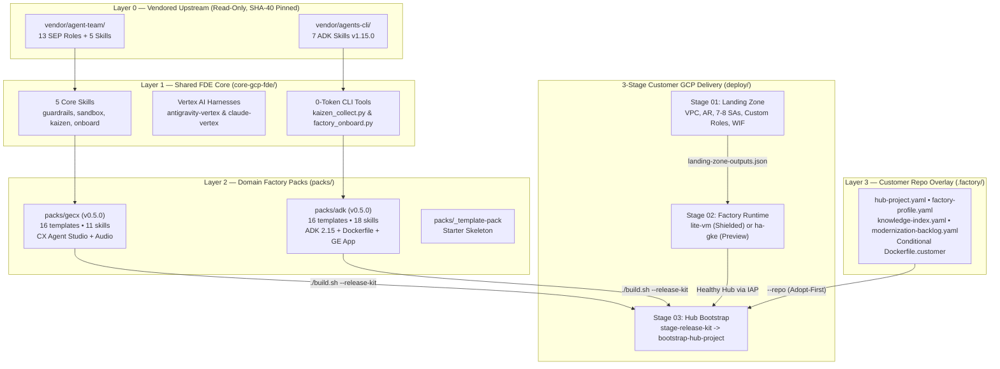

# gcp-fde-factories

**Reusable Autonomous Software Factories for Google Cloud Forward Deployed Engineers (FDEs)** — built on **Google Cloud Scion (`v0.4.0-preview.3`)**, **`scion-frontiers/agent-team` (SEP)**, **Vertex AI-first generic model tiers**, **split-SA Sandbox verification**, **closed-loop Kaizen**, and **zero-overwrite Brownfield onboarding**.

> **Release `bife` (`v0.5.0`):** Self-contained offline Release Kits, 3-project cross-project isolation (`hub` + `inf` + `sbx`), keyless GitHub Actions WIF Verdict Gates, native `google-agents-cli` (`adk_python`) single-container Cloud Run A2A + Playground (`ADR-014`), cognitive Day-0 brownfield onboarding with advisory validators (`ADR-015`), closed-loop Tier A + Tier B Kaizen, cross-vendor Claude Opus 5.5 review, and 12h Lite Single-VM endurance qualification ([Enterprise GCP Prerequisites Checklist](deploy/ENTERPRISE_PREREQUISITES.md) | [Hillclimbing Qualification Ledger](docs/HILLCLIMBING_CHARTER.md)).

---

## 1. Big Picture — 4-Layer Architecture & 3-Stage Delivery

Every factory separates **immutable upstream engineering roles**, **shared FDE governance**, **domain packs**, and **customer repository overlays** so you never fork upstream templates or hardcode customer rules inside the catalog.



---

## 2. Active Domain Packs Matrix

| Dimension | [`packs/gecx`](packs/gecx/README.md) (`v0.5.0`) | [`packs/adk`](packs/adk/README.md) (`v0.5.0`) | `packs/_template-pack` | `packs/agent-platform` |
| :--- | :--- | :--- | :--- | :--- |
| **Status** | Active (`v0.5.0` `bife`) | Active (`v0.5.0` `bife`) | Validated Starter Skeleton | Frozen (Future Release) |
| **Target GCP Platform** | CX Agent Studio (CES text + synthetic `BidiRunSession` audio) | ADK `2.15.0` (Dockerfile-first) + Gemini Enterprise (`GE App`) | Template for new domains | Reserved |
| **Offline Templates** | **16** (`gecx-*`, `<= 1,800` lines/role) | **16** (`adk-*`, `<= 1,800` lines/role) | **1** (`example-coordinator`) | — |
| **Hub Skill Bank** | **11** skills (5 project + 6 role-scoped) | **18** skills (5 project + 13 role-scoped incl. 7 `agents-cli`) | `0` | — |
| **Pinned Toolchain** | `cxas-scrapi==1.11.0` + `/opt/gecx-foundry` | `google-adk[eval,a2a]==2.15.0` + `google-agents-cli==1.15.0` | `core-gcp-fde-base` | — |
| **Live Sandbox Proof** | CES `GET /v1beta/<app>/evaluationRuns` | Vertex AI `reasoningEngines` + Discovery Engine `v1alpha` `agents` | Custom runner | — |
| **CI PR Gate** | `gecx-verdict-gate.yml` (fail-closed) | `adk-verdict-gate.yml` (fail-closed) | — | — |

---

## 3. Opinionated Vertex AI Model Routing (Generic Scion Tiers)

All packs default to **Vertex AI** (`auth_selected_type: vertex-ai`, zero static API keys, `global` endpoint with regional override) and route roles through Scion's **generic semantic tiers** (`small`, `medium`, `large`, `extra-large`) plus canonical `thinking_level` (`0–100`). Concrete model IDs evolve automatically as upstream Scion releases update their alias table, while any role may still pin an explicit Vertex AI model ID in `.factory/hub-project.yaml`.

| Diversity Profile | Default? | Builder / Architect | Code Reviewer / Security Auditor | Doc Writer | Model Garden Requirement |
| :--- | :--- | :--- | :--- | :--- | :--- |
| **`cross-model`** | **Yes (Day-1 Safe)** | `antigravity-vertex` • `extra-large` (`100`) | `antigravity-vertex` • `large` (`100`) | `antigravity-vertex` • `medium` (`50`) | **1P Gemini only** (`claude_model_garden_enabled: false`) |
| **`cross-vendor`** | Opt-In | `antigravity-vertex` • `extra-large` (`100`) | `claude-vertex` • `large` (`75`) | `antigravity-vertex` • `medium` (`50`) | Requires manual Claude opt-in in Vertex AI Model Garden + `claude_model_garden_enabled: true` |
| **`single-family`** | Lab / Restricted | `antigravity-vertex` • `extra-large` (`100`) | Same family (mandatory human PR warning) | `antigravity-vertex` • `medium` (`50`) | 1P Gemini only |

> **Fail-Closed Opt-In:** `parse_hub_project.py` and `model_routing.py` reject `cross-vendor` or any `claude-vertex` role when `harnesses.claude_model_garden_enabled` is `false`.

---

## 4. End-to-End Lifecycle — From Day-0 Scan to Closed-Loop Kaizen

```mermaid
flowchart LR
    D0["Day-0 Brownfield Scan<br/>factory_onboard.py scan<br/>(0 tokens)"] --> GRILL["PO /grill-me Interview<br/>Express 10m or Complete 25m"]
    GRILL --> READY{"Readiness Gate<br/>check --json"}
    READY -->|"ready=false"| GRILL
    READY -->|"ready=true"| EMIT["Emit Layer 3 Overlay<br/>.factory/ + AGENTS.md block"]
    EMIT --> BOOT["Stage 03 Apply<br/>Harnesses + Templates + SAs<br/>+ weekly-kaizen cron"]
    BOOT --> BUILD["SEP Agent Team<br/>Investigate -> Design -> Code<br/>-> Blind Review -> Split-SA Sandbox"]
    BUILD --> PR["GitHub PR + Verdict Gate<br/>Live API Proof + always() Janitor"]
    PR -->|"Merge + Kaizen-Ref"| KZ["Weekly Closed-Loop Kaizen<br/>kaizen_collect.py + kaizen_verifier.py<br/>verified_pass / rollback_triggered"]
    KZ -.->|"Approved Hygiene PR"| BUILD
```



---

## 5. Quickstart (5 Commands)

```bash
# 1. Create Python 3.12 virtualenv and install catalog tooling
uv venv .venv --python 3.12
uv pip install --python .venv/bin/python -e ".[dev]"

# 2. Run static contract, SHA-40 lockfile, context budget, 90d TTL, and clean-room checks
./build.sh --check packs/gecx
./build.sh --check packs/adk
./build.sh --check packs/_template-pack

# 3. Run the complete offline unit test suite
./build.sh --test

# 4. Build self-contained offline Release Kits (zero external URIs)
./build.sh --release-kit packs/gecx --out /tmp/gecx-kit
./build.sh --release-kit packs/adk  --out /tmp/adk-kit

# 5. Scan an existing customer repository before onboarding (0 tokens)
.venv/bin/python core-gcp-fde/scripts/factory_onboard.py scan \
  --repo /path/to/customer-repo \
  --toolchain-manifest packs/adk/toolchain-manifest.json --json
```

---

## 6. Repository Navigation Index

| Area | Guide / Sub-README | What You Will Find |
| :--- | :--- | :--- |
| **Core Layer (Layer 1)** | [`core-gcp-fde/README.md`](core-gcp-fde/README.md) | 5 core skills, Vertex AI harness configs, closed-loop Kaizen collector/verifier, Brownfield scanner & emitter |
| **GECX Pack (Layer 2)** | [`packs/gecx/README.md`](packs/gecx/README.md) | 16 `gecx-*` templates, 11 skills, `cxas 1.11.0`, split-SA CES Sandbox sequence, audio `BidiRunSession` |
| **ADK Pack (Layer 2)** | [`packs/adk/README.md`](packs/adk/README.md) | 16 `adk-*` templates, 18 skills (`agents-cli`), Dockerfile-first deploy, dual `GE App` export (`agent_engine` & `a2a`) |
| **3-Stage Deployment** | [`deploy/README.md`](deploy/README.md) | Stage 01 Terraform Landing Zone, Stage 02 `lite-vm` / `ha-gke` (Preview), Stage 03 image rebuild vs. mirror & Hub bootstrap |
| **JSON Contracts** | [`schemas/README.md`](schemas/README.md) | Producer-to-consumer contract map across all 8 JSON Schemas (`Draft 2020-12`) |
| **Drift Canaries** | [`canaries/README.md`](canaries/README.md) | Upstream CLI/API snapshot guards for `scion`, `cxas-scrapi`, and Discovery Engine `v1alpha` |
| **Operations Manual** | [`docs/AGENT_AUTHORING_AND_OPERATIONS.md`](docs/AGENT_AUTHORING_AND_OPERATIONS.md) | Deep Scion `v0.4.0-preview.3` internals, filesystem mounts, Artifacts/Decisions, Depth-3 walkthrough & Day-2 triage |
| **Landing Zone & Org Policies** | [`docs/CUSTOMER_LANDING_ZONE_REQUIREMENTS.md`](docs/CUSTOMER_LANDING_ZONE_REQUIREMENTS.md) | Multi-project topologies, APIs, 7–8 SAs, Custom Roles (GECX + ADK), Org Policy matrix & FinOps guardrails |
| **Hands-On Walkthrough** | [`docs/HANDS_ON_WALKTHROUGH.md`](docs/HANDS_ON_WALKTHROUGH.md) | Step-by-step zero-to-teardown walkthrough paired with `./scripts/hands-on-walkthrough.sh` |
| **Formal Kaizen & Brownfield Spec** | [`docs/specs/SPEC_KAIZEN_AND_BROWNFIELD_ONBOARDING.md`](docs/specs/SPEC_KAIZEN_AND_BROWNFIELD_ONBOARDING.md) | Formal ASD-STE100 specification and acceptance criteria for `v0.3.0` + `v0.4.0` |
| **Architecture Decision Records** | [`docs/adr/README.md`](docs/adr/README.md) | Formal traceable ADRs (`ADR-001`–`ADR-012`) governing boundaries, IAM, Vertex AI, and runtimes |
| **Architectural Invariants** | [`docs/INVARIANTS.md`](docs/INVARIANTS.md) | 16 enforceable invariants (`INV-01`–`INV-16`) mapped 1:1 to ADRs, code paths, and automated tests |
| **Hillclimbing Charter** | [`docs/HILLCLIMBING_CHARTER.md`](docs/HILLCLIMBING_CHARTER.md) | Functional-first live GCP qualification program (Levels 0–5, VM+GECX and GKE+ADK tracks, teardown proof) |
