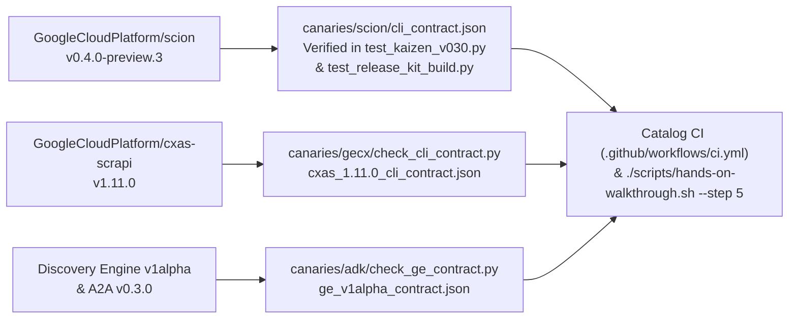

# `canaries/` — Upstream CLI & API Drift Protection

Every external CLI flag or REST payload that the factory depends on is locked inside a machine-checked canary snapshot. When an upstream release (`scion`, `cxas-scrapi`, or Discovery Engine `v1alpha`) renames a flag or alters a schema, CI fails immediately before a broken Release Kit reaches any customer.

---

## 1. Canary Pipeline

---

## 2. Active Canaries

| Canary | Upstream Surface | What It Locks | How to Run |
| :--- | :--- | :--- | :--- |
| **`canaries/scion/cli_contract.json`** | `scion v0.4.0-preview.3` | Exact JSON flags (`--format json list`, `artifact list --all`, `decisions list --all --json`, `schedule list --show recurring`, `harness-config sync <name> --global`, `scion message`) and forbidden legacy flags | `.venv/bin/pytest tests/test_kaizen_v030.py tests/test_release_kit_build.py -q` |
| **`canaries/gecx/check_cli_contract.py`** | `cxas-scrapi==1.11.0` | Verified subcommands (`lint`, `push`, `push-eval`, `test-tools`, `run --eval-type all --wait`) and blocked upstream pitfalls (`WK-001`, `WK-002`) | `.venv/bin/python canaries/gecx/check_cli_contract.py` |
| **`canaries/adk/check_ge_contract.py`** | Discovery Engine `v1alpha` + A2A `v0.3.0` | `adkAgentDefinition.provisionedReasoningEngine` (zero `toolSettings`), `a2aAgentDefinition.jsonAgentCard`, `authorizationConfig`, and endpoint routing | `.venv/bin/python canaries/adk/check_ge_contract.py` |
