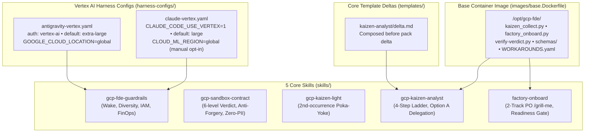
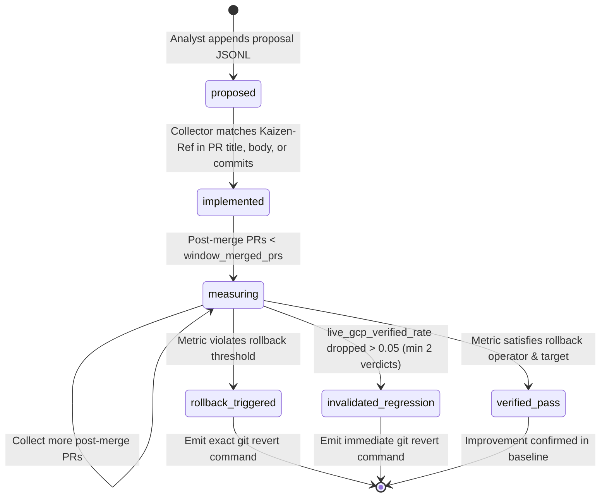

# `core-gcp-fde` — Shared FDE Factory Core (Layer 1)

Layer 1 holds every reusable capability shared across all domain packs (`packs/gecx`, `packs/adk`, and future packs): **Vertex AI-first harness configs**, **5 core skills**, **base container image (`/opt/gcp-fde/`)**, **closed-loop Kaizen (`v0.3.0`)**, and **Brownfield dynamic onboarding (`v0.4.0`)**.

---

## 1. Layer 1 Component Map



---

## 2. Closed-Loop Kaizen State Machine (`kaizen_collect.py` + `kaizen_verifier.py`)

`bootstrap-hub-project.sh apply` schedules `daily-kaizen` (`0 0 * * * America/Sao_Paulo`, daily 00:00 BRT) automatically on every project unless `kaizen.enabled: false` is set. Every cycle collects 0-token telemetry, archives a dated snapshot under `.factory/kaizen/snapshots/`, persists `proposals.state.json`, and evaluates previously merged proposals tagged with `Kaizen-Ref: KZ-YYYY-MM-DD-NN`.



---

## 3. Zero-Overwrite Brownfield Onboarding (`factory_onboard.py`)

1. **`scan` (0 tokens):** inspects manifests, linters, tests, Git Flow, CI workflows, existing AI coding files (`AGENTS.md`, `CLAUDE.md`, `GEMINI.md`, `.cursorrules`, Copilot), and diffs detected binaries against `packs/<pack>/toolchain-manifest.json` (separating installable recipes from unsupported binaries).
2. **`check` (Readiness Gate):** validates the PO-confirmed profile against `schemas/factory-profile.schema.json` plus Express/Complete track completeness rules.
3. **`emit` (Atomic Layer 3):** validates the generated `hub-project.yaml` against `schemas/hub-project.schema.json` **before** touching disk, preserves existing customer files, inserts a CRLF-safe delimited block into `AGENTS.md`, creates `skills/<slug>-repo-conventions/SKILL.md`, and emits `.factory/Dockerfile.customer` only when `missing_binaries` is non-empty.

---

## 4. Quick Commands

```bash
# Run 0-token Kaizen telemetry collection + closed-loop verification
.venv/bin/python core-gcp-fde/scripts/kaizen_collect.py \
  --repo packs/gecx/repo-scaffold \
  --toolchain-manifest packs/gecx/toolchain-manifest.json \
  --out /tmp/kaizen-snapshot.json

# Optional Tier-B GCP observability payload (pre-fetched JSON object)
.venv/bin/python core-gcp-fde/scripts/kaizen_collect.py \
  --repo . \
  --enable-gcp-obs --gcp-obs-json /tmp/gcp-obs-summary.json \
  --out /tmp/kaizen-snapshot.json

# Scan any customer repository statically before Day-0 onboarding
.venv/bin/python core-gcp-fde/scripts/factory_onboard.py scan \
  --repo /path/to/repo \
  --toolchain-manifest packs/gecx/toolchain-manifest.json --json
```
