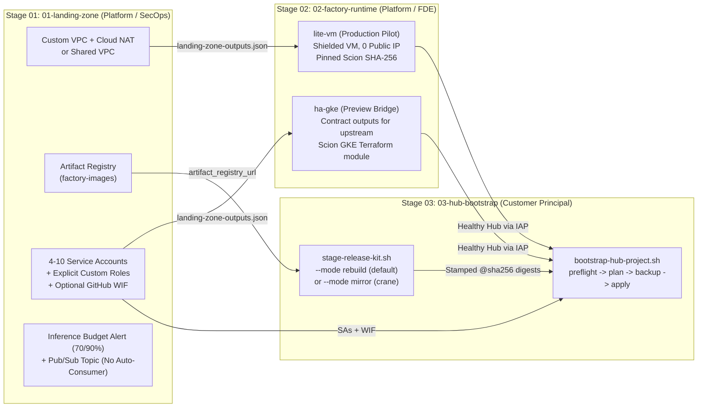

# `deploy/` — 3-Stage Repeatable Customer GCP Deployment

All infrastructure deploys directly inside the customer's Google Cloud organization with **zero static JSON keys**, **additive-only IAM bindings**, **explicit non-wildcard Sandbox Custom Roles**, and **fail-closed Hub settings**.

> **Enterprise Customer Checklist:** Review [ENTERPRISE_PREREQUISITES.md](ENTERPRISE_PREREQUISITES.md) with customer SecOps, Network, GKE, and Billing/Gemini Enterprise admins before Day-1 deployment, and open [docs/gcp-factory-architectures.html](../docs/gcp-factory-architectures.html) for the interactive GCP component-by-component walkthrough across all 3 setup topologies.

---

## 1. Three-Stage Pipeline & Separation of Duties



---

## 2. Container Image Separation (CI Runtime vs. Scion Agent Harnesses)

Stage 03 distinguishes clearly between two container classes so CI stays fast and Scion agents always boot with real `/usr/local/bin/sciontool` + harness CLIs:

| Image Class | Base Image (`--base-image` / flags) | Contains | Used By |
| :--- | :--- | :--- | :--- |
| **Lean CI Runtime (`<pack>-runtime`)** | `python:3.12-slim-bookworm` (default) | `/opt/gcp-fde/`, pack SDK (`cxas` or `google-adk` + `agents-cli`), schemas | GitHub Actions Verdict Gate (`docker run`), offline Level 1 checks |
| **Scion Antigravity Harness (`<pack>-antigravity-runtime`)** | Upstream `scion-antigravity:v0.4.0-preview.4` (`--antigravity-base-image`) | `sciontool`, `git >= 2.48`, Antigravity CLI + `/opt/gcp-fde/` + pack SDK | Scion Hub agents spawned with `<prefix>-antigravity-vertex` |
| **Scion Claude Harness (`<pack>-claude-runtime`)** | Upstream `scion-claude:v0.4.0-preview.4` (`--claude-base-image`) | `sciontool`, `git >= 2.48`, Claude Code CLI + `/opt/gcp-fde/` + pack SDK | Scion Hub agents spawned with `<prefix>-claude-vertex` (when `claude_model_garden_enabled: true`) |

> **Fail-Closed Guard:** `bootstrap-hub-project.sh apply` rejects any harness-config whose `image:` still contains `REPLACE_` or an all-zero `@sha256:0000...` placeholder. Either pass `--antigravity-base-image` / `--claude-base-image` to `stage-release-kit.sh --mode rebuild` (which stamps the pushed `@sha256:` digests automatically) or pass explicit `--harness-image-antigravity` / `--harness-image-claude` refs to `bootstrap-hub-project.sh apply`.

---

## 3. Stage 01 Feature Toggles (`deploy/01-landing-zone/variables.tf`)

> **Cold-Start API Bootstrap (HC-01 F2, HC-02 F1):** On brand-new GCP projects where `serviceusage.googleapis.com` is not yet enabled, run `gcloud services enable serviceusage.googleapis.com cloudresourcemanager.googleapis.com iam.googleapis.com --project <project>` on each target project and wait `~20` seconds for Service Usage propagation before the first `terraform apply`. Stage 01 then enables all remaining APIs, including `policytroubleshooter.googleapis.com` on `hub_project_id`, and binds the custom predict-only `vertexInferencePredict` role (`aiplatform.endpoints.predict` only) plus `roles/serviceusage.serviceUsageConsumer` on `inference_project_id` to `worker`, `deployer`, and `eval`.

| Variable | Default | Effect |
| :--- | :--- | :--- |
| `create_custom_vpc` | `true` | Creates private VPC + Cloud NAT (exporting `vpc_name` for custom Filestore CSI StorageClass). Set `false` + `existing_subnet_self_link` for customer Shared VPC |
| `enable_gecx_sandbox_roles` | `true` | Enables CES/TTS APIs, materializes the CES service identity, and creates `gecxSandboxDeployer`, `gecxSandboxEvaluator`, `gecxSandboxJanitor` |
| `enable_adk_sandbox_roles` | `false` | Enables Discovery Engine, Cloud Run, and Cloud Build APIs, provisions same-project `adk_runtime` SA (`HC-02 F10`), grants cross-project Hub AR reader to `sandbox_deployer`, `adk_runtime`, and Sandbox service agents, and creates `adkSandboxDeployer` (with `discoveryengine.agents.manage`), `adkSandboxEvaluator`, and `adkSandboxJanitor` |
| `enable_agent_engine_re_ar_reader` | `false` | Grants `roles/artifactregistry.reader` on `hub_project_id` to `service-<sandbox_num>@gcp-sa-aiplatform-re.iam.gserviceaccount.com` once materialized by the first ReasoningEngine API call (`HC-02 F11`) |
| `enable_gke_api` | `false` | Enables `container.googleapis.com` on `hub_project_id` and creates the least-privilege `<prefix>-gke-node@` Node Pool SA (`gke_node_sa_email`, `HC-02 F4`) |
| `enable_kaizen_gcp_obs` | `false` | Creates optional 8th SA (`<prefix>-kaizen@`) with read-only Monitoring & Logging Viewer |
| `enable_github_wif` | `false` | Provisions keyless GitHub Actions WIF pool/provider restricted strictly to `github_repository` / `github_repositories` (`owner/repo`) for `sandbox_evaluator` and `sandbox_janitor` |
| `enable_delta_watcher` | `false` | Enables `cloudscheduler.googleapis.com`, provisions least-privilege `<prefix>-delta-watcher@` + `<prefix>-dw-invoker@` SAs, IAM-conditioned GCS cursor bucket (`delta-watcher/`), and empty Secret Manager container (`delta_watcher_token_secret_id`, zero secret value in state). Stage 03 auto-binds the 2-permission `delta-watcher-messenger` Hub role (`agent.message`, `agent.read` only) |

---

## 4. Stage 03 Canonical Execution Sequence

```bash
# 1. Rebuild CI + Scion harness images inside customer Hub project and stamp digests into the kit
/tmp/adk-kit/bootstrap/stage-release-kit.sh \
  --mode rebuild \
  --kit /tmp/adk-kit \
  --landing-zone /tmp/landing-zone-outputs.json \
  --antigravity-base-image ghcr.io/homebrew-scion/scion-antigravity:v0.4.0-preview.4

# 2. Reconcile Hub settings, skills, global harness-configs, templates, SAs, Decisions/Artifacts, Coordinator (--never-suspend), and daily-kaizen
/tmp/adk-kit/bootstrap/bootstrap-hub-project.sh preflight --kit /tmp/adk-kit --hub http://127.0.0.1:8080
/tmp/adk-kit/bootstrap/bootstrap-hub-project.sh plan      --kit /tmp/adk-kit --hub http://127.0.0.1:8080
/tmp/adk-kit/bootstrap/bootstrap-hub-project.sh apply     --kit /tmp/adk-kit --hub http://127.0.0.1:8080 \
  --landing-zone /tmp/landing-zone-outputs.json \
  --repo /path/to/customer-repo
```
