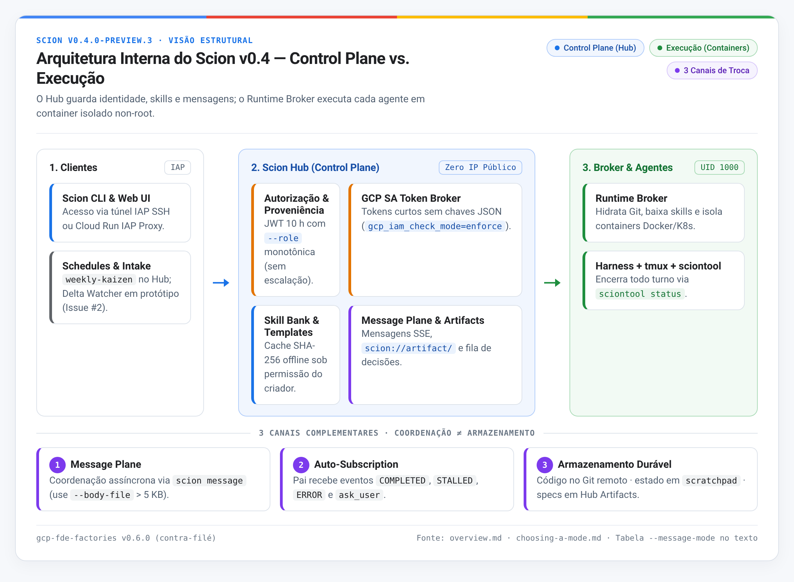
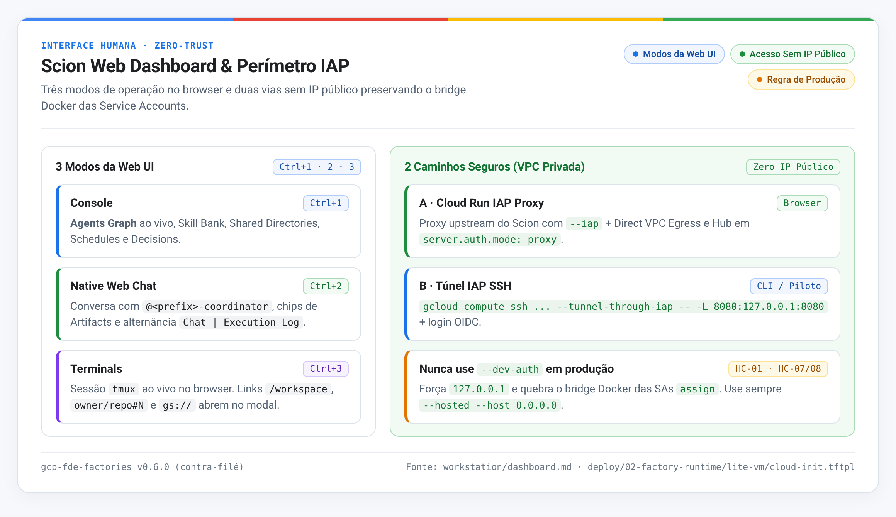
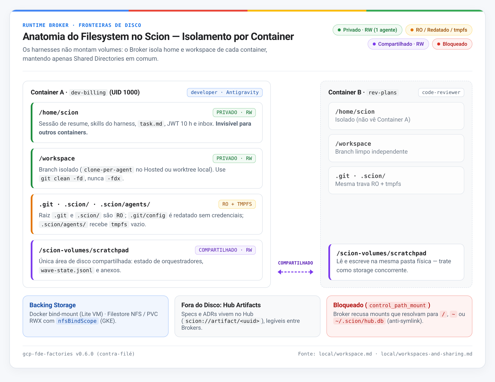
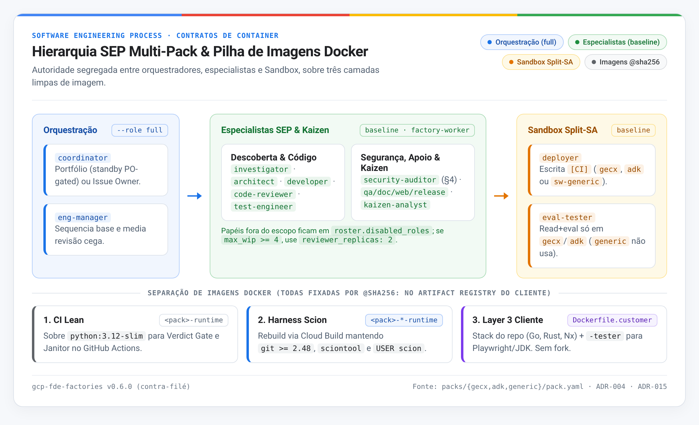
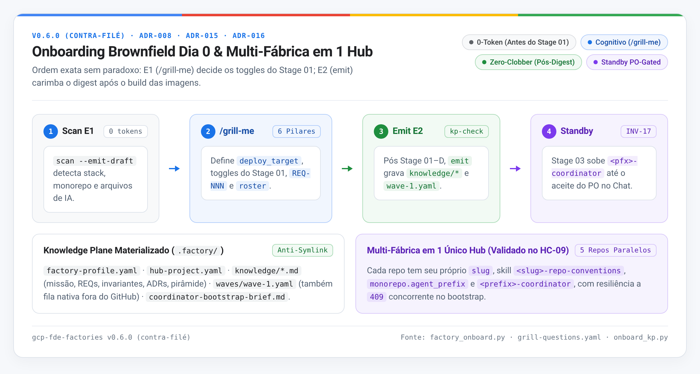
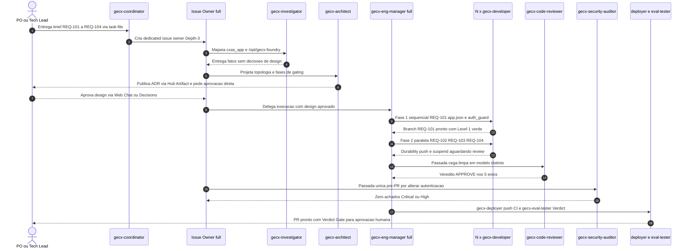
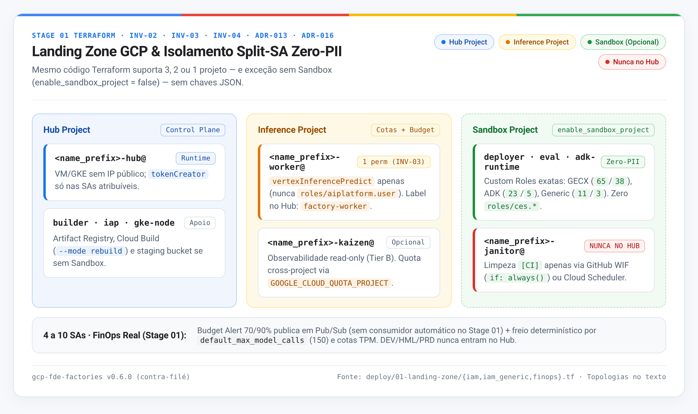
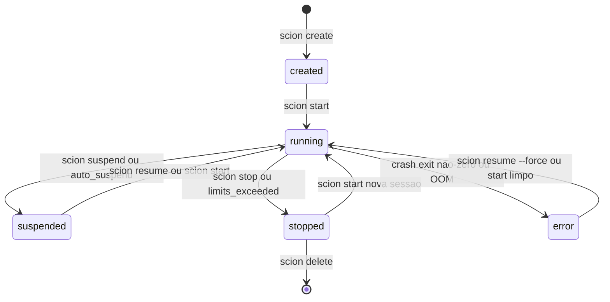

# Guia Didático Completo — Plataforma `gcp-fde-factories` (`v0.6.0 contra-filé`) & Scion `v0.4.0-preview.3`

**Versão:** `v0.6.0` (`contra-filé`) · **Scion Pinado:** `v0.4.0-preview.3` · **Upstream SEP:** `scion-frontiers/agent-team@08faf48` · **ADK Scaffold:** `google/agents-cli v1.15.0`
**Audiência:** FDEs, Arquitetos Google Cloud e Tech Leads — mesmo quem **nunca usou o Scion** antes — que precisam entender o modelo mental, operar fábricas multi-pack (`packs/gecx`, `packs/adk`, `packs/generic`) e depurar agentes no Dia 2.

> [!TIP]
> **Onde começar conforme seu objetivo:**
> - **Primeira leitura (modelo mental + vocabulário):** comece pela **Parte 0** abaixo (5 minutos).
> - **Subir a infra do zero ao teardown (com pré-requisitos e comandos passo a passo):** siga [HANDS_ON_WALKTHROUGH.md](HANDS_ON_WALKTHROUGH.md) e [CUSTOMER_LANDING_ZONE_REQUIREMENTS.md](CUSTOMER_LANDING_ZONE_REQUIREMENTS.md).
> - **Consultar contratos formais:** [INVARIANTS.md](INVARIANTS.md) (`INV-01`–`INV-17`) e [docs/adr/](adr/README.md) (`ADR-001`–`ADR-016`).

### Mapa do Guia
0. [Parte 0 — Modelo Mental em 1 Página, Convenção dos 3 Prefixos & Glossário](#parte-0--modelo-mental-em-1-página-convenção-dos-3-prefixos--glossário)
1. [Parte 1 — Scion `v0.4.0-preview.3` por Dentro: Arquitetura, Web UI via IAP e Roles](#parte-1--scion-v040-preview3-por-dentro-arquitetura-web-ui-via-iap-e-roles)
2. [Parte 2 — Skills, Comunicação Multi-Agente, Filesystem e Primitivas Nativas (Artifacts & Decisions)](#parte-2--skills-comunicação-multi-agente-filesystem-e-primitivas-nativas-artifacts--decisions)
3. [Parte 3 — Imagens Docker, Layer 3 Custom (`Dockerfile.customer`) e Roteamento Vertex AI](#parte-3--imagens-docker-layer-3-custom-dockerfilecustomer-e-roteamento-vertex-ai)
4. [Parte 4 — Arquitetura 4-Camadas, Catálogo Multi-Pack (`gecx`, `adk`, `generic`) e Multi-Fábrica em 1 Hub](#parte-4--arquitetura-4-camadas-catálogo-multi-pack-gecx-adk-generic-e-multi-fábrica-em-1-hub)
5. [Parte 5 — Onboarding Brownfield Dia 0: `/grill-me` (E1), Knowledge Plane (E2) e Coordinator em Standby](#parte-5--onboarding-brownfield-dia-0-grill-me-e1-knowledge-plane-e2-e-coordinator-em-standby)
6. [Parte 6 — 3 Walkthroughs Concretos de Ponta a Ponta (`gecx`, `adk` e `generic`)](#parte-6--3-walkthroughs-concretos-de-ponta-a-ponta-gecx-adk-e-generic)
7. [Parte 7 — Topologias GCP (3 / 2 / 1 Projeto + Sem Sandbox), Split-SA e Operação Dia 2](#parte-7--topologias-gcp-3--2--1-projeto--sem-sandbox-split-sa-e-operação-dia-2)
8. [Parte 8 — Motor Kaizen Closed-Loop, Overlay, Ledger Hillclimbing (`HC-01`–`HC-09`), Roadmap e Referências](#parte-8--motor-kaizen-closed-loop-overlay-ledger-hillclimbing-hc-01hc-09-roadmap-e-referências)

---

## Parte 0 — Modelo Mental em 1 Página, Convenção dos 3 Prefixos & Glossário

### 0.1 O Que É uma Fábrica Autônoma em 60 Segundos

Uma fábrica em `gcp-fde-factories` junta **quatro peças independentes**:

1. **Catálogo Local (`packs/gecx`, `packs/adk` ou `packs/generic`):** empacota papéis especializados de engenharia (desenvolvedor, arquiteto, revisor cego, auditor de segurança, deployer) e skills em um **Release Kit 100% offline** (`./build.sh --release-kit`).
2. **Infraestrutura GCP do Cliente (Stages 01 e 02):** Terraform cria VPC privada, Artifact Registry, Service Accounts segregadas (sem chaves JSON) e sobe o servidor **Scion Hub** (plano de controle) em VM sem IP público.
3. **Overlay do Repositório Cliente (`.factory/`):** o onboarding (`/grill-me`) captura requisitos, comandos de build/test e regras do repositório sem alterar código existente.
4. **Ciclo de Entrega Supervisionado (Stage 03 → PR):** o Stage 03 reconcilia o Hub e inicia um agente líder (`<prefix>-coordinator`) em **standby**. Após aceite do PO, o time investiga, projeta (design aprovado por humano), implementa, faz revisão cega em modelo distinto, valida no Sandbox (ou CI-only) e para em um **Pull Request com aprovação humana obrigatória** (nunca auto-merge).

### 0.2 Convenção dos 3 Prefixos (Leia Antes de Copiar Comandos!)

Para evitar confusão entre nomes no GCP, no Scion Hub e nos templates, guarde esta tabela:

| Onde Aparece | Convenção Real no Código | Exemplo (`packs/generic`) | Fonte no Código |
| :--- | :--- | :--- | :--- |
| **E-mail da SA no GCP (Terraform)** | `<name_prefix>-<papel>@<proj>.iam.gserviceaccount.com` | `gecx-fac-worker@...` *(default `name_prefix = "gecx-factory"`)* | `deploy/01-landing-zone/variables.tf` |
| **Label da SA no Scion Hub (`--service-account`)** | **`factory-worker`** (fixo para todos os packs!) · `<pack_prefix>-deployer` · `<pack_prefix>-evaluator` | `factory-worker` · `sw-deployer` | `deploy/03-hub-bootstrap/bootstrap-hub-project.sh:480-490` |
| **Template & Coordinator (`-t`, `@...`)** | Template: `<pack_prefix>-<papel>` · Agente raiz `v0.6.0`: **`<prefix>-coordinator`** | Template `sw-coordinator` · Agente `@sw-coordinator` *(confira com `scion list`)* | `scripts/lib/onboard_hub_config.py:59-65` |

### 0.3 Glossário Rápido (Termos Usados Neste Guia)

| Termo | Significado Direto |
| :--- | :--- |
| **SEP** (*Software Engineering Process*) | Metodologia multi-agente upstream (`scion-frontiers/agent-team`): **§2** design vai direto ao humano; **§4** passada única pré-PR de `security-auditor`; **§5** revisão de código cega pelo `code-reviewer`. |
| **Depth-1 / Depth-2 / Depth-3 & Issue Owner** | Escala SEP de delegação: tarefas pequenas (`Depth-1`), médias (`Depth-2`) ou grandes (`Depth-3`, onde o Coordinator cria um *Dedicated Issue Owner* para coordenar `investigator`, `architect` e `eng-manager`). |
| **Mode Spine** | Os 3 modos oficiais do Scion v0.4 (`Workstation`, `Single-node Hosted`, `HA Hosted`) — todo comando passa por um Hub. |
| **AK1 Kernel & Provenance Claims** | Motor de autorização do Scion Hub que cruza permissões positivas com restrições monotônicas e grava no JWT quem criou o agente (`creator_user_id`), impedindo escalação de privilégio. |
| **Modo `assign` (GCP SA)** | Modo do Scion onde o Hub intercepta o endpoint de metadados do container e emite tokens curtos da Service Account atribuída (zero chaves JSON no disco). |
| **L0 / L1 / L2 / L3** | As 4 camadas do catálogo: **L0** upstream vendored (`vendor/`), **L1** core compartilhado (`core-gcp-fde/`), **L2** packs de domínio (`packs/*`), **L3** overlay do repo cliente (`.factory/`). |
| **Level 1 / Level 2** | **Level 1:** testes determinísticos 100% offline (ambiente limpo de credenciais). **Level 2:** validação live contra recursos efêmeros `[CI]` no Sandbox GCP. |
| **Tier A / Tier B (Kaizen)** | **Tier A:** telemetria 0-token local (Hub, Git, verdicts, workarounds). **Tier B:** leitura opcional de Cloud Monitoring/Logging via SA `<name_prefix>-kaizen@`. |
| **`[CI]`, Verdict & Janitor** | Recursos efêmeros de teste levam prefixo `[CI]` (ou label `factory_ci=true`). O **Verdict** (`.factory/verdicts/pr-N.json`) amarra a prova ao `commit_sha` do PR. O **Janitor** remove recursos `[CI]` expirados. |
| **`sandbox-direct` vs. `ci-only`** | Valores de `mode` em `.factory/hub-project.yaml`: `sandbox-direct` registra SAs de Sandbox no Hub; `ci-only` omite SAs de Sandbox (toda verificação ocorre no CI). |
| **Durability Push** | Regra SEP de enviar commits ao branch remoto continuamente — commits que ficam só dentro do container somem quando o container é removido. |
| **Prove-It** | Prática SEP de escrever testes que falham sem a correção e provam o comportamento real em vez de mocks vazios. |
| **CriticMarkup** | Sintaxe leve usada pelo editor gráfico de Track Changes do Scion Hub (`{~~antigo~>novo~~}`, `{>>comentário<<}`). |
| **WIF & DRS** | **WIF:** *Workload Identity Federation* (OIDC keyless para GitHub Actions). **DRS:** *Domain Restricted Sharing* (`constraints/iam.allowedPolicyMemberDomains`). |

---

## Parte 1 — Scion `v0.4.0-preview.3` por Dentro: Arquitetura, Web UI via IAP e Roles

O **Scion** é uma plataforma open-source de orquestração de times de agentes de IA que separa rigorosamente o **plano de controle (Hub)** da **camada de execução (Runtime Broker + Containers)**. O mesmo CLI (`scion`) e os mesmos templates rodam no seu laptop, em uma VM única ou em GKE.



### 1.1 Os 3 Modos de Execução (*Mode Spine*)

Na `v0.4`, **todo comando `scion` passa por um Hub** (`choosing-a-mode.md`):

| Modo | Control Plane + Banco | Multiusuário | Como Nossa Plataforma Implanta |
| :--- | :--- | :--- | :--- |
| **Workstation** | *Combo server* local (`Hub + Broker + Web`) em `127.0.0.1`, SQLite local | Não (só você) | Experimentação local com `scion server start`. |
| **Single-node Hosted** | 1 Hub em rede (VM única) + SQLite em disco | Sim (OAuth / IAP) | **`deploy/02-factory-runtime/lite-vm`:** Shielded VM sem IP público, capaz de hospedar **várias fábricas em paralelo** (validado com 5 repos simultâneos no `HC-09`). |
| **HA Hosted** | Múltiplas réplicas atrás de LB + Cloud SQL Postgres + Filestore NFS | Sim (OAuth / Groups) | **`deploy/02-factory-runtime/ha-gke`** é uma **ponte de contrato validada** (0 blocos `resource` TF): ela valida outputs do Stage 01 e emite parâmetros para o módulo Terraform/Helm **upstream** do Scion (a validação atual da ponte usa SQLite em PVC `ReadWriteOnce`; o HA multi-réplica com Cloud SQL vem do módulo upstream). |

### 1.2 As 4 Peças da Arquitetura Interna

1. **`scion` CLI & Web Dashboard:** sua interface de comando. Em modo hosted, o CLI fala HTTPS/WebSocket com o Hub (via túnel IAP SSH em `http://127.0.0.1:8080` ou via Cloud Run IAP Proxy).
2. **Scion Hub (Control Plane):** detém identidade, autenticação, projetos, **Skill Bank**, **Message Plane**, **notificações SSE**, **Schedules (`weekly-kaizen`)**, **Native Artifacts & Decisions** e o motor de autorização **AK1 Kernel**. Emite JWTs de 10 h com *provenance claims* e troca tokens curtos de Service Account GCP via `serviceAccountTokenCreator` sem nenhuma chave JSON estática.
3. **Runtime Broker:** conectado ao Hub, provisiona o workspace (worktree ou clone Git), baixa skills validando SHA-256, injeta variáveis de ambiente (como `GOOGLE_CLOUD_QUOTA_PROJECT`, `ADR-013`) e sobe o container (Docker, Podman ou Kubernetes).
4. **Container do Agente (non-root `UID 1000`):** executa o *harness* (`antigravity`, `claude`, `gemini`, `opencode` ou `codex`) dentro de uma sessão **`tmux`** supervisionada pelo binário **`sciontool`**.

> [!NOTE]
> **Containerizados vs. Managed Agents (`--profile managed-agents`):** o Scion também suporta *Managed Agents* sem container (bons para pesquisa pura). Em `gcp-fde-factories`, usamos **sempre agentes containerizados no Runtime Broker** porque precisamos de Git isolado, toolchains pinados (`cxas`, `uv`, `adk`, `go`, `cargo`, `mvn`, `pnpm`) e `suspend`/`resume`.

### 1.3 Modelo de Estado (`Phase` × `Activity` × `Detail`) e `sciontool status`

O Scion separa infraestrutura de cognição (`concepts.md`):
- **`Phase` (container):** `created` → `provisioning` → `cloning` → `starting` → `running` → `stopping` → `stopped`, além de `suspended`, `error` (exit não-zero ou OOM) e `halted`.
- **`Activity` (dentro de `running`):** `initializing`, `working`, `thinking`, `executing`, `waiting_for_input`, `blocked`, `idle`, `completed`, `limits_exceeded`, `stalled`, `offline`, `harness_error`.
- **Encerramento de turno (`sciontool status`):**
  - `sciontool status blocked "<motivo>"` — aguardando filho, resposta ou **job em background** (build/testes). **Nunca sinalize `idle` enquanto um job background roda**, senão o auto-suspend encerra o container.
  - `sciontool status idle` — nada pendente (elegível a auto-suspend quando `lifecycle.idle_suspend` está ativo).
  - `sciontool status task_completed "<resumo>"` — entregou o artefato pedido.
  - `sciontool status ask_user "<pergunta>"` — alerta no Web Dashboard e aparece em `scion list --activity waiting_for_input`.

### 1.4 Workspaces & Modos de Compartilhamento (`workspaces-and-sharing.md`)

| Modo | Como Isola Agentes | Onde é Padrão | Detalhe Importante |
| :--- | :--- | :--- | :--- |
| **`Worktree-per-agent`** | Linked git worktree em `.scion/agents/<nome>/workspace` no branch `<nome>` | Hub Workstation local | Exige **Git >= 2.48**. Copia apenas commits do `HEAD`. Nunca dê ao agente o nome do branch em checkout (`main`). |
| **`Clone-per-agent`** | Clone HTTPS próprio no branch `scion/<nome>` | **Hub Remoto / Hosted** | Usa secret `GITHUB_TOKEN` (`Contents: Read/Write`) do projeto no Hub. |
| **`Shared-plain`** | Todos montam a mesma pasta sem isolamento | Projetos sem Git | Bom para pastas de documentos compartilhados. |
| **`Empty-per-agent`** | Diretório vazio privado por agente | Projetos Hub-managed sem Git | Sem repositório externo. |

> [!CAUTION]
> **Diretório `.scion/` é somente leitura dentro do agente:** o Broker monta `.scion/` em `RO` e mascara `.scion/agents/` com `tmpfs` vazio. Por isso, nossos arquivos de configuração editáveis vivem em `.factory/` e `packs/*/templates/`.

### 1.5 Mini-Tutorial Prático do Scion CLI + Tmux + Web Dashboard via IAP

```bash
# 1. Conectar o CLI ao Hub (apos abrir tunel IAP em 127.0.0.1:8080 — veja HANDS_ON_WALKTHROUGH.md Etapa E2)
scion hub add fde-hub http://127.0.0.1:8080
scion hub auth login --hub fde-hub
scion use --hub fde-hub

# 2. Inicializar e linkar um repositorio Git ao Hub (ou criar 100% remoto por URL Git)
cd ~/src/meu-repo-cliente
scion init
scion hub link
# Alternativa remota:
# scion hub project create https://github.com/org/meu-repo-cliente.git --slug meu-repo
# scion hub secret set --project=meu-repo GITHUB_TOKEN ghp_xxxx
scion use meu-repo

# 3. Disparar um agente simples e acompanhar sem bloquear o terminal
scion start teste-1 "Liste os servicos de entrada e crie um resumo em docs/mapa.md"
scion list
scion look teste-1 -n 40 --plain
scion logs teste-1

# 4. Entrar no terminal ao vivo do agente (tmux) e sair sem matar o processo
scion attach teste-1
# Dentro do tmux:
#   Ctrl-b d   -> desconecta mantendo o agente rodando (NUNCA use Ctrl-c para sair!)
#   Ctrl-b [   -> modo scroll com setas (aperte 'q' para voltar)

# 5. Limpar preservando o branch Git local (por padrao 'scion delete' apaga o branch local!)
scion delete teste-1 --preserve-branch
```

> [!TIP]
> **Scion dentro do Cloud Shell ou de outro `tmux`?** O prefixo `Ctrl-b` será capturado pelo `tmux` externo (`local/tmux.md`). Edite `.scion/templates/default/home/.tmux.conf` trocando o prefixo para `Ctrl-a`.



- **Web UI ao vivo com SAs `assign` (origem `HC-01`, reconfirmada em `HC-07`/`HC-08`):** nunca use `--dev-auth` com SAs em modo `assign`, pois `--dev-auth` força `--host 127.0.0.1` e quebra o bridge networking Docker exigido pelo metadata interceptor. Nosso `deploy/02-factory-runtime/lite-vm/cloud-init.tftpl` usa `--hosted --host 0.0.0.0 --web-port 8080` na VPC privada (`zero IP público`) + `container_hub_endpoint: "http://scion-hub.internal:8080"`. Para expor a Web UI no browser, faça deploy do proxy Cloud Run IAP localizado no **repositório upstream do Scion** (`GoogleCloudPlatform/scion`, `extras/cloudrun-iap-proxy`, fora deste repo) com `--iap` + Direct VPC Egress e `server.auth.mode: proxy` (`provider: iap`) + `federation`.

### 1.6 Os 4 Eixos Ortogonais (`Template` × `--role` × `--service-account` × `--message-mode`)

1. **Template:** define *como o agente pensa* (`agents.md` + `system-prompt.md`), sem dar permissão na API do Hub.
2. **Agent Authorization Role (`--role`):** define os escopos do JWT no Scion Hub (`none`, `readonly`, `baseline`, `full`).
3. **Identidade GCP (`--service-account`):** define o que o container chama no GCP (usando os **labels do Hub**: `factory-worker`, `<pack_prefix>-deployer`, `<pack_prefix>-evaluator`).
4. **Escopo de Mensagens (`--message-mode`):** define com quem o agente conversa no Message Plane.

| `--role` | Escopos JWT no Hub | Quem Usa na Fábrica |
| :--- | :--- | :--- |
| **`none`** | *(nenhum)* | Jobs batch desconectados da API do Hub. |
| **`readonly`** | `project:read`, `agent:status:update` | Consultas curtas somente leitura (sem refresh de token). |
| **`baseline`** | `project:read`, `agent:status:update`, `agent:token:refresh`, `project:agent:notify`, `agent:port:forward` | **Todos os especialistas** (`developer`, `code-reviewer`, `architect`, `investigator`, `security-auditor`, `test-engineer`, `deployer`, `eval-tester`, `kaizen-analyst` e apoio). |
| **`full`** | Tudo do `baseline` + `project:agent:create`, `project:agent:sa_assign`, `project:agent:lifecycle`, `project:secret:read` | **Apenas os 2 orquestradores:** `<pack_prefix>-coordinator` e `<pack_prefix>-eng-manager`. |

**Regra *No-Escalation* e duas pegadinhas reais do `v0.4.0-preview.3`:**
- **Fórmula:** humano cria com `min(--role, scion.io/max-agent-role)`; pai cria filho com `min(--role, role_do_pai, scion.io/max-agent-role)`. Tentativa de escalação retorna `403 Forbidden`.
- **Pegadinha #1 (`default_agent_role`):** é **read-only via API `scion hub settings set`**. Por isso, o Stage 02 grava `default_agent_role: "baseline"` e `default_gcp_identity_mode: "block"` direto em `/home/scion/.scion/settings.yaml` (`cloud-init.tftpl`, `INV-14`).
- **Pegadinha #2 (`gcp_iam_deny_unknown_policy` tem 2 controles!):** o Stage 02 grava a variável TF `gcp_iam_deny_unknown_policy` no `settings.yaml`, mas o Stage 03 (`bootstrap-hub-project.sh:514`) regrava esse campo usando `${GCP_IAM_DENY_UNKNOWN_POLICY:-fail-open}`. Se sua org concede `roles/iam.denyReviewer` e você quer `fail-closed`, **defina ambos de forma coerente** (a var TF no Stage 02 **e** `export GCP_IAM_DENY_UNKNOWN_POLICY=fail-closed` em todo `apply` do Stage 03).

#### Exemplo Concreto: Os 4 Eixos Ortogonais em Operação (`packs/gecx`)

| Agente Vivo | Template | `--role` Hub | `--service-account` (Label no Hub) | `--message-mode` | Por Que Essa Combinação Existe |
| :--- | :--- | :--- | :--- | :--- | :--- |
| **`gecx-coordinator`** | `gecx-coordinator` | **`full`** | `factory-worker` (`vertexInferencePredict`) | `project` | Cria `eng-manager` e Issue Owners no Hub, mas recebe `403` em escrita no Sandbox ou `ReasoningEngine`. |
| **`em-wave1`** | `gecx-eng-manager` | **`full`** | `factory-worker` (`vertexInferencePredict`) | `project` | Spawna devs (`baseline`), suspende no review e delega `--service-account gecx-deployer` (`sa_assign`). |
| **`dev-billing`** | `gecx-developer` | **`baseline`** | `factory-worker` (`vertexInferencePredict`) | `project` | Mesmo sob prompt injection, recebe `403` ao tentar spawnar filhos, ler secrets ou dar push no Sandbox. |
| **`dep-pr12`** | `gecx-deployer` | **`baseline`** | **`gecx-deployer`** (escrita `[CI]`) | `branch` | Tem poder no Sandbox GCP, mas zero poder no Hub para criar ou alterar outros agentes. |

> [!NOTE]
> **Posse Humana & Ancestralidade:** um **principal do cliente** (nunca um FDE temporário) deve iniciar o `<prefix>-coordinator` raiz. A cadeia de ancestralidade concede acesso transitivo na sub-árvore; quando o criador perde acesso ao projeto, o Scion restringe os agentes dele na varredura de standing.

---

## Parte 2 — Skills, Comunicação Multi-Agente, Filesystem e Primitivas Nativas (Artifacts & Decisions)

### 2.1 Onde Ficam as Skills no Scion (4 Origens + Montagem Física)

Uma **skill** segue a spec [Agent Skills](https://agentskills.io/home) (pasta `kebab-case` com `SKILL.md` + `references/` e `scripts/`):

1. **Platform Skills:** embutidas no binário `scion` (`git-sandbox`, `scion-messaging`).
2. **Hub Skill Bank (padrão offline):** registro versionado no Hub (`global`, `project`, `user`) com hash SHA-256 (`scion skills publish <dir>` usa o nome da pasta, não o `name:` do YAML). Dividimos em skills anexadas ao projeto (`attach_to_project: true`) e skills montadas sob demanda por papel (`skill://scion/global/<nome>`) para respeitar o teto de 1.800 linhas.
3. **Template-mounted `skills/`:** viajam dentro da pasta do template.
4. **Federadas (`gh://`, `gcp-skill://`):** bloqueadas no Release Kit offline (`INV-01`, `INV-05`).

**Caminho físico das skills montadas dentro do container:**
- **Antigravity:** `/home/scion/.gemini/antigravity-cli/skills/<nome>/SKILL.md`
- **Claude Code:** `/home/scion/.claude/skills/<nome>/SKILL.md`
- **Gemini CLI:** `/home/scion/.gemini/skills/<nome>/SKILL.md`

### 2.2 Comunicação Multi-Agente & Matriz `--message-mode`

1. **Hub Message Plane (`scion message`):** coordenação assíncrona. Acima de 5 KB, use `--body-file brief.md` ou `--task-file` (até 96 KiB).
2. **Auto-Subscription:** criar filho inscreve o pai automaticamente em `COMPLETED`, `STALLED`, `ERROR` e `ask_user`.
3. **Storage Durável:** código → branch Git com *durability push*; estado e filas (`wave-state.jsonl`) → `/scion-volumes/scratchpad/`; specs/ADRs → Hub Artifacts.

| `--message-mode` | Quem Fala Com Quem | Uso Recomendado |
| :--- | :--- | :--- |
| **`project`** *(padrão)* | Todos os agentes e humanos do projeto | Padrão para times SEP (workers continuam passando pelo `eng-manager` por regra SEP). |
| **`branch`** | Apenas pai ↔ filho direto + ancestralidade humana | Impede workers de pular o `eng-manager` ou conversar lateralmente. |
| **`lineage`** | Apenas humanos da cadeia de ancestralidade | Agentes isolados supervisionados só por humanos (zero agente ↔ agente). |
| **`none`** / **`hub`** | Selado (admin) / cross-project (3 gates) | Execuções batch fechadas (`none`) ou coordenação multi-repo autorizada (`hub`). |

> [!WARNING]
> **Padrão SEP (`eng-manager/agents.md`):** mesmo com `--message-mode project`, `developer` e `code-reviewer` não debatem entre si; o `eng-manager` (ou *Issue Owner*) media os achados objetivos (`arquivo:linha`).

### 2.3 Anatomia Completa do Filesystem no Scion



**Quatro regras práticas do filesystem:**
1. **`control_path_mount`:** o Broker recusa mounts (mesmo `:ro`) que resolvam (após symlinks) para `/`, `~` ou arquivos de controle em `~/.scion/` (`hub.db`, `dev-token`, `broker-credentials.json`, `settings.yaml`, `plugins/`).
2. **`home/` vs. `provision.py`:** arquivos em `home/` do harness-config entram só na criação (ou `scion reincarnate`); `provision.py` e `config.yaml` rodam em todo `scion start`.
3. **Limpeza segura no Git:** use sempre `git clean -fd`, nunca `git clean -fdx`.
4. **Onde gravar cada coisa:** código/testes → branch Git + `git push`; caches e `.<agente>-state.md` → `/scion-volumes/scratchpad`; specs/ADRs → Hub Artifacts.

### 2.4 Primitivas Nativas do Hub: Artifacts e Decisions


```bash
# A. Native Artifacts: publicar v1, revisar com Track Changes na Web UI e aplicar v2
scion artifact publish .design/adr-001.md --title "ADR-001: Auth e Fronteiras" --key adr-001
scion message @tech-lead "ADR-001 pronto para revisao." --artifact scion://artifact/5f1c2d3e-...
scion artifact comments scion://artifact/5f1c2d3e-...
scion artifact get scion://artifact/5f1c2d3e-... --accept > .design/adr-001.md
scion artifact publish .design/adr-001.md --version-of scion://artifact/5f1c2d3e-... --note "Revisoes aplicadas"

# B. Native Decisions (enviado por agentes; humanos consultam com --all-projects / --made)
scion message @lead@cliente.com "Preciso de 2 decisoes:" --decisions '[
  {"id":"D1","question":"Onde impor bloqueio de auth?","default":"callback","choices":[
    {"id":"callback","label":"Callback Python auth_guard","description":"Deterministico, 0 tokens"},
    {"id":"prompt","label":"Instrucao no prompt","description":"Sujeito a drift"}
  ]}
]'
scion decisions list --all-projects
scion decisions list --made -q "auth"
```

> [!IMPORTANT]
> **Ativação no Scion Hub:** tanto Artifacts quanto Decisions vêm **desligados por padrão**. Habilite em **Admin → Server Config → Experiments** (ou `scion hub experiments enable`) as flags `hub.artifacts`, `web.artifact_review_editor`, `hub.artifact_sponsor_review_grant` e `web.decisions`.

---

## Parte 3 — Imagens Docker, Layer 3 Custom (`Dockerfile.customer`) e Roteamento Vertex AI



### 3.1 Separação de 3 Camadas de Imagens (`ADR-004`, `INV-06`, `ADR-015`)

1. **Imagem Lean de CI (`<pack>-runtime`):** sobre `python:3.12-slim-bookworm` para Verdict Gates e Janitors no GitHub Actions (sem `sciontool`).
2. **Imagem de Harness Scion (`<pack>-antigravity-runtime` / `<pack>-claude-runtime`):** construída por `stage-release-kit.sh --mode rebuild` via Cloud Build no `hub_project_id`, preservando Chainguard `git >= 2.48`, `sciontool` e `USER scion (UID 1000)`, carimbando `@sha256:` no `manifest.json` e `harness-configs/*/config.yaml`.
3. **Layer 3 Condicional (`.factory/Dockerfile.customer` e `.factory/Dockerfile.customer-tester`):** para stacks específicos do cliente (`go`, `rust`, `nx`, `pnpm`, `mvn`, `sox`, `playwright`) sem tocar nas Layers 0–2.

### 3.2 Receita Executável em 4 Passos: Construir e Ligar `.factory/Dockerfile.customer`

`stage-release-kit.sh` constrói as imagens do **pack** (`<pack>-runtime` e `<pack>-*-runtime`). Quando seu repositório usa um `.factory/Dockerfile.customer` (ou `-tester`), construa e conecte-o em 4 passos (validado no `HC-05 M1.4`):

```dockerfile
# .factory/Dockerfile.customer — herda da imagem do pack por @sha256:
FROM us-central1-docker.pkg.dev/SEU-HUB/factory-images/generic-antigravity-runtime@sha256:<DIGEST_DO_PACK>

USER root
RUN apt-get update && apt-get install -y --no-install-recommends golang-go \
    && rm -rf /var/lib/apt/lists/*

# OBRIGATORIO: retornar para USER scion (UID 1000) + smoke check
USER scion
RUN go version && sciontool --version
```

```bash
# 1. Valide o Dockerfile (advisory no Dia 0; security-auditor exige --strict no PR)
.venv/bin/python core-gcp-fde/scripts/factory_onboard.py validate-dockerfile \
  --dockerfile .factory/Dockerfile.customer --strict

# 2. Construa e publique no Artifact Registry do Hub via Cloud Build (sem Docker local)
AR_REPO="us-central1-docker.pkg.dev/<HUB_PROJECT>/factory-images"
gcloud builds submit --project="<HUB_PROJECT>" --region="us-central1" \
  --service-account="projects/<HUB_PROJECT>/serviceAccounts/<name_prefix>-builder@<HUB_PROJECT>.iam.gserviceaccount.com" \
  --config=/dev/stdin . <<EOF
steps:
  - name: gcr.io/cloud-builders/docker
    args: ["build", "-f", ".factory/Dockerfile.customer", "-t", "${AR_REPO}/<slug>-customer:v1", "."]
images: ["${AR_REPO}/<slug>-customer:v1"]
options:
  logging: CLOUD_LOGGING_ONLY
EOF

# 3. Capture o digest imutavel @sha256:
CUSTOM_DIGEST="$(gcloud artifacts docker images describe "${AR_REPO}/<slug>-customer:v1" --format='value(image_summary.digest)')"
CUSTOM_IMAGE="${AR_REPO}/<slug>-customer@${CUSTOM_DIGEST}"

# 4. Crie um harness-config dedicado e sincronize globalmente no Hub (lembre: image: no template eh ignorado!)
cp -r /tmp/<pack>-kit/harness-configs/antigravity-vertex "/tmp/<slug>-customer"
sed -i "s|^image:.*|image: \"${CUSTOM_IMAGE}\"|" "/tmp/<slug>-customer/config.yaml"
scion harness-config sync "/tmp/<slug>-customer" --global
# Use no spawn: scion start dev-1 -t sw-developer --harness-config <slug>-customer ...
```

### 3.3 Roteamento de Modelos Vertex AI (`ADR-006`, `ADR-013`, `INV-09`, `INV-10`)

Todos os packs usam **Vertex AI** (`auth_selected_type: vertex-ai`, zero API keys) e tiers genéricos (`extra-large`, `large`, `medium`, `small`) + `thinking_level` (`0–100`) resolvidos por `scripts/lib/model_routing.py`:

| `diversity_profile` | Padrão? | Builder / Architect | Code Reviewer / Security Auditor | Doc Writer | Pré-Requisito no GCP |
| :--- | :--- | :--- | :--- | :--- | :--- |
| **`cross-model`** | **Sim (Dia 1)** | `antigravity-vertex` · `extra-large` (`100`) | `antigravity-vertex` · `large` (`100`) | `antigravity-vertex` · `medium` (`50`) | Apenas Gemini 1P (`claude_model_garden_enabled: false`) |
| **`cross-vendor`** | Opt-In | `antigravity-vertex` · `extra-large` (`100`) | `claude-vertex` · `large` (`75`) | `antigravity-vertex` · `medium` (`50`) | Opt-in manual de Claude no Model Garden + `claude_model_garden_enabled: true` |
| **`single-family`** | Lab / Restrito | `antigravity-vertex` · `extra-large` (`100`) | Mesma família (aviso humano obrigatório no PR) | `antigravity-vertex` · `medium` (`50`) | Apenas Gemini 1P |

- **Fail-Closed (`INV-10`):** `parse_hub_project.py` recusa `cross-vendor` ou `claude-vertex` quando `harnesses.claude_model_garden_enabled` é `false`.
- **Quota Cross-Project (`ADR-013`, provado no `HC-02`):** Stage 03 injeta `GOOGLE_CLOUD_QUOTA_PROJECT=<inference_project_id>` nos **harness-configs** sempre que `--landing-zone` é passado, e nas **env vars do projeto no Hub** quando `SCION_HUB_TOKEN` está exportado (confirme `SET PROJECT ENV:` na saída do `apply`).

---

## Parte 4 — Arquitetura 4-Camadas, Catálogo Multi-Pack (`gecx`, `adk`, `generic`) e Multi-Fábrica em 1 Hub


### 4.1 Comparativo dos 3 Packs Ativos (`v0.6.0 contra-filé`)

| Dimensão | `packs/gecx` (`v0.5.0`) | `packs/adk` (`v0.5.0`) | `packs/generic` (`v0.6.0`) |
| :--- | :--- | :--- | :--- |
| **Templates & Prefixo** | **16** (`gecx-*`) | **16** (`adk-*`) | **15** (`sw-*`, sem `eval-tester`, filtrável por `roster`) |
| **Hub Skill Bank** | **11** (5 projeto + 6 por papel) | **18** (5 projeto + 13 por papel, incl. 7 `agents-cli`) | **10** (4 projeto + 6 por papel) |
| **Alvo / Stack** | CX Agent Studio (CES texto + áudio `BidiRunSession`) | ADK `2.15.0` (`agents-cli v1.15.0` `app/`, `ADR-014`) + `GE App` | Qualquer software (Go, TS/Node, Python, Java, Rust, monorepo) |
| **Gate & Janitor** | `gecx-eval-runner.sh` + CES `evaluationRuns` + `sandbox_janitor.py` | `adk_sandbox_gate.py` + `ge_export.py` + `sandbox_janitor.py` | `generic_sandbox_gate.py --base-ref` + Cloud Run `sandbox_janitor.py` |

### 4.2 Catálogo Unificado de Papéis SEP

| Papel Base | Prefixo (`gecx` / `adk` / `sw`) | `--role` Hub | SA no Hub | Função na Hierarquia SEP |
| :--- | :--- | :--- | :--- | :--- |
| **`coordinator`** | `gecx-` / `adk-` / `sw-` | **`full`** | `factory-worker` | Raiz do portfólio (standby PO-gated em `v0.6.0`) ou *Dedicated Issue Owner* em Depth-3. |
| **`eng-manager`** | `gecx-` / `adk-` / `sw-` | **`full`** | `factory-worker` | Decompõe o design aprovado em fases, sequencia base e media revisão cega. |
| **`investigator` · `architect` · `researcher`** | `gecx-` / `adk-` / `sw-` | `baseline` | `factory-worker` | Arqueologia factual (`investigator`), design/ADRs direto ao humano (`architect`) e pesquisa (`researcher`). |
| **`developer` · `code-reviewer` · `test-engineer`** | `gecx-` / `adk-` / `sw-` | `baseline` | `factory-worker` | Implementação isolada, revisão cega em modelo distinto (`reviewer_replicas: 2` com `max_wip >= 4`) e testes *Prove-It*. |
| **`security-auditor`** | `gecx-` / `adk-` / `sw-` | `baseline` | `factory-worker` | Passada única pré-PR (§4 SEP): auth, secrets, PII, IAM e `validate-dockerfile --strict`. *(CodeMender: Issue `#3`.)* |
| **`qa-tester`, `doc-writer`, `release-notes`, `web-builder`** | `gecx-` / `adk-` / `sw-` | `baseline` | `factory-worker` | Apoio opcional; papéis fora do escopo entram em `roster.disabled_roles`. |
| **`kaizen-analyst`** | `gecx-` / `adk-` / `sw-` | `baseline` | `factory-worker` *(ou `kaizen`)* | Ciclo semanal (`weekly-kaizen`): `kaizen_collect.py` (0 tokens) + PRs de melhoria humana. |
| **`deployer`** *(domínio)* | `gecx-deployer` / `adk-deployer` / `sw-generic-deployer` | `baseline` | **`<pack_prefix>-deployer`** | Único com escrita `[CI]` no Sandbox (omitido se `deploy_target: none` ou `mode: ci-only`). |
| **`eval-tester`** *(domínio)* | `gecx-eval-tester` / `adk-eval-tester` *(não existe em `generic`)* | `baseline` | **`<pack_prefix>-evaluator`** | Executa evals live sob SA somente leitura/execução e emite Veredito. |

### 4.3 Múltiplas Fábricas no Mesmo Scion Hub (Validado no `HC-09`)

Um único Scion Hub (`lite-vm` ou `ha-gke`) hospeda **N repositórios heterogêneos simultaneamente**, isolados por `--slug`, `monorepo.subdir`, `monorepo.agent_prefix`, skill `skills/<slug>-repo-conventions/SKILL.md` e agente `<prefix>-coordinator` independente. O commit `0d5512b` trata `409 already exists` de forma idempotente quando múltiplos bootstraps rodam em paralelo no mesmo Hub.

---

## Parte 5 — Onboarding Brownfield Dia 0: `/grill-me` (E1), Knowledge Plane (E2) e Coordinator em Standby



### 5.1 Ordem Correta Sem Paradoxo: E1 (Antes do Stage 01) → Infra/Digest → E2 (Emit + Standby)

1. **Fase E1 (antes do Stage 01):** rode `scan --emit-draft`, conduza o `/grill-me` de 6 pilares (`express` ~10 min ou `complete` ~25 min) e valide `check` até `"ready": true`. As decisões do PO (`deploy_target`, `mode`, `enable_sandbox_project`, `existing_hub`) geram os toggles exatos do Stage 01!
2. **Infra & Build (Stages 01, 02 e D):** provisione Terraform + imagens `@sha256:`.
3. **Fase E2 (após a Etapa D):** leia o digest real em `manifest.json`, rode `emit --pack-image "$PACK_IMAGE_DIGEST"` (atômico, anti-symlink, zero-clobber) e confirme `kp-check` = 0 erros.
4. **Stage 03 (`apply`):** filtra `roster.disabled_roles`, omite `-w` no `scion start` (mantendo `.factory/` e `AGENTS.md` em `/workspace`), valida idempotência via `scion --format json list` e sobe **`<prefix>-coordinator`** em **standby PO-gated** (passe `--no-start-coordinator` em CI headless).

### 5.2 Por Que Equilíbrio Cognitivo > Heurísticas Infinitas (Lição do `HC-09`)

Testando 5 repos públicos brownfield em paralelo (`trigger.dev`, `ruff`, `adk-samples`, `scion`, `spring-petclinic`), firmamos a fronteira limpa: **determinismo** cobre contratos estruturais (schemas, anti-symlink, zero-clobber, `kp-check`, `409` concorrente); **raciocínio cognitivo (`/grill-me`)** interpreta regras contraditórias em `CLAUDE.md`/`.cursorrules`/hooks legados e monorepos arbitrários sem heurísticas frágeis.

---

## Parte 6 — 3 Walkthroughs Concretos de Ponta a Ponta (`gecx`, `adk` e `generic`)

### 6.1 Cenário A (`packs/gecx`) — `Telecom_Support_Center` (Depth-3 SEP)

**Requisitos versionados em `.factory/knowledge/requirements.md` (commit + push):** `REQ-101` (`auth_guard` determinístico anti-PII), `REQ-102` (`billing_agent`), `REQ-103` (`tech_support_agent` sinalizando transferência CCaaS como `not-verifiable-in-sandbox`) e `REQ-104` (`plan_upgrade_agent`).

```bash
# 1. Grave o brief em arquivo (ate 96 KiB, entregue em ~/.scion/task.md)
cat <<'EOF' > /tmp/smoke-test-brief.md
Implemente REQ-101 a REQ-104 de .factory/knowledge/requirements.md em Telecom_Support_Center.
Classifique como Depth-3 (SEP):
1. Crie Dedicated Issue Owner (-t gecx-coordinator --role full).
2. Rode gecx-investigator (fatos) e gecx-architect (traga o ADR para minha aprovacao humana).
3. Apos aprovacao, use gecx-eng-manager (--role full) para entregar REQ-101 primeiro e depois
   paralelizar REQ-102..REQ-104 com gecx-developer.
4. Aplique revisao cega com gecx-code-reviewer, testes Prove-It com gecx-test-engineer e
   passada unica de gecx-security-auditor (§4 SEP).
5. Valide no Sandbox via gecx-deployer + gecx-eval-tester e pare no PR para aprovacao humana.
EOF

# 2. Dispare o coordinator sob principal do cliente (label de SA no Hub = factory-worker)
scion start gecx-coordinator \
  -t gecx-coordinator \
  --role full \
  --service-account factory-worker \
  --harness-config gecx-antigravity-vertex \
  --model extra-large \
  --thinking-level 100 \
  --task-file /tmp/smoke-test-brief.md \
  --wait-ready
```



### 6.2 Cenário B (`packs/adk`, `ADR-014`) — Agente ADK `2.15` Nativo `agents-cli` + Dual Export `GE App`

1. **Level 1 Offline (flag exata `level1-only`):**
   ```bash
   .venv/bin/python packs/adk/scripts/adk_sandbox_gate.py \
     --mode level1-only \
     --repo-dir . \
     --pr-number 12 \
     --commit-sha "$(git rev-parse HEAD)" \
     --verdict-out .factory/verdicts/pr-12.json
   ```
   Valida `pytest`, contrato `Dockerfile` (`USER appuser`, `uvicorn app.fast_api_app:app`, zero `cloudpickle`) e `packs/adk/scripts/ge_export.py` (`agent_engine` ou `a2a`).
2. **Level 2 Split-SA (`--mode sandbox-live`):** `adk-deployer` implanta usando a SA same-project `<name_prefix>-adk-runtime@<sbx>` (`ADR-013`, compatível com `disableCrossProjectServiceAccountUsage`). `adk-eval-tester` (read-only + `sandboxEvaluatorPredict`) roda `adk eval` / smoke A2A e grava o Veredito.
3. **CI + Janitor (`adk-verdict-gate.yml`):** valida readback via `SANDBOX_PROJECT_NUMBER` e remove ReasoningEngines, registros GE e serviços Cloud Run `factory_ci=true` (`HC-06`) em `if: always()`.

### 6.3 Cenário C (`packs/generic`, `ADR-016`) — Repositório Brownfield (Cloud Run ou CLI/Lib Sem Sandbox)

1. **Fase E1:** rode `factory_onboard.py scan --pack generic` + `/grill-me`. Em Stage 01, **sempre passe `enable_gecx_sandbox_roles = false`**; para biblioteca/CLI sem Sandbox use `enable_sandbox_project = false` (`deploy_target: none`, `mode: ci-only`); para API Cloud Run use `enable_generic_sandbox_roles = true`.
2. **Fase E2 + Stage 03:** emita `.factory/`, rode `kp-check` e `bootstrap-hub-project.sh apply`. Confirme `@sw-coordinator` em standby com `scion list` e aprove a Wave-1 no Chat.
3. **Gate Anti-Auto-Certificação:** `packs/generic/scripts/generic_sandbox_gate.py --base-ref origin/main` lê `commands` e `deploy_target` do commit base (impedindo que o PR enfraqueça seus próprios testes), executa Level 1 sem credenciais e exige `e2e` fail-closed se `deploy_target != none`.

---

## Parte 7 — Topologias GCP (3 / 2 / 1 Projeto + Sem Sandbox), Split-SA e Operação Dia 2



### 7.1 Topologias GCP, IAM e FinOps Honesto (`INV-02`, `INV-03`, `INV-04`, `ADR-013`, `ADR-016`)

| Topologia (Mesmo Terraform) | Configuração | Quando Usar |
| :--- | :--- | :--- |
| **3 Projetos** *(Produção)* | `hub != inf != sbx` (`enable_sandbox_project = true`) | Isolamento completo de Control Plane, cotas/budget Vertex AI e Sandbox descartável. |
| **2 Projetos** *(Piloto Ágil)* | `hub == inf` + `sbx` separado | Menos projetos mantendo Sandbox descartável isolado. |
| **2 ou 1 Projeto Sem Sandbox** *(Exceção CI)* | `enable_sandbox_project = false` | Fluxos `ci-only` ou libs/CLIs (`deploy_target: none`); cria só 4 SAs e move o staging bucket para o Hub. *(Nota: GitHub WIF no Stage 01 exige `enable_sandbox_project = true`.)* |
| **1 Projeto Com Sandbox** *(Lab)* | `hub == inf == sbx` | Laboratório ou orgs sob `disableCrossProjectServiceAccountUsage`. |

- **FinOps real na `v0.6.0`:** o Stage 01 (`finops.tf`) cria Budget Alerts 70%/90% publicando no tópico Pub/Sub `<name_prefix>-budget-alerts` (**sem consumidor automático no Stage 01**). O freio determinístico em runtime vem de `default_max_model_calls=150` / `default_max_turns=60` (`HC-04 M5.6`, `exitCode=10`) + cotas TPM no `inference_project_id`. Sob Domain Restricted Sharing (`DRS`), defina `enable_budget_pubsub_topic = false` (`HC-04 F2`).
- **Regra absoluta:** `DEV / HML / PRD` nunca entram no Hub; promoções ocorrem apenas no CI/CD após PR aprovado por humano (`gcp-fde-guardrails`, Rule 3).

### 7.2 Ciclo de Vida (`stop` vs. `suspend`)



| Aspecto | `scion stop <agente>` | `scion suspend <agente>` |
| :--- | :--- | :--- |
| **Fase resultante** | `stopped` | `suspended` (`user`, `idle` ou `stalled`) |
| **Próximo `start`/`resume`** | Sessão **nova** (limpa) | **Continua** a conversa (`--continue` / `--resume`) |
| **Auto-wake** | Nunca | Suspensos por `idle`/`stalled` acordam com mensagem *(requer experimento `lifecycle.idle_suspend` habilitado no Hub)*. Suspensos por `user` não acordam sozinhos. |

### 7.3 Painel Rápido de Comandos (`scion v0.4.0-preview.3` & Catálogo `v0.6.0`)

| Objetivo | Comando (sintaxe upstream `v0.4.0-preview.3` / scripts do catálogo) |
| :--- | :--- |
| **Ver árvore e descobrir nome exato do Coordinator** | `scion list` (`scion list --activity waiting_for_input` ou `scion --format json list`) |
| **Espiar tela sem interromper** | `scion look <agente> -n 50 --plain` ou `scion logs <agente>` |
| **Aprovar Wave-1 / design no Coordinator (`v0.6.0`)** | `scion message @<prefix>-coordinator "Wave-1 aprovada. Pode iniciar W1-01."` *(ex.: `@sw-coordinator`)* |
| **Enviar brief grande (> 5 KB)** | `scion message @<agente> --body-file /tmp/brief.md` |
| **Destravar prompt `y/n` no TTY** | `scion keys <agente> "Enter"` *(uma tecla por chamada; nunca `--raw`)* |
| **Ver decisões abertas / histórico** | `scion decisions list --all-projects` · `scion decisions list --made -q "auth"` |
| **Assumir terminal tmux ao vivo** | `scion attach <agente>` (`Ctrl-b d` para sair mantendo rodando) |
| **Validar Knowledge Plane do repo** | `.venv/bin/python core-gcp-fde/scripts/factory_onboard.py kp-check --repo .` |
| **Coletar telemetria Kaizen (0 tokens)** | `.venv/bin/python core-gcp-fde/scripts/kaizen_collect.py --repo . --out /tmp/kaizen.json` |
| **Pausar / retomar o Coordinator** | `scion suspend <prefix>-coordinator` / `scion resume <prefix>-coordinator` |

### 7.4 Tabela de Triage Rápido (Achados Empíricos de `HC-01`–`HC-09`)

> [!IMPORTANT]
> **Regra #1 de Triage:** nunca delete e recrie um agente travado como primeira reação (destrói alterações não enviadas). Inspecione antes com `scion look <agente>` e `scion logs <agente>`.

| Sintoma | Causa Provável | Ação Correta de Recuperação |
| :--- | :--- | :--- |
| **`403 Permission denied` no Vertex AI em 3 projetos** | Faltou `GOOGLE_CLOUD_QUOTA_PROJECT=<inference_project_id>` (`ADR-013`) ou cota/permissão `vertexInferencePredict` foi alterada manualmente. | Exporte `SCION_HUB_TOKEN`, rode `bootstrap-hub-project.sh apply --landing-zone ...` e confirme `SET PROJECT ENV:` na saída. |
| **`403` no Cloud Run / Agent Engine ao anexar SA** | `disableCrossProjectServiceAccountUsage` bloqueou `worker@inference` no Sandbox. | Use `<name_prefix>-adk-runtime@<sandbox>` (`ADR-013`) ou topologia de 1 projeto. |
| **`409 Conflict` em `apply` paralelo no mesmo Hub** | Dois repos inicializando skills/templates globais simultaneamente (`HC-09`). | Use `v0.6.0` (`0d5512b`, idempotente em `409`) e re-execute `apply`. |
| **`harness error` (`APIError 400/429`)** | Vertex AI rejeitou o turno (cota TPM ou modelo). | Ajuste cota/modelo e envie `scion message <agente> "continue"`. |
| **`LIMITS_EXCEEDED`** | Atingiu `default_max_turns` (`60`), `default_max_model_calls` (`150`) ou `default_max_duration` (`2h`). | Revise o progresso e envie `scion message <agente> "continue"`. |
| **Prompt interativo travado (`y/n`)** | Ferramenta aguardou TTY. | Envie `scion keys <agente> "Enter"` (nunca `--raw`, removido com HTTP `422`). |
| **`no_runtime_broker` (422)** | Reconexão temporária após reinício da VM. | Aguarde 30–60 s e confira `scion runtime-broker status`. |
| **`error (crashed)` / exit `137`** | Crash ou OOM de compilação pesada. | Tente `scion resume --force <agente>` ou isole build pesado. |
| **`skill_resolution_failed` (404/500)** | Skill ausente no Skill Bank, falta de permissão ou symlink proibido. | Confira `scion skills list` e rode `bootstrap-hub-project.sh apply`. |

**Teardown *bottom-up*:** encerre workers primeiro → `eng-manager` → Issue Owners → `<prefix>-coordinator` (sempre após confirmar `git push` e zero `ask_user` pendentes).

### 7.5 Dirigindo o Hub via Coding Agent Local (`SCION_HUB_TOKEN`)

```bash
scion hub token create \
  --project meu-projeto-slug \
  --name "local-coding-agent" \
  --scopes project:read,project:list,agent:list,agent:read,agent:create,agent:message,skill:read,skill:list,template:read,template:list,harness_config:read,harness_config:list \
  --expires 30d
```

Exporte `SCION_HUB_TOKEN` em um `HOME` isolado (login interativo em `~/.scion/` tem precedência), use `--format json` e **nunca inclua `agent:delete`**.

---

## Parte 8 — Motor Kaizen Closed-Loop, Overlay, Ledger Hillclimbing (`HC-01`–`HC-09`), Roadmap e Referências

### 8.1 Motor Kaizen Closed-Loop (`v0.3.0`–`v0.6.0`, `INV-11`, `ADR-007`)

1. **Agenda padrão (`weekly-kaizen`):** Stage 03 agenda `0 17 * * 5` (`America/Sao_Paulo` — sextas 17:00 BRT) acordando o agente configurado em `kaizen.coordinator_agent` (`<prefix>-coordinator`, `--wake`) *(desabilitável via `kaizen.enabled: false`)*.
2. **Coleta 0-Token (`kaizen_collect.py`):**
   - **Tier A (sempre ativo):** Hub API, Git, `.factory/verdicts/`, `WORKAROUNDS.yaml` (TTL 90d), scratchpad e toolchain manifest (`schemas/kaizen-snapshot.schema.json`).
   - **Tier B (opcional — exige 2 flags!):** ligue `enable_kaizen_gcp_obs = true` no Stage 01 **e** `kaizen.enable_gcp_obs: true` em `.factory/hub-project.yaml` para registrar `<name_prefix>-kaizen@` e consultar Cloud Monitoring/Logging read-only.
3. **Verificação Closed-Loop (`kaizen_verifier.py`):** PRs de melhoria carregam `Kaizen-Ref: <id>`; na semana seguinte o verificador mede o resultado e marca `verified_pass` ou `rollback_triggered`.
4. **Escada de 4 Degraus:** (1) 1ª ocorrência → PR/REQ; (2) 2ª ocorrência → **teste/linter determinístico** (nunca empilhe mais texto no prompt!); (3) ajuste cirúrgico de skill/roster (teto 1.800 linhas); (4) destilação clean-room para o catálogo com `- source:`.

### 8.2 Overlay de Skills Sem Forkar o Pack

Declare regras exclusivas do cliente em `.factory/hub-project.yaml` (`overlay_skills` + opcional `exclude_skills`) e sincronize com `bootstrap-hub-project.sh overlay-sync --kit /tmp/<pack>-kit --hub http://127.0.0.1:8080 --repo /caminho/do/repo`.

### 8.3 Ledger de Qualificação Live em GCP (`HC-01`–`HC-09`, `INV-16`)

9 campanhas reais em projetos GCP efêmeros com 73 findings resolvidos e teardown verificado a `$0` ([HILLCLIMBING_CHARTER.md](HILLCLIMBING_CHARTER.md)):

| Campanha | Release | Cenário Validado ao Vivo | Principais Evoluções |
| :--- | :--- | :--- | :--- |
| **`HC-01`** | `acém v0.4.0` | 2 sandboxes paralelos (Lite VM + GECX, GKE + ADK) | 31 findings → `vertexInferencePredict`, `container_hub_endpoint`, `docker-credential-gcloud`, lição `--dev-auth`. |
| **`HC-02`** | `acém` | Topologia 3 projetos (`hub` + `inf` + `sbx`) VM + GKE | 14 findings → **`ADR-013`** (`GOOGLE_CLOUD_QUOTA_PROJECT`, `adk_runtime`, `gke_node`, `SANDBOX_PROJECT_NUMBER`). |
| **`HC-03`** | `acém` | Brownfield overlays, GKE Filestore RWX, A2A/Verdict, WIF | 8 findings → staging bucket, overlay UUID, WIF commit SHA binding. |
| **`HC-04`** | `acém` | Upgrade/rollback Hub, `max_model_calls` (`M5.6`), Tier-B Kaizen | 5 findings → `enable_budget_pubsub_topic` (DRS), `kaizen_viewer` predict+usage, prova `exitCode=10` em `max_model_calls`. |
| **`HC-05`** | `acém` | Org Policies endurecidas + brownfield real | 6 findings → **`ADR-014`** (ADK `agents-cli`), **`ADR-015`** (onboarding cognitivo + validador advisory), build manual `Dockerfile.customer`. |
| **`HC-06`** | `acém` | **11,68 h** endurance soak contínuo overnight (VM + ADK) | 1 finding → Janitor ADK limpando Cloud Run `factory_ci=true`. |
| **`HC-07`** | **`bife v0.5.0`** | Dual-runtime cold-start sanity gate (VM + GKE) | `0` Showstoppers, `5/5` gates PASS, teardown `$0`. |
| **`HC-08`** | **`contra-filé v0.6.0`** | 2 projetos **sem Sandbox** (`enable_sandbox_project=false`) + `packs/generic` | 2 findings → qualificação E2E de `sw-*`, Knowledge Plane e Coordinator standby. |
| **`HC-09`** | **`contra-filé v0.6.0`** | **5 repos públicos brownfield em paralelo no mesmo Hub** | 4 findings → resiliência a `409` concorrente e equilíbrio cognitivo `/grill-me`. |

### 8.4 Roadmap Público

- **Issue `#1` — Automated Upstream Dependency Upgrades & Live Canaries** (`https://github.com/carlosmscabral/gcp-fde-factories/issues/1`): sync semanal de `scion`, `agent-team`, `agents-cli`, `cxas-scrapi` + checker live para `canaries/scion/`.
- **Issue `#2` — Provider-Agnostic External Delta Watcher (Cloud Run + Cloud Scheduler)** (`https://github.com/carlosmscabral/gcp-fde-factories/issues/2`): evolui o protótipo `scripts/delta-watcher/watcher.py` para serviço Cloud Run 0-token (GitHub, ADO, GitLab, Jira).
- **Issue `#3` — Integração CodeMender na Camada de Segurança** (`https://github.com/carlosmscabral/gcp-fde-factories/issues/3`): adoção opt-in do `cm` CLI (Gemini Enterprise Agent Platform — Public Preview) no `security-auditor` e CI WIF (SARIF v2.1.0), com SA dedicada preservando `INV-03`/`INV-04`.

### 8.5 Referências Oficiais

- **Scion `v0.4.0-preview.3`:** [Overview](https://github.com/GoogleCloudPlatform/scion/blob/v0.4.0-preview.3/docs-site/src/content/docs/overview.md), [Choosing a Mode](https://github.com/GoogleCloudPlatform/scion/blob/v0.4.0-preview.3/docs-site/src/content/docs/choosing-a-mode.md), [Core Concepts](https://github.com/GoogleCloudPlatform/scion/blob/v0.4.0-preview.3/docs-site/src/content/docs/concepts.md), [Workspaces](https://github.com/GoogleCloudPlatform/scion/blob/v0.4.0-preview.3/docs-site/src/content/docs/local/workspace.md), [Artifacts](https://github.com/GoogleCloudPlatform/scion/blob/v0.4.0-preview.3/docs-site/src/content/docs/hosted/user/artifacts.md), [Messaging & Decisions](https://github.com/GoogleCloudPlatform/scion/blob/v0.4.0-preview.3/docs-site/src/content/docs/hosted/user/messaging.md), [Permissions & Roles](https://github.com/GoogleCloudPlatform/scion/blob/v0.4.0-preview.3/docs-site/src/content/docs/hosted/ha/permissions.md), [Custom Images](https://github.com/GoogleCloudPlatform/scion/blob/v0.4.0-preview.3/docs-site/src/content/docs/local/custom-images.md), [Lifecycle & Triage](https://github.com/GoogleCloudPlatform/scion/blob/v0.4.0-preview.3/docs-site/src/content/docs/local/agent-lifecycle.md) e [Coding Agent CLI](https://github.com/GoogleCloudPlatform/scion/blob/v0.4.0-preview.3/docs-site/src/content/docs/hosted/user/coding-agent-cli.md).
- **Hierarquia SEP (`scion-frontiers/agent-team`):** [Repositório @ `08faf48`](https://github.com/scion-frontiers/agent-team/tree/08faf48269da7d8dd0a20c4e5ca5093afb37495d) e [SEP `SKILL.md`](https://github.com/scion-frontiers/agent-team/blob/08faf48269da7d8dd0a20c4e5ca5093afb37495d/skills/software-engineering-process/SKILL.md).
- **ADK & `google/agents-cli`:** [google/agents-cli](https://github.com/google/agents-cli) e [ADK Docs](https://google.github.io/adk-docs/).
- **Documentação Normativa deste Catálogo:** [INVARIANTS.md](INVARIANTS.md), [docs/adr/README.md](adr/README.md), [deploy/ENTERPRISE_PREREQUISITES.md](../deploy/ENTERPRISE_PREREQUISITES.md) e [HILLCLIMBING_CHARTER.md](HILLCLIMBING_CHARTER.md).
