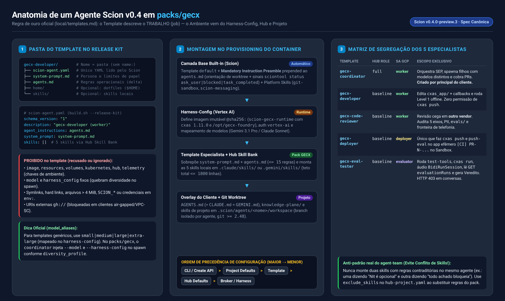
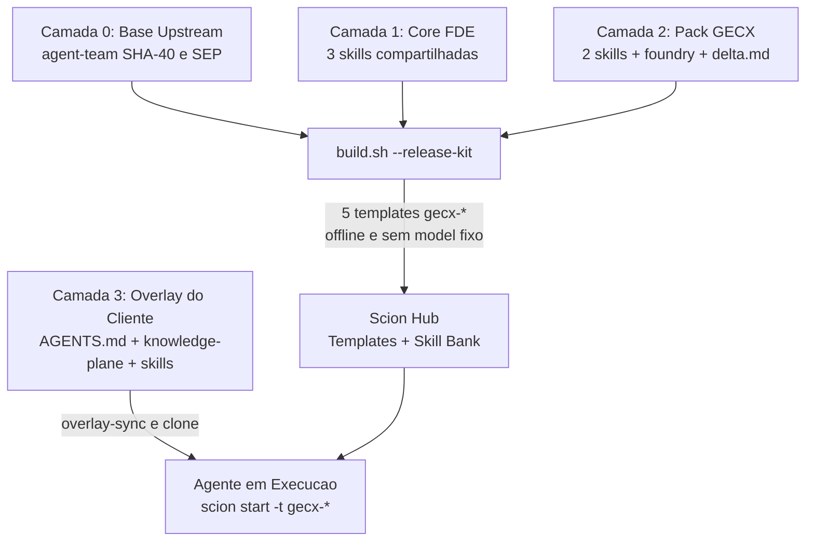
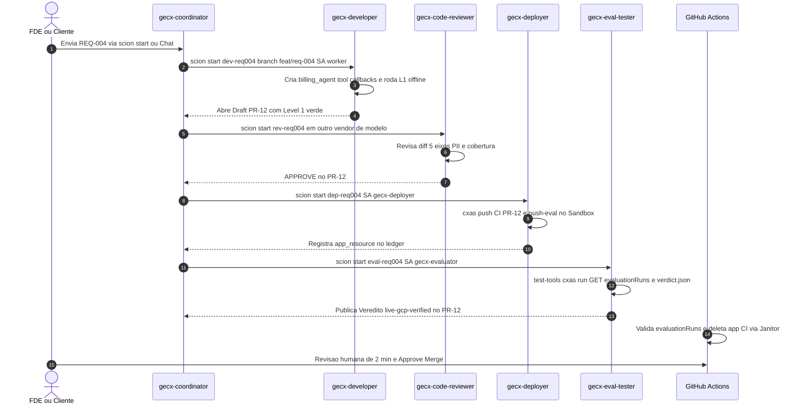
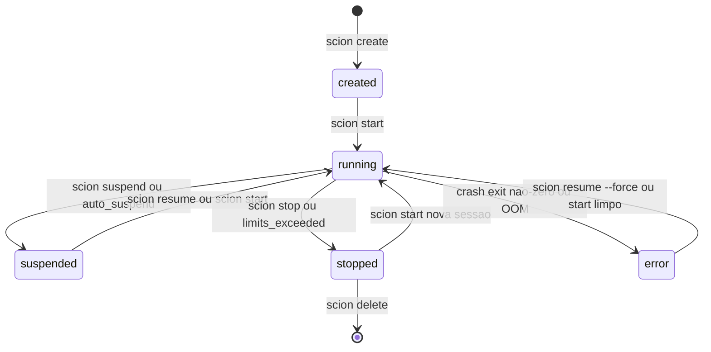

# Guia Didático — Construção e Operação dos Agentes da Fábrica GECX (`packs/gecx`)

**Audiência:** FDEs e Tech Leads que querem entender **como os agentes da fábrica são construídos** (anatomia Scion v0.4, composição em 4 camadas e customização) e **como operar a fábrica no dia a dia** para criar e evoluir um agente real no CX Agent Studio (GECX).

> [!TIP]
> Se você ainda não subiu a infraestrutura base (Terraform, VM do Hub e Release Kit), veja primeiro o guia de infraestrutura em [HANDS_ON_WALKTHROUGH.md](HANDS_ON_WALKTHROUGH.md). Este guia começa no ponto em que o Scion Hub já está no ar e foca **100% nos agentes, nos templates e na operação prática do Dia 2**.

---

## Parte 1 — Como os Agentes da Fábrica São Construídos (Scion v0.4 + 4 Camadas)

A regra de ouro da documentação oficial do Scion (`local/templates.md`) é simples: **um template descreve o trabalho (*job*), nunca o ambiente (*environment*)**. O que o agente faz (persona, regras e skills) mora no template. Onde e como ele roda (imagem de container, CPU/RAM, volumes, auth Vertex AI e mapeamento de modelos) vem do **harness-config**, do **Hub** e do **Projeto**.



O `build.sh` compõe cada especialista em tempo de build a partir de **4 camadas explícitas** e trava o tamanho total de contexto para evitar degradação por excesso de regras:



**Fallback ASCII:**

```text
  Camada 0 (agent-team @ SHA-40) ──┐
  Camada 1 (core-gcp-fde skills)  ──┼─► [build.sh] ─► Templates gecx-* no Hub
  Camada 2 (packs/gecx + delta.md) ─┘                       │
                                                            ▼
  Camada 3 (Repo do Cliente: AGENTS.md + knowledge-plane + skills/) ─► [Agente Vivo]
```

### 1.1 Anatomia Oficial de um Template Scion `v0.4.0-preview.3`

Cada pasta dentro de `templates/` do Release Kit segue exatamente a especificação oficial do Scion v0.4:

```text
gecx-developer/               # O nome do template e o nome da pasta (nao existe campo name:)
├── scion-agent.yaml          # Unico arquivo YAML lido pelo Scion
├── system-prompt.md          # Persona e fronteiras de papel (quem o agente e)
├── agents.md                 # Instrucoes operacionais (regras do pack delta.md)
├── home/                     # Opcional: dotfiles portaveis copiados para $HOME
└── skills/                   # Opcional: skills embarcadas direto no template
```

Veja o `scion-agent.yaml` real gerado por `./build.sh --release-kit packs/gecx`:

```yaml
# Composed offline Scion v0.4 template for gecx-developer.
# Base upstream role: developer @ 08faf48269da7d8dd0a20c4e5ca5093afb37495d.
# Model, harness_config, and environment keys are omitted for spawn-time diversity.
schema_version: "1"
description: "gecx-developer specialist (base: developer, hub role: baseline, SA slot: worker)"
agent_instructions: agents.md
system_prompt: system-prompt.md
skills: []
```

**Cinco regras críticas da documentação oficial do Scion (`reference/agent-config.md` e `local/templates.md`):**

1. **Preâmbulo obrigatório injetado pelo Scion:** todo template herda automaticamente o template embutido `default` e recebe o *Mandatory Instruction Preamble* no topo do `agents.md`. Esse preâmbulo ensina orientação de workspace e os sinais de status `sciontool status ask_user`, `blocked`, `idle` e `task_completed`, além de montar as *platform skills* (`git-sandbox`, `scion-messaging`) sem precisar declará-las.
2. **Chaves de ambiente são ignoradas no template:** `image`, `resources`, `volumes`, `kubernetes`, `hub` e `telemetry` geram aviso e são ignoradas dentro de um template. Defina imagem e auth no `harness-config` e limites em `agent_defaults` do Hub ou nas configurações do projeto.
3. **Sem symlinks, hard links ou arquivos acima de 4 MiB:** qualquer symlink dentro da pasta do template ou de uma skill falha o carregamento (`template content file refused`). Variáveis `SCION_*` e chaves de credencial dentro do bloco `env:` do template são ignoradas.
4. **Skills offline via Hub Skill Bank:** diferentemente do `agent-team` upstream (que referencia `gh://...` online), o Release Kit deixa `skills: []` no YAML e publica as 5 skills localmente via `scion skills publish` e `scion project skills add`. Assim o ambiente funciona mesmo atrás de VPC-SC ou firewall corporativo sem acesso ao GitHub.
5. **Precedência de configuração (maior para menor):** pedido de criação (`scion start` / Web form / `--config`) > padrões do projeto (`scion.io/default-*`) > template (`scion-agent.yaml`) > `agent_defaults` do Hub > broker e `harness-config`.

### 1.2 O Time de 5 Especialistas de `packs/gecx`

Cada papel tem **um único trabalho**, **uma Service Account GCP específica** e **um teto de permissão no Hub (`--role`)**:

| Template no Hub | Papel Base (`agent-team`) | `--role` no Hub | Service Account (`--service-account`) | O que Faz na Prática |
| :--- | :--- | :--- | :--- | :--- |
| **`gecx-coordinator`** | `coordinator` | `full` (pode criar filhos) | `factory-worker` (só Vertex AI) | Lê `knowledge-plane/`, quebra a demanda, spawna os outros 4 papéis, cobra revisões e reporta status ao humano. **Iniciado por principal do cliente.** |
| **`gecx-developer`** | `developer` | `baseline` | `factory-worker` (só Vertex AI) | Escreve `cxas_app/` (agents, instructions, tools, callbacks) + `evals/callback_tests/` em branch isolado, roda Level 1 offline e abre PR. Nunca faz `cxas push`. |
| **`gecx-code-reviewer`** | `code-reviewer` | `baseline` | `factory-worker` (só Vertex AI) | Revisão cega do diff em **outro modelo/vendor** (ex.: Claude revisando Gemini). Checa 5 eixos, PII, cobertura de callbacks e fronteira de telefonia. |
| **`gecx-deployer`** | `developer` | `baseline` | `gecx-deployer` (`gecxSandboxDeployer`) | Único agente autorizado a chamar `cxas push` e `cxas push-eval --file` no Sandbox (app efêmero `[CI] PR-N-...`). Nunca edita código de negócio. |
| **`gecx-eval-tester`** | `qa-tester` | `baseline` | `gecx-evaluator` (`gecxSandboxEvaluator`) | Roda `cxas test-tools`, `cxas run --eval-type all --wait`, áudio sintético (`BidiRunSession`), lê `GET evaluationRuns` e emite `.factory/verdicts/pr-N.json`. Zero escrita em apps e HTTP 403 em conversas. |

### 1.3 Por que `model` e `harness_config` Ficam Fora do Template?

1. **Diversidade real no spawn:** o `coordinator` escolhe modelos distintos ao disparar `gecx-developer` (ex.: `gemini-3.1-pro-preview`) e `gecx-code-reviewer` (ex.: `claude-sonnet-4-6`), seguindo `diversity_profile` em `.factory/hub-project.yaml` (`cross-vendor`, `cross-model` ou `single-family`).
2. **Portabilidade e *model size aliases*:** para templates genéricos fora do pack, o Scion recomenda usar aliases abstratos (`small`, `medium`, `large`, `extra-large` ou `s`, `m`, `l`, `xl`) mapeados em `model_aliases:` do `harness-config`. No `packs/gecx`, omitimos até o alias no template para que o `coordinator` imponha diversidade explícita no comando `scion start`.

> [!WARNING]
> **Lição real do `scion-frontiers/agent-team` (evite conflito de skills):** nunca associe duas skills com regras contraditórias ao mesmo agente. No `agent-team`, o template `code-reviewer` exclui propositalmente `code-review-and-quality` porque sua regra ("Nit é opcional") contradiz a política do `software-engineering-process`. No `packs/gecx`, use `exclude_skills:` em `.factory/hub-project.yaml` ao substituir uma skill do pack.

### 1.4 Receita Prática: Como Criar, Importar ou Editar um Especialista

**Caminho A — Adicionar ou editar um especialista no `packs/gecx` (governado e versionado):**

1. **Crie ou edite o delta (`<= 15` regras numeradas):** por exemplo, `packs/gecx/templates/gecx-prompt-tuner/delta.md` com regras curtas e verificáveis.
2. **Declare o papel em [packs/gecx/pack.yaml](../packs/gecx/pack.yaml):** adicione a entrada em `specialist_templates:` com `base_role`, `delta_dir`, `hub_role: "baseline"` e `sandbox_sa_slot: "worker"`.
3. **Valide o orçamento de contexto (Camadas 0+1+2 <= 1800 linhas) e os testes unitários:**
   ```bash
   ./build.sh --check packs/gecx
   ./build.sh --test
   ```
4. **Regenere o Release Kit e aplique no Hub (preservando templates customizados do cliente):**
   ```bash
   ./build.sh --release-kit packs/gecx --out /tmp/gecx-kit
   ./deploy/03-hub-bootstrap/bootstrap-hub-project.sh apply --kit /tmp/gecx-kit --hub http://127.0.0.1:8080
   ```

**Caminho B — Atalhos oficiais do Scion CLI para prototipagem rápida:**

```bash
# Criar um template vazio herdando de default ou clonar um existente
scion templates create meu-especialista
scion templates clone gecx-developer meu-dev-experimental

# Importar sub-agentes existentes do Claude Code (.claude/agents/*.md) ou Gemini CLI (.gemini/agents/*.md)
scion templates import --dry-run .claude/agents/code-reviewer.md
scion templates import --all .

# Sincronizar uma pasta fora de .scion/ direto para o Hub
scion templates sync ./templates/meu-especialista --name meu-especialista
```

> [!NOTE]
> Agentes que compartilham o workspace enxergam o diretório `.scion/` em modo somente leitura (`local/templates.md`). Para que um agente ajude a editar templates, mantenha os fontes fora de `.scion/` (como fazemos em `packs/gecx/templates/`) e sincronize passando o caminho da pasta. O Scion também embute a skill `team-creation` para gerar conjuntos coordenados de templates.

---

## Parte 2 — Operando a Fábrica na Prática (Exemplo Real: Criar um Agente GECX Novo)

Vamos acompanhar **passo a passo** como você opera a fábrica para entregar uma funcionalidade real em um app do CX Agent Studio (GECX):

> **Objetivo do Exemplo:** Adicionar o sub-agente **`billing_agent`** (Segunda Via de Fatura) ao app `Customer_Support_Agent`, com a tool Python `fetch_invoice`, um callback determinístico que bloqueia acesso quando `auth_status != "authenticated"`, 3 testes unitários de tool (`evals/tool_tests/`) e 1 golden eval (`evals/goldens/`).

### Etapa 1 — Especificar a Demanda no Repositório-Alvo (Spec-Driven)

A fábrica trabalha a partir de especificações versionadas no repositório (criado a partir de [packs/gecx/repo-scaffold](../packs/gecx/repo-scaffold)), nunca a partir de pedidos soltos no chat:

- `AGENTS.md` (= `CLAUDE.md` = `GEMINI.md`): convenções de código, idioma e proibição de PII do cliente.
- `knowledge-plane/requirements.md`: requisitos numerados e testáveis (`REQ-001`..`REQ-NNN`).
- `knowledge-plane/invariants.md`: invariantes que nunca podem ser quebrados.
- `.factory/hub-project.yaml`: `diversity_profile` (`cross-vendor`) e modo (`sandbox-direct` ou `ci-only`).

Adicione `REQ-004` em `knowledge-plane/requirements.md` e faça commit (lembre da regra do worktree abaixo):

```markdown
- **REQ-004 (Segunda Via de Fatura):**
  1. Criar sub-agente `billing_agent` acionado quando o cliente pedir segunda via de fatura ou boleto.
  2. Criar tool `fetch_invoice(account_id: str)` retornando valor, vencimento e codigo de barras sintetico.
  3. Se `context.state["auth_status"] != "authenticated"`, a tool retorna `status="error"` e `agent_action="Solicitar autenticacao antes de informar dados da fatura"`.
  4. Incluir 3 testes em `evals/tool_tests/billing_tool_tests.yaml` (sucesso, sem autenticacao, account_id vazio) e 1 golden em `evals/goldens/billing_second_copy.yaml`.
  5. Nenhum dado pessoal real (CPF, boleto real ou telefone real) nos fixtures.
```

### Etapa 2 — Ligar o `coordinator` (Principal do Cliente + Cuidado com Git Worktree)

> [!CAUTION]
> **Três regras críticas de Git Worktree do Scion (`getting-started/tutorial.md`):**
> 1. Exige **Git >= 2.48** para linked worktrees locais.
> 2. Cada agente roda no worktree isolado `.scion/agents/<nome>/workspace` a partir dos **commits do `HEAD` atual**. Alterações locais não commitadas **não são copiadas** para o agente.
> 3. **Nunca nomeie um agente com o nome do branch atualmente em checkout** (por exemplo, nunca faça `scion start main`). Se o nome coincidir com o branch atual, o agente trabalha direto no seu checkout.

Conecte seu CLI ao Scion Hub dentro do repositório já linkado (`scion project init` e `scion hub link`) e dispare o `coordinator`:

```bash
# 1. Conferir Hub, templates gecx-* e Service Accounts verificadas
scion hub status
scion templates list
scion service-accounts list

# 2. Sincronizar harness-configs de Vertex AI (Gemini + Claude) se ainda nao estiverem no Hub
scion harness-config sync core-gcp-fde/harness-configs

# 3. Iniciar o coordinator (principal do cliente, --role full, SA somente inferencia)
scion start coordinator \
  -t gecx-coordinator \
  --role full \
  --service-account factory-worker \
  --harness-config antigravity-vertex \
  --harness-auth vertex-ai \
  --model gemini-3.1-pro-preview \
  --thinking-level high \
  --wait-ready \
  "Implemente REQ-004 do knowledge-plane/requirements.md seguindo o processo SEP, diversidade cross-vendor e verificacao Level 1 + Level 2 no Sandbox."
```

> [!TIP]
> **Tarefas extensas (`--task-file`):** para briefs detalhados (até 96 KiB), grave o texto em um arquivo Markdown e use `--task-file req-004-brief.md` em vez de passar uma string gigante no shell. O Scion grava o conteúdo em `~/.scion/task.md` dentro do container.
> **Por que container brokered e não Managed Agents?** O modo `--profile managed-agents` do Scion (`hosted/single-node/managed-agents.md`) roda sem container e sem repositório Git (bom para pesquisa pura). Em `packs/gecx`, usamos agentes containerizados no Runtime Broker para ter Git worktrees isolados, `cxas 1.11.0`, `/opt/gecx-foundry` e `suspend`/`resume`.

### Etapa 3 — O Que a Fábrica Faz por Dentro (Orquestração dos 5 Papéis)

O `coordinator` **não edita o código diretamente**. Ele orquestra a linha de montagem SEP e aplica a segregação de modelos e Service Accounts:



**O que cada especialista usa dentro do container:**
- `dev-req004` consulta os schemas oficiais do CES em `/opt/gecx-foundry/references/api-schemas/` e executa `cxas lint`, `sync-callbacks.py --from-local` e `cxas test-callbacks` **100% offline**.
- `rev-req004` nasce em container **limpo** (sem memória da conversa do `dev-req004`) e em **outro vendor** (`claude-sonnet-4-6`), auditando o diff e os invariantes.
- `dep-req004` é o único com permissão de importar o app efêmero `[CI] PR-12-...` no Sandbox.
- `eval-req004` roda `cxas test-tools` e `cxas run --eval-type all --wait`, consulta `GET /v1beta/<app>/evaluationRuns` e grava `.factory/verdicts/pr-12.json`.

### Etapa 4 — Operação no Dia 2: Web Dashboard, Native Web Chat e CLI

Você acompanha todo o time pelo navegador no **Scion Web Dashboard** (via túnel IAP em `http://127.0.0.1:8080` ou URL HTTPS IAP) ou pelo CLI:


**Recursos de alta produtividade do Scion v0.4 Web Dashboard (`workstation/dashboard.md` e `hosted/user/messaging.md`):**

- **Atalhos de teclado sem perder contexto:** `Ctrl+1` (Console), `Ctrl+2` (Native Web Chat) e `Ctrl+3` (Terminals) (`Cmd+1/2/3` no macOS). Trocar de Console para Chat dentro de um projeto abre direto o espaço de chat daquele projeto.
- **Alternância `Chat | Execution Log` e filtros de densidade:** alterne entre diálogo limpo e log bruto de execução no mesmo painel, ajustando a densidade entre **Conversation** (só diálogo), **Verbose** (menções/CCs) ou **Full** (eventos de estado).
- **Links clicáveis nativos:** caminhos `/workspace/...`, referências `owner/repo#N` e URIs `gs://bucket/objeto` (com `web.gcs_links`) viram links interativos no chat. Para `gs://`, o Hub busca o objeto usando a própria Service Account GCP do agente remetente.
- **Promoção de DM para Thread compartilhada:** quando uma conversa 1-para-1 com `@coordinator` gera contexto útil para o time, clique em promover DM para transformá-la em thread do projeto sem recarregar a página.
- **Alertas de navegador e fuso horário:** o sino notifica eventos de `stalled`, `error` e `ask_user` (mensagens de chat ficam no contador do botão Chat). Ajuste **Display timezone** no perfil para `America/Sao_Paulo` (afeta só a visualização, nunca o `TZ` do container).
- **Dropdown "New Agent" por escopo:** templates aparecem sempre na ordem `User Templates > Project Templates > Global Templates`.

#### Ciclo de Vida do Agente (`stop` vs. `suspend` + Recuperação)



| Aspecto | `scion stop <agente>` | `scion suspend <agente>` |
| :--- | :--- | :--- |
| **Fase resultante** | `stopped` | `suspended` (registra `suspendReason`: `user`, `idle` ou `stalled`) |
| **Próximo `start`/`resume`** | Sessão **nova** (limpa) | **Continua** a conversa anterior (`--continue` no Claude Code, `--resume` no Gemini CLI) |
| **Atividade preservada** | Limpa | Mantém `completed`, `idle` ou `harness_error` (ex.: `suspended · completed (stalled)`) |
| **Quando usar** | Tarefa encerrada ou quer recomeçar do zero | Fim do expediente ou pausa aguardando resposta humana |

> [!TIP]
> **`start` e `resume` são conscientes da intenção:** rodar `scion start` em um agente `suspended` faz resume implícito da conversa. Rodar `scion resume` em um agente `stopped` inicia sessão limpa. No runtime Docker (usado no `lite-vm`), o diretório home do agente fica em bind-mount no host e preserva sessões automaticamente. Em Kubernetes/Cloud Run, session resume exige volume persistente (NFS/filestore).

#### Comandos Diários Verificados (`scion v0.4.0-preview.3`)

| O que Você Quer Fazer | Comando Exato |
| :--- | :--- |
| **Ver todo o time e status/motivo de suspensão** | `scion list` (filtrar quem precisa de humano: `scion list --activity waiting_for_input`) |
| **Espiar a tela de um agente sem interromper** | `scion look dev-req004 -n 50 --plain` ou `scion logs dev-req004` |
| **Enviar instrução ou redirecionar o `coordinator`** | `scion message @coordinator "REQ-004: inclua cenario de fatura ja paga no golden."` |
| **Destravar prompt interativo (`y/n`) no terminal** | `scion keys dev-req004 "Enter"` (uma tecla por chamada) |
| **Revisar e registrar decisões em aberto** | `scion decisions list` → `scion decisions show <id>` → `scion decisions record` |
| **Assumir o terminal tmux para debug manual** | `scion attach dev-req004` |
| **Pausar todos os agentes no fim do dia** | `scion suspend --all` (ou `scion suspend <agente>` num agente `idle` para travá-lo como `user`) |
| **Retomar o `coordinator` no dia seguinte** | `scion resume coordinator` |
| **Controlar alcance de mensagens entre agentes** | `--message-mode project` (padrão), `branch` (só pai/filho), `lineage` (só humanos da linhagem) ou `none` |

### Etapa 5 — Triage Rápido de Agentes Travados & Teardown Seguro

> [!IMPORTANT]
> **Regra #1 de Triage (`local/agent-lifecycle.md`):** **não delete e recrie um agente travado como primeira reação.** Recriar destrói arquivos não commitados no worktree e o histórico de terminal. Inspecione sempre com `scion look <agente>` e `scion logs <agente>` antes.

| Sintoma no `scion list` / Logs | Causa Provável | Ação Correta de Recuperação |
| :--- | :--- | :--- |
| **`harness error`** (ex.: `APIError status 400/429`) | Provedor Vertex AI rejeitou o turno (quota, modelo ou credencial), mas o harness continua vivo. | Corrija a causa e envie `scion message <agente> "continue"`. Não recrie. |
| **`LIMITS_EXCEEDED`** | Atingiu `default_max_turns` (`60`) ou `default_max_duration` (`2h`). | Envie `scion message <agente> "continue"` para abrir novo ciclo. |
| **Prompt interativo travado (`y/n`)** | Uma ferramenta aguardou confirmação no terminal. | Use `scion keys <agente> "Enter"` (nunca use `scion message --raw`, removido com HTTP `422 raw_input_removed` na v0.4). |
| **Erro `no_runtime_broker` (422)** | Reconexão temporária do Runtime Broker após reinício da VM. | Aguarde 30–60 s e confira `scion runtime-broker status`. |
| **Fase `error (crashed)`** | Container saiu com código não-zero ou OOM (`exit 137`). | Recupere a sessão com `scion resume --force <agente>` ou reinicie limpo com `scion start <agente>`. |
| **Erro `skill_resolution_failed` (404/500)** | Skill ausente no Skill Bank, falta de permissão ou symlink dentro da skill. | Confira `scion skills list` e execute `bootstrap-hub-project.sh apply` novamente. |

**Três regras de segurança ao encerrar agentes (teardown *bottom-up*):**

1. **Conclusão não é deleção:** encerre primeiro os filhos (`dev-req004`, `rev-req004`, `dep-req004`, `eval-req004`) e por último o `coordinator`.
2. **Pergunta humana em aberto bloqueia deleção:** nunca delete um agente com `ask_user` pendente sem concluir o diálogo.
3. **Commit não é Push:** antes de `scion delete <agente> --non-interactive`, confirme que todos os commits foram enviados ao branch remoto (ou PR aberto).

### Etapa 6 — Revisão Humana do PR (Checklist de 2 Minutos Antes do Merge)

Na v1, **nenhum agente faz auto-merge em `main`**. Quando o `coordinator` avisar que o PR-12 está pronto, verifique 4 itens:

1. **Status Check `GECX Verdict Gate` verde:** confirma paridade `AGENTS.md`/`CLAUDE.md`/`GEMINI.md`, zero PII em `evals/`, `evaluationRun` existente no CES sob `gecx-evaluator@`, e limpeza do app `[CI]` pelo `janitor`.
2. **Alteração combinada de código + `evals/`:** como `REQ-004` criou novos evals junto com o código, o CI bloqueia até você revisar os novos testes (garantindo que o agente não afrouxou asserções) e aplicar manualmente a label **`eval-change-approved`**.
3. **Nível do Veredito:**
   - `live-gcp-verified` confirma validação de texto ou áudio sintético no Sandbox.
   - `not-verifiable-in-sandbox` exige revisão manual da lista `not_verifiable_surfaces` se o diff tocou SIP, SBC, AudioCodes VAIC, DTMF ou transferência CCaaS.
4. **Approve & Merge:** após o seu merge humano, o pipeline CI/CD do cliente promove para DEV / HML / PRD via WIF.

---

## Parte 3 — Customização por Cliente (Overlay), Coding Agent CLI e Kaizen

### 3.1 Adicionando Regras Específicas de um Cliente sem Forkar o Pack

Nunca altere os arquivos de `packs/gecx` para regras específicas de um cliente (como tom de voz, política de cobrança ou nomenclatura proprietária). Use o **Overlay no repositório do cliente**:

1. Crie `skills/regras-tom-de-voz/SKILL.md` com frontmatter YAML (`name:` em kebab-case igual ao nome da pasta e `description:`), ou use `scion skills create regras-tom-de-voz`.
2. Declare a skill em `.factory/hub-project.yaml`:
   ```yaml
   overlay_skills:
     - dir: "skills/regras-tom-de-voz"
       version: "1.0.0"
   ```
3. Se precisar substituir uma skill do pack em vez de somar, adicione o nome da skill original em `exclude_skills:` e dê um nome novo à substituta (`./build.sh --check` bloqueia colisão de nomes).
4. Sincronize no Hub:
   ```bash
   ./deploy/03-hub-bootstrap/bootstrap-hub-project.sh overlay-sync \
     --kit /tmp/gecx-kit \
     --hub http://127.0.0.1:8080 \
     --repo /caminho/para/repo-do-cliente
   ```

### 3.2 Dica Avançada: Dirigindo o Scion Hub via Coding Agent Local (`SCION_HUB_TOKEN`)

Se você quiser que um assistente local no seu terminal (como Claude Code ou Gemini CLI) liste agentes, dispare tarefas ou leia logs no Hub em seu nome (`hosted/user/coding-agent-cli.md`):

```bash
# Crie um Personal Access Token com escopo minimo (sem agent:delete!)
scion hub token create \
  --project customer-support-gecx \
  --name "local-coding-agent" \
  --scopes project:read,project:list,agent:list,agent:read,agent:create,agent:message,skill:read,skill:list,template:read,template:list,harness_config:read,harness_config:list \
  --expires 30d
```

- Passe o token em `SCION_HUB_TOKEN` com `--format json` (prompts e avisos vão para `stderr` e `stdout` entrega JSON puro).
- **Atenção:** um login interativo salvo (`scion hub auth login`) tem precedência sobre `SCION_HUB_TOKEN`. Use um `HOME` isolado para o coding agent.
- **Evite `--yes` e `--non-interactive`:** sem essas flags, o CLI sem TTY responde "Não" com segurança a toda ação destrutiva e avisa no `stderr`.

### 3.3 Regra de Ouro de Kaizen: Quando Mudar Prompt vs. Quando Virar Código

- **1ª ocorrência de erro do agente:** corrija no PR ou torne `knowledge-plane/requirements.md` menos ambíguo.
- **2ª ocorrência do mesmo erro** (ex.: agente esquece de limpar `_action_trigger` no callback ou usa nome inválido de tool): **não adicione mais 20 linhas de prosa no prompt**. Gradue a regra para um teste determinístico em `evals/callback_tests/` ou uma checagem de CI (custo zero de tokens e 100% determinístico).
- **Lição generalizável para outros clientes:** remova todo identificador de cliente, reproduza o cenário em repositório sintético, inclua o campo `source:` obrigatório e abra PR em `gcp-fde-factories`.

---

## Referências Oficiais (`GoogleCloudPlatform/scion@v0.4.0-preview.3` & `agent-team`)

- [Templates & Roles (`local/templates.md`)](https://github.com/GoogleCloudPlatform/scion/blob/v0.4.0-preview.3/docs-site/src/content/docs/local/templates.md) — anatomia de diretórios, `scion-agent.yaml`, preâmbulo obrigatório e `model_aliases`.
- [Agent Configuration Reference (`reference/agent-config.md`)](https://github.com/GoogleCloudPlatform/scion/blob/v0.4.0-preview.3/docs-site/src/content/docs/reference/agent-config.md) — chaves de trabalho vs. ambiente e precedência de configuração.
- [Skills — Authoring & Publishing (`local/skills.md`)](https://github.com/GoogleCloudPlatform/scion/blob/v0.4.0-preview.3/docs-site/src/content/docs/local/skills.md) — frontmatter `SKILL.md`, Skill Bank e resolução de erros.
- [Agent Lifecycle — Suspend, Resume & Recovery (`local/agent-lifecycle.md`)](https://github.com/GoogleCloudPlatform/scion/blob/v0.4.0-preview.3/docs-site/src/content/docs/local/agent-lifecycle.md) — `stop` vs. `suspend`, tabela de triage e teardown *bottom-up*.
- [Web Dashboard (`workstation/dashboard.md`)](https://github.com/GoogleCloudPlatform/scion/blob/v0.4.0-preview.3/docs-site/src/content/docs/workstation/dashboard.md) e [Messaging & Notifications (`hosted/user/messaging.md`)](https://github.com/GoogleCloudPlatform/scion/blob/v0.4.0-preview.3/docs-site/src/content/docs/hosted/user/messaging.md) — Native Web Chat, atalhos `Ctrl+1/2/3`, links clicáveis e notificações.
- [Tutorial & Git Worktrees (`getting-started/tutorial.md`)](https://github.com/GoogleCloudPlatform/scion/blob/v0.4.0-preview.3/docs-site/src/content/docs/getting-started/tutorial.md) e [Coding Agent CLI (`hosted/user/coding-agent-cli.md`)](https://github.com/GoogleCloudPlatform/scion/blob/v0.4.0-preview.3/docs-site/src/content/docs/hosted/user/coding-agent-cli.md) — regras de worktree e PATs com escopo mínimo.
- [Biblioteca Upstream `scion-frontiers/agent-team`](https://github.com/scion-frontiers/agent-team/tree/08faf48269da7d8dd0a20c4e5ca5093afb37495d) — 13 papéis base e processo SEP.
