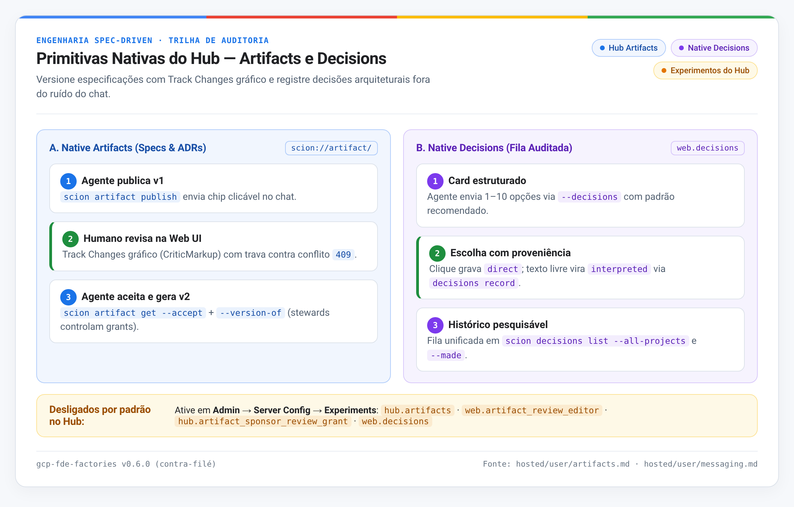
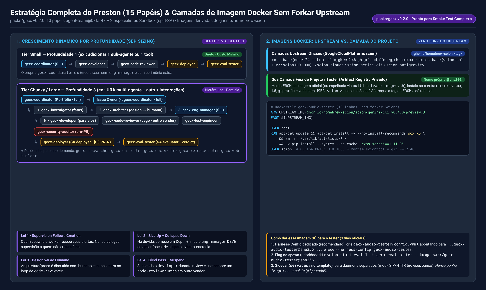
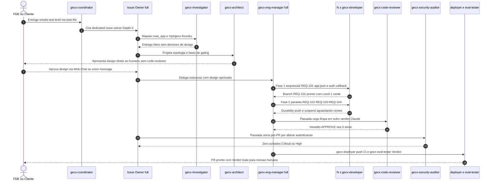
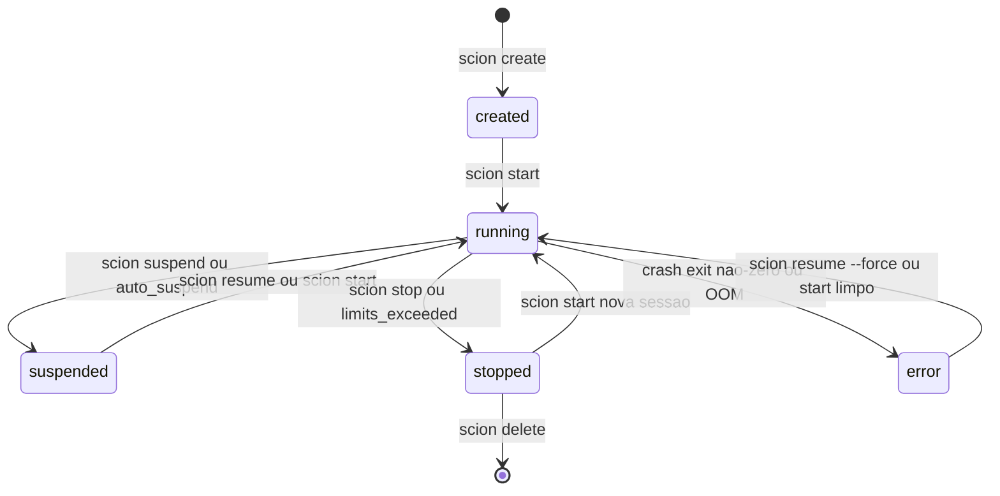

# Guia Completo — Scion `v0.4.0-preview.3` + Operação da Fábrica GECX (`packs/gecx v0.2.0`)

**Audiência:** FDEs e Tech Leads que querem dominar **o Scion por dentro** (arquitetura, comandos, skills, comunicação entre agentes e imagens Docker customizadas) e **operar a fábrica `packs/gecx` com a estratégia hierárquica completa do Preston (15 papéis)** para construir agentes complexos no CX Agent Studio (GECX).

> [!TIP]
> Se você ainda não provisionou a infraestrutura GCP (Terraform, VM do Hub, Org Policies e Release Kit), comece pelo guia de infraestrutura em [HANDS_ON_WALKTHROUGH.md](HANDS_ON_WALKTHROUGH.md) e pelos requisitos de Landing Zone em [CUSTOMER_LANDING_ZONE_REQUIREMENTS.md](CUSTOMER_LANDING_ZONE_REQUIREMENTS.md). Este guia assume o Scion Hub no ar e cobre **todo o funcionamento do Scion e da fábrica no Dia 2, sempre baseado em exemplos concretos**.

---

## Parte 1 — Tutorial Completo do Scion `v0.4.0-preview.3` (Arquitetura, Conceitos e Modos)

O **Scion** é uma plataforma open-source de orquestração de times de agentes de IA que separa rigorosamente o **plano de controle (Hub)** da **camada de execução (Runtime Broker + Containers)**. O mesmo CLI (`scion`) e os mesmos templates rodam no seu laptop, em uma VM única ou em cluster corporativo de alta disponibilidade.


### 1.1 Os 3 Modos de Execução (*Mode Spine*)

Na v0.4, **todo comando `scion` passa por um Hub** (o antigo modo solo sem Hub foi removido). O que muda entre modos é quanta infraestrutura existe atrás do Hub (`choosing-a-mode.md`):

| Modo | Control Plane + Banco | Multiusuário | Quando Escolher |
| :--- | :--- | :--- | :--- |
| **Workstation** | *Combo server* local (`Hub + Broker + Web`) em `127.0.0.1`, SQLite local | Não (só você) | *"Quero testar agentes na minha máquina agora."* Um comando: `scion server start`. |
| **Single-node Hosted** | 1 Hub em rede (VM única ou 1 instância Cloud Run) + SQLite em disco | Sim (OAuth / IAP) | **Nosso `deploy/02-factory-runtime/lite-vm`:** Hub compartilhado simples e barato para 1 cliente ou piloto. |
| **HA Hosted** | Múltiplas réplicas do Hub atrás de Load Balancer + Cloud SQL Postgres + GCS | Sim (OAuth / Groups) | **Nosso `deploy/02-factory-runtime/ha-gke`:** operação contínua sem downtime para times grandes. |

### 1.2 As 4 Peças da Arquitetura Interna

1. **`scion` CLI & Web Dashboard:** sua interface de comando. Em modo hosted, o CLI fala HTTPS/WebSocket com o Hub (ou por túnel IAP em `http://127.0.0.1:8080`).
2. **Scion Hub (Control Plane):** detém identidade, autenticação, projetos, **Skill Bank**, **Message Plane**, **notificações SSE** e o motor de autorização **AK1 Kernel** (`Effective Permissions = RoleBindings positivos ∩ AccessConstraints monotônicos`). Emite JWTs assinados com *provenance claims* (`creator_user_id`, `template_id`, `project_id`, `broker_id`) e faz troca de tokens de Service Account GCP sem nenhuma chave JSON estática.
3. **Runtime Broker:** serviço conectado ao Hub via canal de controle. Quando o Hub despacha um `scion start`, o Broker provisiona o workspace (worktree ou clone Git), hidrata o template e baixa as skills (com cache por SHA-256) e sobe o container no runtime configurado (Docker, Podman, Apple Container ou Kubernetes).
4. **Container do Agente (non-root `UID 1000`):** executa o *harness* (Claude Code, Gemini CLI, Antigravity, OpenCode ou Codex) sempre dentro de uma sessão **`tmux` obrigatória** supervisionada pelo binário **`sciontool`**.

> [!NOTE]
> **Agentes Containerizados vs. Managed Agents (`--profile managed-agents`):** o Scion também suporta *Managed Agents* que rodam direto via API de nuvem sem container nem repositório Git (ótimos para pesquisa pura). Em `packs/gecx`, usamos **sempre agentes containerizados no Runtime Broker** porque precisamos de Git worktrees/clones isolados, `cxas 1.11.0`, `/opt/gecx-foundry` e `suspend`/`resume`.

### 1.3 Modelo de Estado do Agente (`Phase` × `Activity` × `Detail`)

O Scion separa infraestrutura de cognição em três dimensões (`concepts.md`):

- **`Phase` (ciclo do container):** `created` → `provisioning` → `cloning` → `starting` → `running` → `stopping` → `stopped`, além de `suspended` (pausado com sessão preservada), `error` (crash com exit code não-zero ou OOM) e `halted` (interrompido pela plataforma).
- **`Activity` (o que a IA faz dentro de `running`):** `initializing`, `working`, `thinking`, `executing`, `waiting_for_input`, `blocked`, `idle`, `completed`, `limits_exceeded`, `stalled`, `offline`, `harness_error`.
- **`Detail`:** resumo livre do passo atual (tool em execução ou pergunta ao usuário).

**Como o agente avisa o Hub ao terminar um turno (`sciontool status`):**
Todo agente recebe automaticamente um preâmbulo obrigatório exigindo encerrar cada turno com um destes quatro sinais:

- `sciontool status blocked "<motivo>"` — esperando algo específico (filho terminar, resposta de pergunta ou **job em background** como build/testes). **Regra crítica:** nunca sinalize `idle` enquanto um build/teste background estiver rodando, pois o auto-suspend encerraria o container e mataria o job.
- `sciontool status idle` — nada pendente até chegar nova mensagem (pode ser auto-suspenso e acorda sozinho com nova mensagem quando `lifecycle.idle_suspend` está ligado).
- `sciontool status task_completed "<resumo>"` — entregou o artefato pedido.
- `sciontool status ask_user "<pergunta>"` — dispara alerta no sino do Web Dashboard e aparece em `scion list --activity waiting_for_input`.

### 1.4 Workspaces & Modos de Compartilhamento (`workspaces-and-sharing.md`)

Todo container monta seu diretório de trabalho em `/workspace`. O projeto escolhe um de quatro modos:

| Modo | Como Isola Agentes | Onde é Padrão | Detalhe Importante |
| :--- | :--- | :--- | :--- |
| **`Worktree-per-agent`** | Linked git worktree em `.scion/agents/<nome>/workspace` no branch `<nome>` | Hub Workstation local | Exige **Git >= 2.48**. Copia apenas commits do `HEAD` (mudanças não commitadas não entram). **Nunca dê ao agente o nome do branch em checkout** (ex.: `main`). |
| **`Clone-per-agent`** | Cada container clona o repo HTTPS e cria branch `scion/<nome>` | **Hub Remoto / Hosted** | Usa secret `GITHUB_TOKEN` (`Contents: Read/Write`) do projeto no Hub. Não depende de SSH local. |
| **`Shared-plain`** | Todos montam a mesma pasta sem isolamento | Projetos sem Git | Bom para pastas de documentos compartilhados. |
| **`Empty-per-agent`** | Diretório vazio privado por agente | Projetos Hub-managed sem Git | Sem repositório externo. |

> [!CAUTION]
> **Diretório `.scion/` é somente leitura dentro do agente:** quando `.scion/` está na raiz do workspace, o Scion monta essa pasta em modo read-only e oculta `.scion/agents/`. Por isso, templates editáveis por agentes devem ficar em pastas normais do repo (como `packs/gecx/templates/`) e ser sincronizados por caminho (`scion templates sync ./minha-pasta`).

### 1.5 Mini-Tutorial Prático do Scion CLI + Tmux + Web Dashboard (5 Minutos)

Se você nunca usou o `scion` na vida, este roteiro reproduz a experiência completa do tutorial oficial (`getting-started/tutorial.md` e `hosted/user/hosted-user.md`):

```bash
# 1. Conectar seu CLI a um Hub (ou subir local com 'scion server start')
scion hub add gecx-hub http://127.0.0.1:8080
scion hub auth login --hub gecx-hub
scion use --hub gecx-hub

# 2. Inicializar e linkar um repositorio Git ao Hub (ou criar direto por URL Git)
cd ~/src/meu-agente-gecx
scion init
scion hub link
# Alternativa 100% remota (sem clone local):
# scion hub project create https://github.com/org/meu-agente-gecx.git --slug meu-agente-gecx
# scion hub secret set --project=meu-agente-gecx GITHUB_TOKEN ghp_xxxx

# 3. Trabalhar de qualquer diretorio sem repetir --project
scion use meu-agente-gecx

# 4. Disparar um agente simples e acompanhar sem bloquear o terminal
scion start teste-1 "Liste a estrutura de cxas_app/ e crie um resumo em docs/mapa.md"
scion list
scion look teste-1 -n 40 --plain
scion logs teste-1

# 5. Entrar no terminal ao vivo do agente (tmux) e sair sem matar o processo
scion attach teste-1
# Dentro do tmux:
#   Ctrl-b d   -> desconecta mantendo o agente rodando (NUNCA use Ctrl-c para sair!)
#   Ctrl-b [   -> modo scroll com setas (aperte 'q' para voltar)
#   Ctrl-b m   -> liga/desliga scroll do mouse (no Web Terminal, segure Shift para copiar texto)

# 6. Limpar preservando o branch Git (por padrao 'scion delete' apaga o branch local!)
scion delete teste-1 --preserve-branch
```

> [!TIP]
> **Usando Scion dentro do Google Cloud Shell ou de outro `tmux`?** O prefixo padrão `Ctrl-b` será capturado pelo seu `tmux` externo (`local/tmux.md`). Edite `.scion/templates/default/home/.tmux.conf` adicionando `set -g prefix C-a` / `unbind C-b` / `bind C-a send-prefix` para usar `Ctrl-a` dentro dos agentes.


**Atalhos e recursos de ouro no Web Dashboard (`workstation/dashboard.md` e `hosted/user/messaging.md`):**
- **Mode Switcher (`Ctrl+1` Console / `Ctrl+2` Native Web Chat / `Ctrl+3` Terminals, `Cmd+1/2/3` no macOS):** alternar entre Console e Chat preserva o projeto aberto.
- **Alternância `Chat | Execution Log` e Filtros de Densidade:** veja diálogo limpo (**Conversation**), menções (**Verbose**) ou eventos internos (**Full**), e alterne para o stream bruto de execução sem sair da aba.
- **Links clicáveis automáticos:** `/workspace/...`, `owner/repo#N` e `gs://bucket/objeto` abrem visualização direta no modal do Dashboard (no caso de `gs://`, o Hub busca o arquivo usando a própria Service Account GCP do agente remetente).
- **Promoção de DM para Thread:** promova uma conversa 1-para-1 com `@coordinator` para uma thread compartilhada do time com um clique.
- **Display Timezone:** configure `America/Sao_Paulo` no seu perfil (altera apenas a exibição das horas na tela, nunca o `TZ` interno dos containers).

### 1.6 O Que São as *Roles* dos Agentes (`--role none | readonly | baseline | full`)?

Um ponto que costuma confundir quem chega no Scion é o uso da palavra **"role"** em três camadas diferentes e totalmente independentes:

1. **Papel cognitivo (Template):** ex. `gecx-developer`, `gecx-eng-manager`, `gecx-code-reviewer`. Define *como o agente pensa e trabalha* (`agents.md` + `system-prompt.md`), mas **não dá nenhuma permissão na API do Hub** (o antigo campo `hubAccess.scopes` no template foi removido na v0.4).
2. **Agent Authorization Role (`--role` no Hub):** define **o que o container pode chamar na API do Scion Hub** (traduzido para os escopos do JWT `~/.scion/scion-token`).
3. **Identidade GCP (`--service-account`):** define **o que o container pode chamar na nuvem GCP** (Vertex AI, CX Agent Studio Sandbox). É ortogonal à role do Hub.

#### Os 4 Níveis de Agent Authorization Role (`hosted/ha/permissions.md`)

| `--role` | Escopos JWT Concedidos no Hub | O Que o Agente Pode Fazer na Prática | Quem Usa em `packs/gecx` |
| :--- | :--- | :--- | :--- |
| **`none`** | *(nenhum)* | Executa completamente desconectado da API do Hub (sem claims de autorização). | Scripts isolados ou tarefas batch sem interação com o Hub. |
| **`readonly`** | `project:read`, `agent:status:update` | Consulta estado do projeto e reporta o próprio status. **Não** renova token, **não** abre port-forward, **não** envia notificações e **não** gerencia outros agentes. | Consultas curtas somente leitura sem necessidade de refresh de token. |
| **`baseline`** | `project:read`, `agent:status:update`, `agent:token:refresh`, `project:agent:notify`, `agent:port:forward` | Trabalho padrão de longa duração: reporta status, renova o próprio JWT de 10 h, envia notificações e abre port-forward. **Não** pode criar sub-agentes, atribuir SAs GCP, suspender/deletar outros agentes ou ler secrets do projeto. | **13 dos 15 papéis** (`developer`, `code-reviewer`, `architect`, `investigator`, `security-auditor`, `test-engineer`, `gecx-deployer`, `gecx-eval-tester` e papéis de apoio). |
| **`full`** | Tudo do `baseline` + `project:agent:create`, `project:agent:sa_assign`, `project:agent:lifecycle`, `project:secret:read` | Controle completo de orquestração no projeto: cria filhos (`scion start`), atribui Service Accounts GCP aos filhos (`--service-account`), suspende/retoma/deleta filhos e lê secrets do projeto. | **Apenas os 2 papéis orquestradores:** `gecx-coordinator` (incluindo *Issue Owner*) e `gecx-eng-manager`. |

#### Regra de Teto e Anti-Escalação (*No-Escalation*, Fail-Closed)

O Scion calcula a role efetiva no momento da criação sem nunca permitir que um agente escale privilégios por conta própria:

- **Disparo feito por usuário humano:** `role efetiva = min(role pedida no --role, max_agent_role do projeto)`.
- **Disparo feito por agente pai (sub-agente):** `role efetiva = min(role pedida, role do pai, max_agent_role do projeto)`.
- **Tentativa de escalação retorna `403 Forbidden`:** um agente `baseline` nunca consegue criar filhos, e um pai nunca consegue dar ao filho uma role maior que a sua (em `scion reincarnate --role`, um agente só pode **rebaixar** a própria role, nunca subir). Se o registro do pai falhar na consulta ao banco, o Hub falha fechado para `baseline`.
- **Re-derivação no refresh de token:** ao renovar o JWT (`RefreshAgentToken`), o Hub sempre recalcula os escopos a partir da role armazenada no banco (nunca copia escopos antigos cegamente).

> [!CAUTION]
> **Pegadinha importante da v0.4 (`default_agent_role`):** no upstream do Scion, o fallback padrão quando `--role` é omitido passou de `baseline` para **`full`**. Em ambientes corporativos, configure `scion.io/default-agent-role = baseline` no projeto (ou passe `--role baseline` explicitamente em todo worker) e reserve `--role full` somente para `gecx-coordinator` e `gecx-eng-manager`.

#### Exemplo Concreto: Os 4 Eixos Ortogonais no `Telecom_Support_Center`

| Agente Vivo | Template (Trabalho) | `--role` (Hub API) | `--service-account` (GCP API) | `--message-mode` (Chat) | Por Que Essa Combinação Existe |
| :--- | :--- | :--- | :--- | :--- | :--- |
| **`coordinator`** | `gecx-coordinator` | **`full`** | `factory-worker` (só Vertex) | `project` | Cria `gecx-eng-manager` e Issue Owners no Hub, mas não consegue tocar em apps do Sandbox no GCP. |
| **`em-telecom`** | `gecx-eng-manager` | **`full`** | `factory-worker` (só Vertex) | `project` | Spawna `N` devs (`baseline`), suspende devs no review (`lifecycle`) e passa `--service-account gecx-deployer` ao deployer (`sa_assign`). |
| **`dev-billing`** | `gecx-developer` | **`baseline`** | `factory-worker` (só Vertex) | `project` | Mesmo sofrendo prompt injection, recebe `403 Forbidden` se tentar spawnar filhos, ler secrets do projeto ou dar `cxas push`. |
| **`dep-pr12`** | `gecx-deployer` | **`baseline`** | **`gecx-deployer`** (CES push) | `branch` | Tem poder no **GCP Sandbox** para `cxas push`, mas zero poder no **Hub** para spawnar ou alterar outros agentes. |

> [!NOTE]
> **Roles de Usuário vs. Roles de Agente + Cadeia de Ancestralidade:** usuários humanos têm duas roles separadas — uma **Hub Role** (`admin`, `member` que pode criar projetos, ou `viewer`) e uma **Project Role** por projeto (`project-owner`, `project-admin`, `project-member`, `project-viewer`). Quando você cria o `coordinator` raiz, o Scion grava a cadeia de ancestralidade (`você → coordinator → em-telecom → dev-billing`): você ganha **acesso transitivo** para inspecionar (`scion look`), dar `attach` ou parar qualquer descendente da sua árvore, mesmo que outro membro do projeto não consiga dar `attach` nos seus agentes.

---

## Parte 2 — Onde Ficam as Skills e Como os Agentes Se Comunicam

### 2.1 Onde Ficam as Skills no Scion (4 Origens + Montagem no Container)

Uma **skill** segue a convenção aberta [Agent Skills](https://agentskills.io/home): uma pasta cujo nome em `kebab-case` coincide com `name:` no frontmatter de `SKILL.md`, podendo incluir arquivos de apoio (`references/`, `scripts/`).

**No Scion v0.4, as skills existem em 4 camadas (com precedência de template sobre platform skill):**

1. **Platform Skills (embutidas no binário `scion`):** injetadas automaticamente conforme contexto — ex.: `git-sandbox` (regras de worktree/branch) e `scion-messaging`. Não precisam ser declaradas.
2. **Hub Skill Bank (nosso padrão corporativo offline):** registro versionado no Hub com três escopos (`global`, `project`, `user`) e deduplicação por `sha256`. Em `packs/gecx v0.2.0`, publicamos **10 skills** no Skill Bank e dividimos em dois grupos para economizar contexto:
   - **5 skills anexadas ao projeto inteiro (`attach_to_project: true`):** todo agente recebe `gcp-fde-guardrails`, `gcp-sandbox-contract`, `gcp-kaizen-light`, `gecx-foundry-adapter` e `gecx-domain-guardrails` via `scion project skills add`.
   - **5 skills de processo do `agent-team` montadas só nos papéis que precisam (`attach_to_project: false`):** `software-engineering-process` (470 linhas), `code-review` (416 linhas), `artifact-durability`, `agent-state-continuity` e `release-notes-daily` ficam no Skill Bank e são referenciadas via `skill://scion/global/<nome>` no `scion-agent.yaml` apenas dos papéis correspondentes (assim `gecx-deployer` e `gecx-eval-tester` não desperdiçam 900 linhas de contexto com processo de code review).
3. **Template-mounted `skills/`:** pastas commitadas dentro de `<template>/skills/<nome>/`. Viajam com o template sem precisar de Hub.
4. **Skills Federadas (`gh://...` ou `gcp-skill://...`):** resolvidas sob demanda pelo Hub/Broker com cache em disco. **Bloqueadas no nosso Release Kit offline** para garantir funcionamento atrás de VPC-SC e firewall corporativo.

**Onde a skill aparece fisicamente DENTRO do container do agente?**
No provisioning, o Broker baixa os arquivos verificando o hash SHA-256 e instala cada pasta dentro do diretório nativo do harness em `/home/scion/`:

- **Claude Code:** `/home/scion/.claude/skills/<nome-da-skill>/SKILL.md`
- **Gemini CLI:** `/home/scion/.gemini/skills/<nome-da-skill>/SKILL.md`
- **Antigravity:** `/home/scion/.gemini/antigravity-cli/skills/<nome-da-skill>/SKILL.md`

> [!IMPORTANT]
> **Quem precisa de permissão para ler uma skill?** O Hub resolve skills do Skill Bank usando as permissões do **criador do agente** (você ou o agente pai), nunca a identidade do Runtime Broker. Se uma skill obrigatória falhar ao resolver (404, 403 ou symlink proibido), o `scion start` falha imediatamente com `skill_resolution_failed` em vez de subir um agente "cego". Use `optional: true` somente para skills auxiliares.

### 2.2 Como os Agentes Se Comunicam (3 Canais + Matriz `--message-mode`)

No Scion, a comunicação multi-agente combina **três canais complementares**:

1. **Hub Message Plane (`scion message`):** entrega assíncrona de mensagens entre humanos e agentes (`scion message @coordinator "..."` para conversa ou `scion message dev-1 "..."` para DM). Para textos grandes (> 5 KB), passe `--body-file brief.md` ou grave no workspace compartilhado e mande o caminho — briefs enormes inline podem abortar o agente silenciosamente.
2. **Sinais de Ciclo de Vida + Auto-Subscription (*Supervision follows creation*):** sempre que um agente pai (`coordinator` ou `eng-manager`) cria um filho via `scion start`, o Hub **inscreve automaticamente o criador** nas notificações de `COMPLETED`, `STALLED`, `ERROR` e `ask_user` daquele filho. Além disso, a cadeia de ancestralidade (`root → parent → child`) dá permissão transitiva para qualquer ancestral inspecionar (`scion look`) ou gerenciar seus descendentes.
3. **Canais Duráveis (Git + Shared Volumes + Scratchpad):** mensagens de chat servem para coordenação, mas **não são o armazenamento do entregável**. Código vai em **branches Git enviados ao remoto** (*durability push* contínuo), arquivos compartilhados grandes ficam em `/scion-volumes/...`, e orquestradores de longa duração (`gecx-coordinator`, `gecx-eng-manager`) mantêm um arquivo de estado `.<nome-do-agente>-state.md` (skill `agent-state-continuity`) para sobreviver a reinícios sem perder memória.

**Matriz de alcance de mensagens (`--message-mode`, de `reference/messaging-authorization.md`):**

| Modo | Quem Pode Enviar/Receber Mensagens | Uso Recomendado |
| :--- | :--- | :--- |
| **`project`** *(padrão)* | Todos os agentes e membros do mesmo projeto | Padrão para times SEP em um repositório. |
| **`branch`** | Apenas relação direta **pai ↔ filho** (ambos em `branch`) + humanos na ancestralidade | Quando você quer impedir que workers "pulem" o `eng-manager`. |
| **`lineage`** | Apenas humanos da cadeia de ancestralidade (zero agente ↔ agente) | Agentes isolados supervisionados só por humanos. |
| **`none`** | Selado (apenas super-admin) | Execuções batch totalmente fechadas. |
| **`hub`** | Permite DM entre projetos no mesmo Hub (desligado por padrão, exige 3 gates) | Coordenação cross-repo controlada por admin. |

> [!WARNING]
> **Padrão do Preston (`eng-manager/agents.md`):** mesmo quando `--message-mode project` está ativo, **workers (`developer`, `code-reviewer`) não conversam diretamente entre si**. O `eng-manager` (ou *issue owner*) lê o relatório do revisor e repassa achados objetivos com `arquivo:linha` ao desenvolvedor. Isso preserva a revisão cega e evita debates infinitos entre dois agentes sem autoridade de decisão.

### 2.3 Anatomia Completa do Filesystem no Scion (Mounts, Backing Storage e Isolamento)

Uma dúvida frequente ao operar múltiplos agentes em paralelo é: **"onde cada arquivo mora fisicamente, como o harness enxerga esses mounts e qual container consegue ler o arquivo de outro container?"**

No Scion, **os harnesses (`claude`, `gemini`, `antigravity`) não montam nada por conta própria**. Quem monta o filesystem antes de iniciar o container é o **Runtime Broker**, combinando áreas privadas, áreas compartilhadas e proteções em modo read-only/máscara (`local/workspace.md` e `local/workspaces-and-sharing.md`).


**Mapa exato do que existe dentro de cada container (exemplo com `dev-billing` e `dev-plans` rodando juntos):**

| Caminho no Container | O Que Está Por Baixo (Backing Storage) | Tipos de Arquivo Que Vivem Ali | Quem Enxerga e Por Quê |
| :--- | :--- | :--- | :--- |
| **`/home/scion`** *(Agent Home)* | Bind-mount local no host em Docker/Workstation (`~/.scion/.../agents/<nome>/home/`). Em GKE/Cloud Run exige NFS/PVC para persistir sessões (ou RAM efêmera se `persistence: ephemeral`). | Sessão do harness (`.claude/`, `.gemini/settings.json` usada por `--continue`/`--resume`), skills montadas (`.claude/skills/`, `.gemini/skills/`), `.scion/task.md`, JWT `.scion/scion-token` (10 h), `.scion/harness/provision.py`, anexos recebidos em `.scion/inbox/<msg>/` (retenção 7 dias), `.tmux.conf`, `.gitconfig` pessoal e cache Playwright (`~/.cache/ms-playwright`). | **Somente aquele agente (`RW`).** `dev-billing` nunca acessa o token, o histórico ou o inbox de `dev-plans`. |
| **`/workspace`** *(em `clone-per-agent`, `shared-plain` ou `empty-per-agent`)* | Em `clone-per-agent`: pasta privada por agente (`<nfs>/<proj>/agents/<nome>/workspace` ou disco do broker). O Broker impõe `nfsBindScope` para que cada container monte apenas a própria subpasta. | Código-fonte clonado via HTTPS no branch `scion/<nome>` (`depth=1` por padrão — rode `git fetch --unshallow` se precisar de histórico completo). | **Somente aquele agente (`RW`)** em `clone-per-agent` e `empty-per-agent`. **Todos os agentes (`RW`)** em `shared-plain` (sem isolamento). |
| **`/repo-root/.scion/agents/<nome>/workspace`** *(em `worktree-per-agent`)* | Linked git worktree (`git >= 2.48`) do checkout do host ou do clone-base compartilhado no Broker. **Atenção:** `/workspace` não é montado nesse modo — scripts devem usar `$PWD` ou `git rev-parse --show-toplevel`. | Working tree isolado do agente sobre o histórico Git compartilhado. | **Working tree privado (`RW`)** por agente, mas **objetos/branches Git são compartilhados**. |
| **`/repo-root/.git`** *(em `worktree-per-agent`)* | Diretório `.git` do repositório compartilhado, com camadas cirúrgicas de montagem. | Metadados Git. A **raiz `.git` é montada `RO`** (impede criar `.git/commondir` ou hooks maliciosos no host). Apenas `objects/`, `refs/`, `logs/`, `lfs/` e `worktrees/<agente>/` são reabertos em `RW`. Em Docker/Podman, `.git/config` é uma **cópia privada `RO` redatada** sem `credential.*`, `http.extraheader` ou senhas em URL, e com `gc.auto=0`. | **Compartilhado com proteção estrita.** Comandos que reescrevem `packed-refs` na raiz (`git gc`, `git fetch --prune`, deletar tag) falham de forma segura dentro do container. |
| **`.scion/` e `.scion/agents/`** *(dentro do workspace)* | Pasta de configuração do projeto no repositório. | `settings.yaml`, templates locais. `.scion/` entra **`RO`** e **`.scion/agents/` é mascarado com um `tmpfs` vazio**. | **Configuração `RO` e demais agentes invisíveis.** Impede que um agente altere a configuração do projeto no host ou leia o worktree de outro agente. |
| **`/scion-volumes/<nome>`** ou **`/workspace/.scion-volumes/<nome>`** *(Shared Directories)* | Pasta no host (Workstation/Docker), export **NFS/Filestore** (`server.project_storage.backend: nfs`) em multi-broker/Cloud Run, ou **PVC `ReadWriteMany`** em GKE. | **`scratchpad`** (criado automaticamente por padrão: anexos de threads em `.attachments/`, `.<agente>-state.md`, trocas de relatórios), além de volumes extras (`scion shared-dir create build-cache` ou `knowledge --in-workspace --read-only`). | **Todos os agentes do projeto (em TODOS os modos, inclusive `clone-per-agent`!).** Atravessam propositalmente o isolamento do workspace — trate como storage concorrente. Também visíveis na aba **Shared Directories** da Web UI. |

**Quatro regras práticas do filesystem que evitam horas de debug:**

1. **Bloqueio de paths de controle do Broker (`control_path_mount`):** o Runtime Broker recusa qualquer mount (`volumes:`, `--workspace` ou shared-dir), mesmo em modo `:ro`, cujo caminho real no host (após resolver symlinks) alcance `/`, `~` ou arquivos de controle em `~/.scion/` (`hub.db`, `dev-token`, `broker-credentials.json`, `hub-credentials/`, `settings.yaml`, `plugins/`, `runtime-broker-state/`).
2. **Quando alterações de `harness-config` chegam ao `/home/scion` (`reference/harness-settings.md`):** arquivos em `home/` (ex.: `.claude/settings.json`, `.tmux.conf`) são copiados **apenas na criação** (ou em `scion reincarnate`), enquanto `provision.py` e `config.yaml` rodam de novo em todo `scion start`.
3. **Nunca use `git clean -fdx` dentro de um agente:** use sempre **`git clean -fd`** (respeita `.gitignore` e preserva metadados `.scion/` e arquivos de estado ignorados).
4. **Quando usar Shared Directory vs. Git vs. Hub Artifact?**
   - **Código e testes versionados:** branch Git com *durability push* contínuo (lembre: `scion delete --preserve-branch` só preserva no clone local, não faz push!).
   - **Caches pesados, binários intermediários ou `.<agente>-state.md`:** Shared Directory (`/scion-volumes/build-cache` ou `/scion-volumes/scratchpad`).
   - **Specs, Design Docs, ADRs e relatórios HTML para revisão humana:** **Hub Artifacts** (seção 2.4 abaixo), que vivem no Hub fora do filesystem do container.

### 2.4 Specs, Design Docs, ADRs e Decisões Nativas no Scion (`v0.4.0-preview.3`)

Em vez de espalhar especificações e ADRs como blocos longos de texto solto no chat ou arquivos esquecidos em branches de container, o Scion `v0.4.0-preview.3` oferece **duas primitivas nativas do Hub** pensadas exatamente para engenharia orientada a specs e decisões arquiteturais (`hosted/user/artifacts.md` e `hosted/user/messaging.md`):



#### A. Native Artifacts (`hub.artifacts` + `web.artifact_review_editor`) — Specs & ADRs com Track Changes

Um **Artifact** é um arquivo ou pasta (ex.: uma spec Markdown, um `ADR-001.md` ou um relatório HTML completo) armazenado no próprio **Hub** com referência imutável **`scion://artifact/<uuid>`** (versões `@1`, `@2`, `@3`). Como os bytes vivem no Hub, qualquer usuário autorizado ou agente em **outro Runtime Broker** lê o documento sem precisar montar o workspace do autor.

**Fluxo real no nosso Smoke Test (`gecx-architect` ↔ Humano):**

```bash
# 1. O gecx-architect publica o ADR-001 / Spec da arquitetura Telecom_Support_Center (v1)
scion artifact publish .design/adr-001-telecom.md \
  --title "ADR-001: Auth Callback e Topologia Telecom_Support_Center" \
  --key adr-001-telecom
# Saida: scion://artifact/5f1c2d3e-... (v1)

# 2. Envia no chat como chip clicavel (nao duplica copia!)
scion message @tech-lead "ADR-001 pronto para revisao humana." \
  --artifact scion://artifact/5f1c2d3e-...
```

3. **Você revisa na Web UI com Track Changes nativo:** abra o chip no chat e clique em **Review**. Com `web.artifact_review_editor` ligado, o editor abre em modo **Graphical** (Track Changes sempre ativo) — você edita parágrafos, tabelas e listas direto no documento renderizado e aperta `Ctrl+Alt+M` (`Cmd+Alt+M` no macOS) para comentar. O Scion salva uma versão do tipo `review` em [CriticMarkup](https://github.com/CriticMarkup/CriticMarkup-toolkit) (`{~~antigo~>novo~~}`, `{>>comentário<<}`), coloca o selo **`Review pending`** e avisa se outra pessoa já estiver revisando (`409 review_open`).
4. **O `gecx-architect` aplica suas revisões sem parsear marcação na mão e gera a `v2`:**
   ```bash
   scion artifact comments scion://artifact/5f1c2d3e-...                # lista comentarios/sugestoes
   scion artifact get scion://artifact/5f1c2d3e-... --accept > .design/adr-001-telecom.md
   scion artifact publish .design/adr-001-telecom.md \
     --version-of scion://artifact/5f1c2d3e-... \
     --note "Revisoes de auth_guard e callback_tests aplicadas"
   ```
5. **Governança de acesso (*Stewards*):** agentes **nunca** podem compartilhar artefatos para fora do projeto. Apenas os *stewards* humanos (quem delegou o agente ou `project-owner`) criam grants (`read`, `review`, `write`, `admin`) ou links temporários (`scion artifact share <ref> --ttl 3d`). Com `hub.artifact_sponsor_review_grant`, o humano que iniciou o agente já recebe *Can review* automaticamente.

#### B. Native Decisions (`web.decisions`) — ADRs Estruturados com Fila e Auditoria

Na `v0.4.0-preview.3`, as antigas escolhas de chat foram promovidas a **Decisions** nativas: um sistema de perguntas estruturadas com chaves versionadas (`D1`, `D2`, `v1`/`v2`), páginas dedicadas em **Project Decisions** (`/projects/:id/decisions`) e **Profile Decisions** (agrupando todos os seus projetos), e log pesquisável de decisões tomadas (**Made**) com proveniência (`direct`, `interpreted`, `confirmed`, `overridden`).

**Exemplo prático no `Telecom_Support_Center` (o agente envia 1 a 10 decisões por card):**

```bash
# Enviado pelo gecx-architect (somente agentes podem usar --decisions!)
scion message @lead@cliente.com "Preciso de 2 decisoes antes de fechar o ADR-001:" --decisions '[
  {
    "id": "D1",
    "question": "Onde impor o bloqueio de autenticacao antes de fetch_invoice?",
    "default": "callback",
    "choices": [
      {"id": "callback", "label": "Callback Python auth_guard", "description": "Deterministico, 0 tokens extras"},
      {"id": "prompt", "label": "Instrucao no prompt", "description": "Mais simples, sujeito a drift do modelo"}
    ]
  },
  {
    "id": "D2",
    "question": "Como tratar a transferencia CCaaS no REQ-103 durante o Sandbox?",
    "default": "flag_nv",
    "choices": [
      {"id": "flag_nv", "label": "Marcar not-verifiable-in-sandbox", "description": "Gera veredito honesto com revisao humana"},
      {"id": "defer", "label": "Deixar transferencia para Fase 2", "description": "Escopo 100% live-gcp-verified agora"}
    ]
  }
]'
```

- **Resposta no clique ou em texto livre:** você responde clicando no card no Chat ou na aba **Decisions → Waiting on you** (`direct`). Se preferir responder em texto livre (*"vamos de callback na D1 e not-verifiable na D2"*), o agente registra formalmente com `scion decisions record --from <message-id> D1=callback D2=flag_nv` (gravado como `interpreted`, que você pode confirmar ou sobrescrever depois!).
- **Atualização e limpeza:** o agente pode revisar uma decisão com `--update` (gera `v2` e marca `v1` como `replaced`) ou cancelar dúvidas que caducaram com `scion decisions withdraw D2 --reason "Movido para Fase 2"`.
- **Consulta humana a qualquer momento:** `scion decisions list --all-projects` (pendentes) ou `scion decisions list --made -q "auth"` (histórico auditado de ADRs).

> [!IMPORTANT]
> **Ativando no seu Scion Hub (`v0.4.0-preview.3`):** tanto Artifacts quanto Decisions vêm **desligados por padrão** como experimentos. Para habilitá-los no Hub (via **Admin → Server Config → Experiments** ou `scion hub experiments enable`), ligue `hub.artifacts`, `web.artifact_review_editor`, `hub.artifact_sponsor_review_grant` e `web.decisions`.

---

## Parte 3 — Imagens Docker dos Agentes: Upstream, Atualizações e Tools Específicas de Projeto

### 3.1 De Onde Vêm as Imagens dos Harnesses e Quando São Atualizadas?

Na arquitetura oficial do Scion (`local/custom-images.md` e `image-build/README.md`), as imagens de container são montadas em **3 camadas hierárquicas**:

```text
core-base         node:24-trixie-slim + Go, Python, Chainguard git >= 2.48,
                  gh, gcloud, gcsfuse, kubectl, helm (v3.17.3), Chromium, ffmpeg, @playwright/cli
  └── scion-base  Adiciona binarios scion + sciontool + usuario non-root scion (UID 1000)
        ├── scion-claude       Claude Code CLI (harness)
        ├── scion-gemini-cli   Gemini CLI (harness)
        ├── scion-antigravity  Antigravity CLI (harness)
        ├── scion-opencode / scion-codex / scion-pi (opt-in)
        └── scion-hub          Servidor do Scion Hub
```

**Como o upstream publica e atualiza essas imagens (`getting-started/install.md`):**

- **Releases oficiais (tags `vX.Y.Z` / `v0.4.0-preview.3`):** o projeto upstream publica imagens pré-construídas em **`ghcr.io/homebrew-scion`** com a mesma tag do binário (ex.: `ghcr.io/homebrew-scion/scion-claude:v0.4.0-preview.3` e `ghcr.io/homebrew-scion/scion-gemini-cli:v0.4.0-preview.3`).
- **Auto-match de versão:** todo binário de release do Scion puxa automaticamente a tag `:<sua-versao>` para imagens cujo nome começa com `scion-*` (via experimento `hub.image_tag_version_default`, ligado por padrão). Assim o `sciontool` dentro do container sempre casa com a versão do Hub/Broker.
- **Nightlies NÃO publicam imagens prontas:** se você testar uma build `nightly-YYYYMMDD` ou precisar espelhar/construir tudo dentro do Artifact Registry privado do cliente (atrás de VPC-SC ou proxy corporativo), rode o script standalone oficial que clona a tag exata do release e gera o DAG inteiro:

```bash
# Constroi todas as imagens oficiais da tag v0.4.0-preview.3 no Cloud Build do cliente
curl -fsSLO https://raw.githubusercontent.com/GoogleCloudPlatform/scion/v0.4.0-preview.3/image-build/scripts/build-release-images.sh
bash build-release-images.sh v0.4.0-preview.3 -- \
  --builder cloud-build \
  --registry us-central1-docker.pkg.dev/SEU-HUB-PROJECT/scion-images

# Atrás de proxy corporativo (local-docker / local-podman):
# NPM_REGISTRY=https://npm.corp.local/ PIP_INDEX_URL=https://pypi.corp.local/simple/ \
#   image-build/scripts/build-images.sh --target all --push --registry ...
```

### 3.2 Exemplo Prático: Preciso de Tools Específicas para um Tester (Sem Forkar o Upstream!)

Suponha que no seu projeto GECX o **`gecx-eval-tester`** precise de **`sox`** (manipulação de áudio 8 kHz/16 kHz), **`k6`** (teste de carga em webhooks de fulfillment), **`cxas-scrapi==1.11.0`** e os schemas em `/opt/gecx-foundry` — mas você **não quer forkar** o repositório do Preston nem reescrever o build do Scion a cada release.

**A solução limpa é criar um Dockerfile fino de ~10 linhas que herda (`FROM`) da imagem oficial/espelhada do harness:**

```dockerfile
# Dockerfile.gecx-audio-tester — deriva do upstream SEM forkar nada!
ARG UPSTREAM_HARNESS_IMAGE=ghcr.io/homebrew-scion/scion-gemini-cli:v0.4.0-preview.3
FROM ${UPSTREAM_HARNESS_IMAGE}

# Troca temporariamente para root apenas durante a instalacao de pacotes
USER root
RUN apt-get update && apt-get install -y --no-install-recommends \
      sox libsox-fmt-all \
    && rm -rf /var/lib/apt/lists/* \
    && pip install --no-cache-dir "cxas-scrapi==1.11.0"

# Exemplo: copiar scripts/schemas do projeto com permissao legivel pelo usuario scion
COPY --chown=scion:scion foundry/ /opt/gecx-foundry/

# OBRIGATORIO: voltar para o usuario non-root scion (UID 1000)
USER scion
```

**Três invariantes sagrados para nunca quebrar um container Scion:**
1. **Sempre termine com `USER scion` (`UID 1000`):** o Scion exige execução non-root (especialmente em Kubernetes) e monta `/home/scion` no start.
2. **Nunca sobrescreva `/usr/bin/git` nem `/usr/libexec/git-core` nem `sciontool`:** o `core-base` já traz `git >= 2.48` da Chainguard (obrigatório para `git worktree add --relative-paths`). Se um `apt-get install git` voltar o git para 2.43, o worktree-per-agent quebra.
3. **Publique com nome próprio (sem prefixo `scion-`) e fixe por `@sha256:`:** o ajuste `image_registry` só reescreve imagens começando com `scion-`. Um nome como `us-central1-docker.pkg.dev/<hub>/gecx-images/gecx-gemini-audio-tester@sha256:...` nunca é reescrito acidentalmente.

**O que fazer quando o upstream lançar `v0.4.0-preview.4`?**
Zero merge de fork! Você só atualiza a variável `UPSTREAM_HARNESS_IMAGE` para `:v0.4.0-preview.4`, dispara o Cloud Build desse Dockerfile de 10 linhas, copia o novo digest `@sha256:` para o `harness-config` e executa `scion harness-config sync`.

**Como entregar essa imagem SÓ para o tester (sem inchar os containers de `developer` e `architect`)?**
Lembre-se de que **`image:` dentro de um template é ignorado com aviso**. Use uma das **3 vias oficiais** (em ordem de recomendação):

1. **Harness-Config dedicado (recomendado para uso recorrente):** crie uma variante copiando o bundle base (`cp -r ~/.scion/harness-configs/gemini-cli ~/.scion/harness-configs/gecx-audio-tester`), aponte `image:` em `config.yaml` para o `@sha256:` da sua imagem derivada, publique com `scion harness-config sync gecx-audio-tester` e spawne o tester com `--harness-config gecx-audio-tester`.
2. **Flag `--image` no spawn (prioridade #1 da cadeia de precedência):**
   ```bash
   scion start eval-audio -t gecx-eval-tester \
     --service-account gecx-evaluator \
     --image us-central1-docker.pkg.dev/SEU-HUB/gecx-images/gecx-gemini-audio-tester@sha256:... \
     "Execute a suite BidiRunSession e valide latencia de audio."
   ```
3. **Sidecar (`services:` no `scion-agent.yaml`):** quando a ferramenta do tester é um **daemon separado** (por exemplo, mock de API bancária, simulador SIP/HTTP ou Chromium headless na porta `9222`), declare-a como sidecar com `ready_check` TCP/HTTP em vez de empilhar tudo no container do agente.

> [!NOTE]
> **Onde entra o `packs/gecx/Dockerfile` do nosso repositório?** Hoje [packs/gecx/Dockerfile](../packs/gecx/Dockerfile) gera uma imagem Python enxuta (`core-gcp-fde-base` + `cxas 1.11.0` + `/opt/gecx-foundry`) otimizada para execução determinística de Level 1 offline em CI (`docker run --network=none`) e scripts do runner. Para rodar um agente LLM interativo no Broker com `cxas` pré-instalado, basta derivar da imagem `scion-gemini-cli` ou `scion-claude` seguindo exatamente a receita acima.

---

## Parte 4 — Como os 15 Agentes da Fábrica GECX São Construídos (Estratégia Completa do Preston)

Na v0.2.0, `packs/gecx` incorpora **100% da biblioteca `scion-frontiers/agent-team@08faf48`** (todos os 13 papéis + as 5 skills Apache-2.0 de processo SEP vendored offline em `vendor/agent-team/`) somada aos **2 especialistas split-SA do Sandbox GECX**, compondo **15 templates prefixados `gecx-*`** e **10 skills no Hub Skill Bank** — tudo validado sob o teto de **1.800 linhas totais por papel**.




### 4.1 Anatomia de um Template Gerado (`build.sh --release-kit`)

Cada um dos 15 diretórios em `dist/gecx-kit/templates/` segue estritamente a spec Scion v0.4 (`local/templates.md`):

- **Nome = nome da pasta** (sem campo `name:` dentro do YAML).
- **Chaves de ambiente proibidas no template:** zero `image`, `resources`, `volumes`, `kubernetes`, `hub`, `telemetry`.
- **Modelo e harness fora do template:** zero `model` ou `harness_config` fixos — assim o orquestrador escolhe modelos distintos no spawn seguindo `diversity_profile` (`cross-vendor`, `cross-model` ou `single-family`).
- **Fusão real em build-time:** `system-prompt.md` combina persona e limites de SA/Hub role. Em paralelo, `agents.md` coloca nossas regras de override do `delta.md` no topo (precedência) seguidas das instruções completas do papel upstream em `vendor/agent-team/templates/<base_role>/agents.md`.
- **Skills 100% offline via Hub Skill Bank:** `skills:` referencia apenas `skill://scion/global/<nome>` (zero `gh://`).

Veja o `gecx-eng-manager/scion-agent.yaml` gerado pelo Release Kit:

```yaml
# Composed offline Scion v0.4 template for gecx-eng-manager.
# Base upstream role: eng-manager @ 08faf48269da7d8dd0a20c4e5ca5093afb37495d.
# Model, harness_config, and environment keys are omitted for spawn-time diversity.
schema_version: '1'
description: 'gecx-eng-manager specialist (base: eng-manager, hub role: full, SA slot: worker)'
agent_instructions: agents.md
system_prompt: system-prompt.md
skills:
- uri: skill://scion/global/software-engineering-process
- uri: skill://scion/global/agent-state-continuity
- uri: skill://scion/global/artifact-durability
```

### 4.2 Catálogo Completo dos 15 Papéis de `packs/gecx v0.2.0`

| Template no Hub | `--role` Hub | SA GCP | Skills de Papel (além das 5 do Projeto) | Linhas Totais (Teto 1800) | Função na Hierarquia do Preston |
| :--- | :--- | :--- | :--- | :--- | :--- |
| **`gecx-coordinator`** | **`full`** | `worker` | `SEP`, `state-continuity`, `artifact-durability` | 1.040 | Raiz do portfólio (2–3 issues) ou **Dedicated Issue Owner** em Depth-3. **Iniciado pelo cliente.** |
| **`gecx-eng-manager`** | **`full`** | `worker` | `SEP`, `state-continuity`, `artifact-durability` | 954 | Decompõe o design aprovado em fases, sequencia infra compartilhada, gerencia `N` devs e reviewers em paralelo. |
| **`gecx-architect`** | `baseline` | `worker` | `artifact-durability` | 367 | Lê os fatos do `investigator`, projeta sub-agentes/tools/callbacks CES e itera o design direto com o humano. |
| **`gecx-investigator`** | `baseline` | `worker` | `SEP`, `artifact-durability` | 798 | Arqueologia factual do repositório (`cxas_app/`, `evals/`, schemas) sem tomar decisões de arquitetura. |
| **`gecx-developer`** | `baseline` | `worker` | `artifact-durability` | 336 | Implementa sub-agente/tool/callbacks em branch isolado, roda Level 1 offline e faz *durability push*. |
| **`gecx-code-reviewer`** | `baseline` | `worker` | `code-review`, `SEP` | 1.110 | Revisão **cega e limpa** em **outro vendor de modelo** (5 eixos, PII, cobertura, fronteira de telefonia). |
| **`gecx-test-engineer`** | `baseline` | `worker` | `artifact-durability` | 374 | Escreve suites Level 1 offline (`callback_tests`, `tool_tests`, `goldens`, padrão *Prove-It*) com dados sintéticos. |
| **`gecx-security-auditor`** | `baseline` | `worker` | `artifact-durability` | 383 | Passada única pré-PR quando há mudança em auth, entradas sem auth ou prompts/expressões de usuário. |
| **`gecx-deployer`** | `baseline` | **`deployer`** | `artifact-durability` | 337 | Único autorizado a chamar `cxas push` / `push-eval` no app efêmero `[CI] PR-N-...` no Sandbox. |
| **`gecx-eval-tester`** | `baseline` | **`evaluator`** | `artifact-durability` | 327 | Roda `cxas test-tools`, `cxas run --eval-type all --wait`, áudio `BidiRunSession`, lê `GET evaluationRuns` e emite Veredito. |
| **`gecx-qa-tester`** | `baseline` | `worker` | `artifact-durability` | 319 | Validação funcional exploratória geral (base `agent-team`). |
| **`gecx-researcher`** | `baseline` | `worker` | `artifact-durability` | 355 | Pesquisa técnica e comparação de abordagens (base `agent-team`). |
| **`gecx-doc-writer`** | `baseline` | `worker` | `artifact-durability` | 328 | Documentação técnica, runbooks e ADRs (base `agent-team`). |
| **`gecx-release-notes`** | `baseline` | `worker` | `artifact-durability`, `release-notes-daily` | 436 | Consolidação de changelogs e notas de versão (base `agent-team`). |
| **`gecx-web-builder`** | `baseline` | `worker` | `artifact-durability` | 302 | Protótipos web e páginas de apoio (base `agent-team`). |

### 4.3 Como Criar, Importar ou Editar um Especialista

- **No pack versionado (`packs/gecx`):** crie `packs/gecx/templates/<papel>/delta.md` (`<= 15` regras), declare em [packs/gecx/pack.yaml](../packs/gecx/pack.yaml), valide com `./build.sh --check packs/gecx && ./build.sh --test`, gere o kit (`./build.sh --release-kit packs/gecx --out /tmp/gecx-kit`) e aplique via `bootstrap-hub-project.sh apply`.
- **Atalhos rápidos do Scion CLI:** `scion templates create <nome>`, `scion templates clone gecx-developer meu-dev`, ou `scion templates import .claude/agents/*.md` (também suporta `.gemini/agents/*.md`). O Scion inclui ainda a skill embutida `team-creation` para gerar conjuntos coordenados de papéis.

---

## Parte 5 — Smoke Test Passo a Passo: Construindo um Agente GECX Complexo (Depth-3 do Preston)

Vamos percorrer **um cenário real de smoke test complexo**, desenhado exatamente para exercitar a hierarquia completa **Depth-3** do Preston (`coordinator → Issue Owner → investigator + architect + eng-manager → múltiplos developers + blind cross-vendor reviewer + test-engineer + security-auditor → deployer + eval-tester`).

> **Cenário do Smoke Test (`Telecom_Support_Center` — Multi-Agente):**
> Construir um app CX Agent Studio com **3 sub-agentes especializados**, **1 camada compartilhada de autenticação/anti-PII** e **verificação ponta a ponta**:
> 1. **`auth_guard` (compartilhado):** callback determinístico + `app.json` exigindo `context.state["auth_status"] == "authenticated"` antes de qualquer tool sensível e bloqueando exposição de CPF/telefone nos retornos.
> 2. **`billing_agent`:** tool `fetch_invoice(account_id)` retornando valor, vencimento e código de barras sintético + 3 tool tests + 1 golden eval.
> 3. **`tech_support_agent`:** tool `run_line_diagnostics(line_id)` com triagem de sinal e regra explícita de escalonamento para transferência humana (sinalizando fronteira CCaaS como `not-verifiable-in-sandbox`).
> 4. **`plan_upgrade_agent`:** tool `list_eligible_plans(segment)` + 2 tool tests + 1 golden eval.

### Etapa 1 — Versionar os Requisitos no Repositório-Alvo (Spec-Driven)

Crie `knowledge-plane/requirements.md` no repositório do smoke test, adicione os 4 requisitos (`REQ-101`..`REQ-104`) e **faça commit + push** (lembre: worktrees e clones só enxergam código commitado):

```markdown
- **REQ-101 (Auth & Anti-PII Compartilhado):** callback deterministico em `cxas_app/Telecom_Support_Center/` bloqueando tools sensiveis quando `context.state["auth_status"] != "authenticated"`.
- **REQ-102 (`billing_agent`):** sub-agente + tool `fetch_invoice(account_id)` + 3 tool tests + 1 golden eval (zero PII real).
- **REQ-103 (`tech_support_agent`):** sub-agente + tool `run_line_diagnostics(line_id)` + regra de transferencia CCaaS (declarar `not-verifiable-in-sandbox` se tocar superficie de transferencia).
- **REQ-104 (`plan_upgrade_agent`):** sub-agente + tool `list_eligible_plans(segment)` + 2 tool tests + 1 golden eval.
```

### Etapa 2 — Disparar o `gecx-coordinator` Usando `--task-file`

Como o brief de um agente complexo é detalhado, grave o pedido em `smoke-test-brief.md` e use `--task-file` (até 96 KiB, entregue em `~/.scion/task.md`):

```bash
cat <<'EOF' > /tmp/smoke-test-brief.md
Implemente REQ-101 a REQ-104 de knowledge-plane/requirements.md no app Telecom_Support_Center.
Classifique o porte seguindo software-engineering-process (Depth-3 esperado por envolver
camada compartilhada de auth + 3 sub-agentes independentes + auditoria de seguranca):
1. Crie um dedicated issue owner (-t gecx-coordinator --role full).
2. Execute gecx-investigator (fatos) e gecx-architect (traga o design para minha aprovacao humana).
3. Apos minha aprovacao do design, use gecx-eng-manager (--role full) para sequenciar REQ-101
   primeiro e depois paralelizar REQ-102, REQ-103 e REQ-104 com gecx-developer.
4. Aplique revisao cega cross-vendor com gecx-code-reviewer, reforco de testes com gecx-test-engineer
   e passada unica de gecx-security-auditor (pois toca autenticacao).
5. Valide no Sandbox via gecx-deployer + gecx-eval-tester e pare no PR pronto para minha revisao humana.
EOF

# Dispare o coordinator (sempre sob principal do cliente, --role full, SA worker)
scion start coordinator \
  -t gecx-coordinator \
  --role full \
  --service-account factory-worker \
  --harness-config antigravity-vertex \
  --harness-auth vertex-ai \
  --model gemini-3.1-pro-preview \
  --thinking-level high \
  --task-file /tmp/smoke-test-brief.md \
  --wait-ready
```

### Etapa 3 — O Que Acontece por Dentro na Árvore Depth-3



**Quatro detalhes finos do Preston que você vai observar acontecendo ao vivo nesse smoke test:**

1. **O design NÃO entra em loop de `code-reviewer`:** conforme §2 do `software-engineering-process`, artefatos de arquitetura/prosa vão **direto para você** discutir e aprovar no Chat ou via `scion message @<issue-owner> "Design aprovado, pode seguir para o eng-manager."`.
2. **Sequenciamento antes do fan-out:** o `gecx-eng-manager` não dispara 4 devs ao mesmo tempo para brigarem pelo `app.json`. Primeiro um dev entrega e valida `REQ-101` (base compartilhada + auth callback). Só depois ele abre 3 `gecx-developer` em paralelo (`dev-billing`, `dev-tech`, `dev-plans`).
3. **Economia de recursos com `suspend`:** assim que cada `gecx-developer` faz *durability push* da branch, o `gecx-eng-manager` suspende o dev (`scion suspend`) enquanto o `gecx-code-reviewer` roda em container limpo e modelo oposto. Se houver achado bloqueante, ele apenas chama `scion resume` no dev original com o relatório `arquivo:linha`, e abre um **novo** `gecx-code-reviewer` limpo para a segunda passada cega!
4. **Checklist humano final (2 minutos):** você confere o Status Check `GECX Verdict Gate`, revisa os novos arquivos em `evals/` e aplica a label `eval-change-approved`, valida eventuais itens em `not_verifiable_surfaces` (como a transferência CCaaS de `REQ-103`) e aprova o merge.

---

## Parte 6 — Dia 2: Ciclo de Vida, Triage Rápido, Teardown e Coding Agent CLI

### 6.1 Ciclo de Vida (`stop` vs. `suspend` + Recuperação)



| Aspecto | `scion stop <agente>` | `scion suspend <agente>` |
| :--- | :--- | :--- |
| **Fase resultante** | `stopped` | `suspended` (grava `suspendReason`: `user`, `idle` ou `stalled`) |
| **Próximo `start`/`resume`** | Sessão **nova** (limpa) | **Continua** a conversa (`--continue` no Claude, `--resume` no Gemini CLI) |
| **Atividade preservada** | Limpa | Mantém `completed`, `idle` ou `harness_error` (ex.: `suspended · completed (stalled)`) |
| **Auto-wake** | Nunca acorda sozinho | Agentes suspensos por `idle`/`stalled` acordam ao receber mensagem (com `lifecycle.idle_suspend`). Suspensos por `user` não acordam sozinhos. |

> [!TIP]
> **`start` e `resume` são conscientes da intenção:** `scion start` em um agente `suspended` faz resume implícito da conversa. `scion resume` em um agente `stopped` inicia sessão limpa. No runtime Docker (nosso `lite-vm`), o home do agente fica em bind-mount no host e preserva sessões automaticamente. Em Kubernetes/Cloud Run, session resume exige volume persistente (NFS/Filestore).

### 6.2 Painel Rápido de Comandos Diários (`scion v0.4.0-preview.3`)

| Objetivo | Comando Verificado |
| :--- | :--- |
| **Ver toda a árvore de agentes e status** | `scion list` (filtrar quem aguarda humano: `scion list --activity waiting_for_input`) |
| **Espiar a tela sem interromper** | `scion look <agente> -n 50 --plain` ou `scion logs <agente>` |
| **Enviar instrução ou aprovar design** | `scion message @<agente> "Design aprovado. Siga para implementacao."` |
| **Enviar brief grande sem truncar** | `scion message @<agente> --body-file /tmp/brief.md` |
| **Destravar prompt `y/n` no terminal** | `scion keys <agente> "Enter"` (uma tecla por chamada) |
| **Ver e responder decisões abertas** | `scion decisions list` → `scion decisions show <id>` → `scion decisions record` |
| **Assumir terminal tmux ao vivo** | `scion attach <agente>` (`Ctrl-b d` para sair) |
| **Agendar um lembrete ou verificação futura** | `scion hub schedule create ...` (`hosted/user/scheduling.md`) |
| **Pausar tudo no fim do expediente** | `scion suspend --all` (ou `scion suspend <agente>` num `idle` para travá-lo como `user`) |
| **Retomar no dia seguinte** | `scion resume coordinator` |

### 6.3 Tabela de Triage Rápido (`local/agent-lifecycle.md`)

> [!IMPORTANT]
> **Regra #1 de Triage:** nunca delete e recrie um agente travado como primeira reação (isso destrói arquivos não enviados no worktree e o histórico). Inspecione antes com `scion look <agente>` e `scion logs <agente>`.

| Sintoma | Causa Provável | Ação Correta de Recuperação |
| :--- | :--- | :--- |
| **`harness error`** (`APIError 400/429`) | Vertex AI rejeitou o turno (quota, modelo ou credencial), mas o harness continua rodando. | Corrija a causa e envie `scion message <agente> "continue"`. Não recrie. |
| **`LIMITS_EXCEEDED`** | Atingiu `default_max_turns` (`60`) ou `default_max_duration` (`2h`). | Envie `scion message <agente> "continue"` para abrir novo ciclo. |
| **Prompt interativo travado (`y/n`)** | Ferramenta aguardou confirmação no TTY. | Envie `scion keys <agente> "Enter"` (nunca use `scion message --raw`, removido com HTTP `422 raw_input_removed`). |
| **`no_runtime_broker` (422)** | Reconexão temporária após reinício da VM. | Aguarde 30–60 s e confira `scion runtime-broker status`. |
| **Fase `error (crashed)`** | Container saiu com código não-zero ou OOM (`exit 137`). | Tente `scion resume --force <agente>` ou reinicie limpo com `scion start <agente>`. |
| **`skill_resolution_failed` (404/500)** | Skill ausente no Skill Bank, falta de permissão ou symlink dentro da pasta. | Confira `scion skills list` e rode `bootstrap-hub-project.sh apply`. |

**Três regras de ouro para teardown *bottom-up*:**
1. **De baixo para cima:** encerre primeiro workers (`devs`, `reviewers`, `deployer`, `eval-tester`), depois `gecx-eng-manager`, depois o Issue Owner e por último o `gecx-coordinator`.
2. **Pergunta humana aberta bloqueia deleção:** nunca delete um agente com `ask_user` sem resposta.
3. **Commit não é Push:** antes de `scion delete <agente> --non-interactive`, confirme que o branch já está no remoto (um commit só dentro do container morre com o container).

### 6.4 Dirigindo o Scion Hub via Coding Agent Local (`SCION_HUB_TOKEN`)

Para permitir que um agente no seu terminal (Claude Code, Gemini CLI ou Jetski) consulte e opere o Hub com segurança (`hosted/user/coding-agent-cli.md`):

```bash
scion hub token create \
  --project telecom-support-gecx \
  --name "local-coding-agent" \
  --scopes project:read,project:list,agent:list,agent:read,agent:create,agent:message,skill:read,skill:list,template:read,template:list,harness_config:read,harness_config:list \
  --expires 30d
```

- Exporte `SCION_HUB_TOKEN` em um `HOME` isolado (um login interativo salvo em `~/.scion/` tem precedência sobre o token!) e use `--format json` (`stdout` vira JSON puro e avisos vão para `stderr`).
- **Nunca inclua `agent:delete`** nesse token nem passe `--yes` / `--non-interactive` — sem essas flags, o CLI sem TTY responde "Não" com segurança a ações destrutivas.

---

## Parte 7 — Customização por Cliente (Overlay), Kaizen e Referências Oficiais

### 7.1 Overlay de Skills sem Forkar o Pack

Nunca altere `packs/gecx` para regras de um único cliente (tom de voz, fluxos proprietários ou políticas comerciais). Use o **Overlay no repositório do cliente**:

1. Crie `skills/regras-tom-de-voz/SKILL.md` (`scion skills create regras-tom-de-voz`).
2. Declare em `.factory/hub-project.yaml`:
   ```yaml
   overlay_skills:
     - dir: "skills/regras-tom-de-voz"
       version: "1.0.0"
   ```
3. Para substituir uma skill do pack em vez de somar, adicione o nome da original em `exclude_skills:` (`./build.sh --check` bloqueia colisão de nomes).
4. Sincronize com `bootstrap-hub-project.sh overlay-sync --kit /tmp/gecx-kit --hub http://127.0.0.1:8080 --repo /caminho/do/repo`.

### 7.2 Regra de Ouro de Kaizen (1ª vs. 2ª Ocorrência)

- **1ª ocorrência de erro do agente:** corrija na revisão do PR ou torne `knowledge-plane/requirements.md` explícito.
- **2ª ocorrência do mesmo erro:** não empilhe mais 20 linhas de prosa no prompt — gradue a regra para um teste determinístico em `evals/callback_tests/` ou regra de CI (custo zero de tokens).
- **Lição generalizável:** remova identificadores do cliente, reproduza em repo sintético, adicione `- source:` e abra PR em `gcp-fde-factories`.

### 7.3 Referências Oficiais (`GoogleCloudPlatform/scion@v0.4.0-preview.3` & `agent-team`)

- **Arquitetura & Modos:** [Overview](https://github.com/GoogleCloudPlatform/scion/blob/v0.4.0-preview.3/docs-site/src/content/docs/overview.md), [Choosing a Mode](https://github.com/GoogleCloudPlatform/scion/blob/v0.4.0-preview.3/docs-site/src/content/docs/choosing-a-mode.md) e [Core Concepts & Agent State Model](https://github.com/GoogleCloudPlatform/scion/blob/v0.4.0-preview.3/docs-site/src/content/docs/concepts.md).
- **Tutorial, Workspaces & Filesystem:** [Tutorial](https://github.com/GoogleCloudPlatform/scion/blob/v0.4.0-preview.3/docs-site/src/content/docs/getting-started/tutorial.md), [Connecting to a Hub](https://github.com/GoogleCloudPlatform/scion/blob/v0.4.0-preview.3/docs-site/src/content/docs/hosted/user/hosted-user.md), [About Workspaces & Host Git Safety](https://github.com/GoogleCloudPlatform/scion/blob/v0.4.0-preview.3/docs-site/src/content/docs/local/workspace.md), [Workspaces & Sharing Modes](https://github.com/GoogleCloudPlatform/scion/blob/v0.4.0-preview.3/docs-site/src/content/docs/local/workspaces-and-sharing.md), [Volume Source Restrictions](https://github.com/GoogleCloudPlatform/scion/blob/v0.4.0-preview.3/docs-site/src/content/docs/reference/orchestrator-settings.md) e [Interactive Tmux](https://github.com/GoogleCloudPlatform/scion/blob/v0.4.0-preview.3/docs-site/src/content/docs/local/tmux.md).
- **Specs, ADRs, Artifacts & Decisions Nativas:** [Using Artifacts & Track-Changes Reviews](https://github.com/GoogleCloudPlatform/scion/blob/v0.4.0-preview.3/docs-site/src/content/docs/hosted/user/artifacts.md), [Artifacts Reference](https://github.com/GoogleCloudPlatform/scion/blob/v0.4.0-preview.3/docs-site/src/content/docs/reference/artifacts.md) e [Decisions (`web.decisions`)](https://github.com/GoogleCloudPlatform/scion/blob/v0.4.0-preview.3/docs-site/src/content/docs/hosted/user/messaging.md).
- **Templates, Skills & Imagens:** [Templates & Roles](https://github.com/GoogleCloudPlatform/scion/blob/v0.4.0-preview.3/docs-site/src/content/docs/local/templates.md), [Agent Config Reference](https://github.com/GoogleCloudPlatform/scion/blob/v0.4.0-preview.3/docs-site/src/content/docs/reference/agent-config.md), [Skills Authoring](https://github.com/GoogleCloudPlatform/scion/blob/v0.4.0-preview.3/docs-site/src/content/docs/local/skills.md), [Skill Registry & Federation](https://github.com/GoogleCloudPlatform/scion/blob/v0.4.0-preview.3/docs-site/src/content/docs/hosted/single-node/skill-registry.md), [Building Custom Images](https://github.com/GoogleCloudPlatform/scion/blob/v0.4.0-preview.3/docs-site/src/content/docs/local/custom-images.md) e [Harness Settings](https://github.com/GoogleCloudPlatform/scion/blob/v0.4.0-preview.3/docs-site/src/content/docs/reference/harness-settings.md).
- **Comunicação, Dashboard & Segurança:** [Web Dashboard](https://github.com/GoogleCloudPlatform/scion/blob/v0.4.0-preview.3/docs-site/src/content/docs/workstation/dashboard.md), [Messaging & Notifications](https://github.com/GoogleCloudPlatform/scion/blob/v0.4.0-preview.3/docs-site/src/content/docs/hosted/user/messaging.md), [Messaging Authorization](https://github.com/GoogleCloudPlatform/scion/blob/v0.4.0-preview.3/docs-site/src/content/docs/reference/messaging-authorization.md), [Permissions, Roles & Ancestry (`hosted/ha/permissions.md`)](https://github.com/GoogleCloudPlatform/scion/blob/v0.4.0-preview.3/docs-site/src/content/docs/hosted/ha/permissions.md), [Permissions & AK1 Kernel](https://github.com/GoogleCloudPlatform/scion/blob/v0.4.0-preview.3/docs-site/src/content/docs/reference/permissions-policy.md), [Agent Lifecycle & Triage](https://github.com/GoogleCloudPlatform/scion/blob/v0.4.0-preview.3/docs-site/src/content/docs/local/agent-lifecycle.md) e [Coding Agent CLI](https://github.com/GoogleCloudPlatform/scion/blob/v0.4.0-preview.3/docs-site/src/content/docs/hosted/user/coding-agent-cli.md).
- **Estratégia do Preston (`scion-frontiers/agent-team`):** [Repositório @ `08faf48`](https://github.com/scion-frontiers/agent-team/tree/08faf48269da7d8dd0a20c4e5ca5093afb37495d) e [Software Engineering Process (`SKILL.md`)](https://github.com/scion-frontiers/agent-team/blob/08faf48269da7d8dd0a20c4e5ca5093afb37495d/skills/software-engineering-process/SKILL.md).
