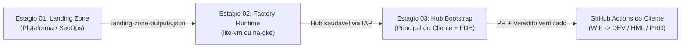

# Requisitos de Landing Zone para Clientes — Fábrica GECX (`packs/gecx`)

**Versão:** 1.0 (Validada na Fase 1b em ambiente isolado de validação GCP — 22/11/2026)  
**Audiência:** Times de Plataforma GCP, SecOps, IAM, FinOps e Engenharia de IA do Cliente  
**Escopo:** Piloto e operação controlada da Fábrica Autônoma de CX Agent Studio (GECX / CES) rodando no Google Cloud do cliente

---

## 1. Visão Geral e Separação de Responsabilidades

A fábrica roda integralmente dentro do Google Cloud do cliente. Nenhum código de produção, conversa real ou dado pessoal (PII) sai da organização do cliente.



| Estágio | Executor Recomendado | O que Provisiona | Privilégio Necessário |
| :--- | :--- | :--- | :--- |
| **01 — `01-landing-zone`** | Plataforma / SecOps do Cliente | Rede (VPC nova ou Shared VPC), Artifact Registry, 7 Service Accounts com bindings aditivos, 3 Custom Roles CES sem curingas, bucket efêmero e Budget FinOps. | Project IAM Admin + Network Admin + Billing Budgets Admin |
| **02 — `02-factory-runtime`** | Plataforma ou FDE | Perfil `lite-vm` (Shielded VM sem IP público) **ou** perfil `ha-gke` (GKE + Cloud SQL + GCS + IAP Proxy). | Compute / GKE Admin (sem IAM Admin) |
| **03 — `03-hub-bootstrap`** | **Principal do Cliente** (+ FDE) | Configurações `fail-closed` do Scion Hub, registro de SAs, publicação de skills, sync local de templates e start do `coordinator` sob posse do cliente. | Hub Admin + `roles/iam.serviceAccountUser` nas 3 SAs atribuíveis |

> [!IMPORTANT]
> **Posse obrigatória no Dia 1:** Um **principal do cliente** (nunca o FDE) deve iniciar o agente raiz (`coordinator`). O Scion suspende automaticamente agentes quando seu criador perde acesso ao projeto (`owner_access_ended`, validado ao vivo na Fase 1b).

---

## 2. Topologia de Projetos Suportada (Mesmo Código Terraform)

O módulo [deploy/01-landing-zone](../deploy/01-landing-zone) aceita três variáveis independentes (`hub_project_id`, `inference_project_id`, `sandbox_project_id`), suportando três topologias sem alteração de código:

| Topologia | Recomendado Para | Isolamento Obtido |
| :--- | :--- | :--- |
| **3 Projetos (Padrão Produção)** | Pilotos corporativos e produção | Hub/AR isolados, faturamento e cotas TPM de Vertex AI em Projeto de Inferência dedicado, apps efêmeros `[CI]` em Sandbox descartável. |
| **2 Projetos (Piloto Ágil)** | Pilotos rápidos (validado na Fase 1b) | `hub_project_id == inference_project_id` + `sandbox_project_id` descartável separado. |
| **1 Projeto (Restrito)** | Laboratório rápido em conta única | Todas as variáveis apontam para o mesmo projeto (mantém separação lógica por SA e Custom Roles). |

Ambientes superiores (**DEV / HML / PRD**) **nunca** recebem Service Accounts registradas no Scion Hub. Promoções ocorrem exclusivamente pelo CI/CD do cliente (GitHub Actions + Workload Identity Federation) após aprovação humana obrigatória no Pull Request.

---

## 3. APIs Google Cloud Obrigatórias por Projeto

| Projeto Alvo | APIs Obrigatórias | Motivo Técnico |
| :--- | :--- | :--- |
| **Hub (`hub_project_id`)** | `compute`, `oslogin`, `run`, `iap`, `artifactregistry`, `secretmanager`, `cloudbuild`, `pubsub`, `billingbudgets`, `iamcredentials`, `logging`, `monitoring` | VM/GKE, IAP SSH (`oslogin` é obrigatório com `enable-oslogin=TRUE`), registro de imagens por digest, Cloud Build opcional e alertas FinOps. |
| **Inferência (`inference_project_id`)** | `aiplatform`, `serviceusage`, `logging`, `monitoring`, `billingbudgets` | Chamadas Vertex AI (Gemini e Claude no Model Garden), cotas TPM e orçamento dedicado. |
| **Sandbox (`sandbox_project_id`)** | `ces`, `aiplatform`, `texttospeech`, `storage`, `serviceusage`, `iamcredentials`, `logging` | Apps efêmeros `[CI]`, avaliações live, áudio sintético (`BidiRunSession`) e bucket efêmero de staging (TTL 1 dia). |

---

## 4. Identidade, IAM e Isolamento Zero-PII (Zero Chaves JSON)

A arquitetura proíbe chaves estáticas JSON de Service Account. O Scion Hub emite tokens curtos via impersonação (`roles/iam.serviceAccountTokenCreator`) com `gcp_iam_check_mode: enforce` e `gcp_iam_deny_unknown_policy: fail-closed`.

### 4.1 Por que os 11 Papéis Pré-Definidos `roles/ces.*` São Proibidos

A auditoria live do catálogo IAM do Google Cloud comprovou dois problemas estruturais nos papéis pré-definidos `roles/ces.*`:

1. Todos os 11 papéis `roles/ces.*` herdam **79 permissões de `contactcenterinsights.*` e `ces.conversations.*`** (incluindo `generateSignedAudio`), violando isolamento zero-PII.
2. O papel `roles/ces.appEditor` omite `ces.agents.*`, `ces.tools.*`, `ces.toolsets.*` e `ces.guardrails.*`, fazendo `cxas push` falhar.

Por isso, o Stage 01 cria **3 Custom Roles explícitas sem curingas** no Projeto Sandbox:

- **`gecxSandboxDeployer` (64 permissões explícitas):** cria, importa, atualiza e deleta apps/agents/tools/guardrails/evals efêmeros. Zero acesso a conversas ou Insights.
- **`gecxSandboxEvaluator` (37 permissões explícitas):** lê metadados, executa `test-tools`, `runEvaluation`, `runSession` e `bidiRunSession`. Retorna **HTTP 403** em escrita de apps, exclusão e `ces.conversations.list`.
- **`gecxSandboxJanitor` (7 permissões explícitas):** lista e remove apenas apps `[CI]` expirados (`> 4h`).

### 4.2 Matriz Completa de Service Accounts (7 SAs + CES Service Agent)

| Service Account | Projeto | Registrada no Hub? | Permissões Mínimas |
| :--- | :--- | :--- | :--- |
| `<prefix>-hub@` | Hub | Runtime do Hub | `roles/iam.securityReviewer` nos projetos alvo + `roles/iam.serviceAccountTokenCreator` apenas nas 3 SAs atribuíveis (`worker`, `deployer`, `eval`) + `artifactregistry.reader` + `logging.logWriter`. |
| `<prefix>-iap@` | Hub | Não (Proxy IAP) | Zero roles de projeto (invocação interna do backend apenas). |
| `<prefix>-builder@` | Hub | Não (Cloud Build) | `artifactregistry.writer`, `logging.logWriter`, `storage.objectViewer` (exigida em projetos GCP novos no modo `--mode rebuild`). |
| `<prefix>-worker@` | Inferência | **Sim (Padrão)** | `roles/aiplatform.user`, `serviceusage.serviceUsageConsumer`, `logging.logWriter`, `monitoring.metricWriter`. |
| `<prefix>-deployer@` | Sandbox | **Sim** (`sandbox-direct`) | Custom Role `gecxSandboxDeployer` + `serviceusage.serviceUsageConsumer` + `storage.objectAdmin` no bucket de staging. |
| `<prefix>-eval@` | Sandbox | **Sim** (`sandbox-direct`) | Custom Role `gecxSandboxEvaluator` + `roles/aiplatform.user` + `serviceusage.serviceUsageConsumer` + `storage.objectViewer` no bucket de staging. |
| `<prefix>-janitor@` | Sandbox | **NUNCA** | Custom Role `gecxSandboxJanitor` + `serviceusage.serviceUsageConsumer` (usada apenas por Cloud Scheduler/CI). |
| `service-<SBX_NUM>@gcp-sa-ces...` | Sandbox | Nativa GCP | `roles/storage.objectUser` no bucket efêmero de staging (evita falha no `cxas push` com gravação de áudio). |

**Operadores Humanos (`var.factory_operator_members`):** o grupo de operadores da fábrica recebe `roles/iam.serviceAccountUser` (`actAs`) exclusivamente nas 3 SAs atribuíveis (`worker`, `deployer`, `eval`), satisfazendo `gcp_iam_check_mode: enforce` sem precisar de Editor ou Owner.

---

## 5. Rede, Acesso, Entrega de Imagens e GitHub

1. **Rede sem VPC `default`:** o Stage 01 cria VPC customizada + Private Google Access + Cloud NAT ou conecta diretamente a uma **Shared VPC** existente (`create_custom_vpc = false` + `existing_subnet_self_link`). A VM `lite-vm` é Shielded (Secure Boot + vTPM + Integrity Monitoring) e possui **zero IP público**.
2. **Acesso de Controle (IAP):** acesso administrativo exclusivamente via IAP TCP forwarding (`35.235.240.0/20`, porta 22) no perfil `lite-vm`, ou proxy HTTPS protegido por **IAP restrito à organização do cliente**.
3. **Entrega Híbrida do Release Kit (`stage-release-kit.sh`):**
   - **Modo `rebuild` (padrão — SecOps / Binary Authorization):** reconstrói a imagem dentro do projeto do cliente via `cloudbuild.yaml` usando `<prefix>-builder@`.
   - **Modo `mirror`:** espelha imagens pré-construídas por `@sha256:` digest via `crane`/`gcrane` para o Artifact Registry do cliente (recusa placeholders).
4. **GitHub (Pré-Requisito da v1):** GitHub Cloud ou GitHub Enterprise Server com proteção de branch em `main` (aprovação humana obrigatória, zero auto-merge), label humana `eval-change-approved`, e Workload Identity Federation (WIF) para o workflow de Verdict Gate (que valida o Veredito via `<prefix>-eval@` e limpa recursos efêmeros `[CI]` em `if: always()` via `<prefix>-janitor@`).
5. **Modelos Ativos na Vertex AI (Padrão Vertex-First + Opt-In Manual de Claude):** a fábrica consome modelos via **Vertex AI** por padrão (sem chaves de API, usando a SA de inferência): Antigravity com **`gemini-4-neon-high`** (default `extra-large`) e **`gemini-4-carbon-high`** / **`gemini-4-hydrogen-medium`**, mais Claude Code com **`claude-opus-5-5`** (`CLOUD_ML_REGION=global` por padrão, ajustável para `us`, `eu` ou `us-east5`). **Atenção:** habilitar modelos Anthropic Claude no **Vertex AI Model Garden** exige aceite manual de termos no Console GCP do `inference_project_id`; se o cliente não habilitar Claude, selecione `diversity_profile: cross-model` e `harnesses.claude_model_garden_enabled: false` durante o `factory-onboard` (usando `gemini-4-neon-high` + `gemini-4-carbon-high` em dois sub-agentes Antigravity).

---

## 6. Organization Policies (`constraints/*`) e Controles de Perímetro (VPC-SC)

Organizações Enterprise operam com Organization Policies restritivas na raiz ou em folders. A matriz abaixo separa o que **já funciona sem exceção** do que exige **allowlist controlada no Folder/Projeto da fábrica** (nunca relaxamento global na organização).

> [!NOTE]
> Esta matriz cobre os principais bloqueios Enterprise observados em Landing Zones Google Cloud, mas não é exaustiva. Clientes frequentemente possuem Custom Organization Policies (`custom.*`) e regras próprias de VPC-SC. Execute o comando de auditoria da Seção 6.3 no Dia 0 antes de rodar o Terraform.

### 6.1 Org Policies Já Compatíveis por Design (Zero Exceção Necessária)

Apresente esta tabela ao time de SecOps para demonstrar que o desenho respeita a postura de segurança padrão da organização:

| Constraint | Status na Fábrica | Como a Arquitetura Atende |
| :--- | :--- | :--- |
| `constraints/iam.disableServiceAccountKeyCreation` (`iam.managed.disableServiceAccountKeyCreation`) e `iam.managed.disableServiceAccountKeyUpload` | **100% Compatível** | Zero chaves JSON estáticas em toda a arquitetura (apenas tokens curtos via impersonação e WIF). |
| `constraints/compute.vmExternalIpAccess` | **100% Compatível** | A VM `lite-vm` não possui IP externo (`access_config` omitido). Todo egress sai via Cloud NAT. |
| `constraints/compute.requireShieldedVm` | **100% Compatível** | Secure Boot, vTPM e Integrity Monitoring ativos no módulo `lite-vm`. |
| `constraints/compute.requireOsLogin` | **100% Compatível** | `enable-oslogin=TRUE` na VM e `oslogin.googleapis.com` habilitada no Stage 01. |
| `constraints/compute.skipDefaultNetworkCreation` | **100% Compatível** | Stage 01 nunca usa a VPC `default` (cria VPC customizada ou conecta em Shared VPC). |
| `constraints/storage.uniformBucketLevelAccess` e `constraints/storage.publicAccessPrevention` | **100% Compatível** | Bucket efêmero do Sandbox usa Uniform Bucket-Level Access e acesso estritamente privado. |
| `constraints/cloudbuild.disableCreateDefaultServiceAccount` e `cloudbuild.useComputeServiceAccount` | **100% Compatível** | Stage 01 provisiona a SA dedicada `<prefix>-builder@` sem depender da Compute SA padrão. |
| `constraints/run.managed.requireInvokerIam` e `constraints/run.allowedIngress` | **100% Compatível** | Proxy IAP e Delta Watcher exigem autenticação IAM e ingress interno ou via Load Balancer. |

### 6.2 Org Policies que Podem Exigir Allowlist ou Adaptação no Projeto/Folder da Fábrica

| Constraint / Controle | O que Quebra se Estiver Travada | Exceção Mínima Segura (Escopo Folder/Projeto) | Alternativa sem Relaxar a Policy |
| :--- | :--- | :--- | :--- |
| `constraints/gcp.restrictServiceUsage` | Bloqueia habilitação de `ces`, `aiplatform`, `texttospeech`, `oslogin`, `iap` ou `iamcredentials`. | Liberar exclusivamente as APIs da Seção 3 nos projetos da fábrica. | Não aplicável (APIs listadas são estritamente obrigatórias). |
| `constraints/gcp.resourceLocations` | Bloqueia CES multi-region `us`, bucket `US` de staging ou endpoints Vertex AI `global` (`gemini-4-neon-high` e `claude-opus-5-5`). | Permitir `in:us-locations` (e `global` para endpoints Vertex) nos projetos de Inferência e Sandbox. | Ajustar `harnesses.vertex_claude_region` (`us`/`eu`/`us-east5`) ou `diversity_profile: cross-model` alinhado à residência aprovada. |
| `constraints/iam.disableCrossProjectServiceAccountUsage` | Impede `<prefix>-hub@` (Projeto Hub) de impersonar `<prefix>-worker@` (Inferência) e `<prefix>-deployer@`/`<prefix>-eval@` (Sandbox). | Isentar apenas o Folder dos projetos da fábrica (mantendo ativo no restante da Org). | Adotar a **topologia de 1 projeto** (`hub == inference == sandbox`), preservando o isolamento pelas 7 SAs e 3 Custom Roles. |
| `constraints/iam.allowedPolicyMemberDomains` (`iam.managed.allowedPolicyMembers`) | Bloqueia adicionar contas externas (`@google.com`) diretamente no IAM ou Hub do cliente. | **Evite relaxar.** Conceda contas do domínio do cliente aos FDEs ou opere o Hub exclusivamente com principais do cliente. | Operação 100% por principal do cliente (já exigido para posse do `coordinator` no Dia 1). |
| `constraints/iam.workloadIdentityPoolProviders` | Bloqueia criar o provedor WIF para `https://token.actions.githubusercontent.com` (ou GHES interno) usado pelo `gecx-verdict-gate.yml`. | Adicionar o issuer OIDC do GitHub do cliente à allowlist do projeto Sandbox/CI, travando `attribute_condition` na org GitHub do cliente. | Executar o CI em runner self-hosted dentro do próprio GCP do cliente com SA dedicada. |
| `constraints/compute.trustedImageProjects` | Bloqueia `ubuntu-os-cloud/ubuntu-2204-lts` no perfil `lite-vm`. | Adicionar `projects/ubuntu-os-cloud` no projeto do Hub. | Passar a **Golden Image corporativa** do cliente via `var.boot_image` em `deploy/02-factory-runtime/lite-vm` (zero exceção). |
| `constraints/cloudbuild.allowedWorkerPools` e `cloudbuild.allowedIntegrations` | Bloqueia `gcloud builds submit` no pool público padrão durante `--mode rebuild`. | Autorizar o pool privado corporativo no projeto do Hub. | Usar `--mode mirror` (espelhamento de digests) ou definir `options.pool.name` no `cloudbuild.yaml`. |
| `constraints/gcp.restrictNonCmekServices` e `gcp.restrictCmekCryptoKeyProjects` | Bloqueia criação de Artifact Registry, bucket GCS, disco da VM ou Cloud SQL sem chave Cloud KMS. | Informar a chave KMS corporativa em `var.boot_disk_kms_key_self_link` (e nos recursos de Stage 01), concedendo uso aos Service Agents. | Não aplicável (atender com CMEK corporativa). |
| **VPC Service Controls (VPC-SC) e Proxy de Egress** | Bloqueia download de pacotes durante boot da VM, chamadas cross-project Hub <-> Sandbox ou acesso à API do GitHub. | Criar regras de ingress/egress explícitas entre Hub, Inferência e Sandbox, além de saída restrita ao endpoint GitHub do cliente. | Usar Release Kit 100% offline (`--mode mirror` + espelho interno do binário do Scion) para eliminar egress para GitHub/PyPI no boot. |

### 6.3 Auditoria Obrigatória de Org Policies no Dia 0 (Read-Only)

Antes de executar o Stage 01, o time de Plataforma do cliente executa este levantamento read-only para identificar todas as policies (gerenciadas e `custom.*`) herdadas nos projetos alvo:

```bash
for P in "$HUB_PROJECT_ID" "$INFERENCE_PROJECT_ID" "$SANDBOX_PROJECT_ID"; do
  echo "=== Effective Org Policies: $P ==="
  gcloud org-policies list --project="$P" --show-unset=false
done
```

---

## 7. Controles de FinOps e Limites Honestos

> [!NOTE]
> Os controles abaixo estabelecem exposição máxima calculável (`Cota TPM x latência do Cloud Billing`) e nunca prometem "teto instantâneo zero risco". Qualquer estimativa de custo de referência usa exclusivamente preços públicos de tabela do Google Cloud e não cobre descontos ou acordos comerciais específicos do cliente.

1. **Projeto de Inferência dedicado** + **cotas explícitas de TPM** por modelo na Vertex AI (freio físico em tempo real).
2. **Limites no Scion Hub:** `default_max_duration=2h`, `default_max_turns=60`, `server.hub.auto_suspend_idle=true`.
3. **Budget Alert 70% / 90% + Kill-Switch por Revogação IAM:** ao atingir 90%, o handler remove `roles/aiplatform.user` de `<prefix>-worker@` e suspende agentes. Na validação live da Fase 1b, o corte HTTP 403 entrou em vigor em **68,6 segundos** (resistente a reativação automática via `--wake`).

---

## 8. Limite Honesto do Sandbox (`not-verifiable-in-sandbox`)

O Sandbox valida **texto**, **callbacks offline**, **tool unit tests**, **golden/simulation evals** e **áudio sintético (`Sessions.async_bidi_run_session`)**. Ele **não** simula tronco SIP, SBC, AudioCodes VAIC, áudio 8 kHz de operadora, DTMF ou transferência live para CCaaS. Mudanças que toquem essas superfícies recebem automaticamente o nível `not-verifiable-in-sandbox` e exigem aceite humano explícito.

---

## 9. Checklist Go / No-Go (Antes do Dia 1)

- [ ] Auditoria read-only de Organization Policies (`gcloud org-policies list`) e VPC-SC executada nos projetos alvo, com allowlists ou alternativas (1 projeto, Golden Image, CMEK, Private Pool) acordadas com SecOps.
- [ ] Projetos alvo criados e vinculados ao Billing Account (3, 2 ou 1 projeto).
- [ ] `01-landing-zone` aplicado pela Plataforma/SecOps e `landing-zone-outputs.json` exportado.
- [ ] Grupo de operadores do cliente incluído em `factory_operator_members` e principal do cliente definido como dono do `coordinator`.
- [ ] Perfil de diversidade escolhido (`cross-vendor`, `cross-model` ou `single-family`) e cotas TPM configuradas no Projeto de Inferência.
- [ ] Repositório GitHub com branch protection em `main`, WIF configurado para `eval@`/`janitor@` e label `eval-change-approved` criada.
- [ ] Modo de entrega de imagem definido (`mirror` vs. `rebuild`) e validado offline (`--network=none`).
