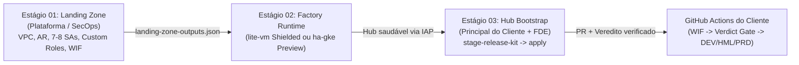
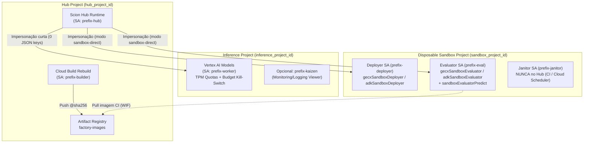

# Requisitos de Landing Zone para Clientes — Fábricas GCP FDE (`packs/gecx` e `packs/adk`)

**Versão:** `v0.4.0` (Release `acém` — 24/11/2026 BRT)
**Audiência:** Times de Plataforma GCP, SecOps, IAM, FinOps e Engenharia de IA do Cliente
**Escopo:** Piloto e operação controlada de fábricas autônomas **GECX (`packs/gecx`)** e **ADK + Gemini Enterprise (`packs/adk`)** dentro do Google Cloud do cliente

---

## 1. Visão Geral e Separação de Responsabilidades

A fábrica roda integralmente dentro da organização Google Cloud do cliente. Nenhum código de produção, conversa real ou dado pessoal (PII) sai do perímetro do cliente.



| Estágio | Executor Recomendado | O que Provisiona | Privilégio Necessário |
| :--- | :--- | :--- | :--- |
| **01 — `01-landing-zone`** | Plataforma / SecOps do Cliente | Rede (VPC nova ou Shared VPC), Artifact Registry, **7 SAs base** (+ opcional 8ª SA `kaizen_viewer`), **Custom Roles explícitas sem curingas** (`sandboxEvaluatorPredict`, 3 roles GECX e/ou 3 roles ADK), opcional GitHub WIF, bucket efêmero e Budget FinOps. | Project IAM Admin + Network Admin + Billing Budgets Admin |
| **02 — `02-factory-runtime`** | Plataforma ou FDE | Perfil **`lite-vm`** (Shielded VM sem IP público, SHA-256 pinado do binário Scion) **ou** **`ha-gke`** *(Preview Contract Bridge exportando parâmetros validados para o módulo Terraform oficial do Scion)*. | Compute / GKE Admin (sem IAM Admin) |
| **03 — `03-hub-bootstrap`** | **Principal do Cliente** (+ FDE) | Rebuild/espelhamento de imagens por `@sha256:`, configurações `fail-closed` do Scion Hub, registro de SAs, skills, harness-configs Vertex AI globais, templates, agenda `weekly-kaizen` e start do `coordinator` sob posse do cliente. | Hub Admin + `roles/iam.serviceAccountUser` nas SAs atribuíveis + `cloudbuild.builds.editor` (modo `rebuild`) |

> [!IMPORTANT]
> **Posse obrigatória no Dia 1:** Um **principal do cliente** (nunca o FDE) deve iniciar o agente raiz (`coordinator`). O Scion suspende automaticamente agentes quando seu criador perde acesso ao projeto (`owner_access_ended`).

---

## 2. Topologia de Projetos Suportada (Mesmo Código Terraform)



O módulo [deploy/01-landing-zone](../deploy/01-landing-zone) aceita três variáveis independentes (`hub_project_id`, `inference_project_id`, `sandbox_project_id`), suportando três topologias sem alteração de código:

| Topologia | Recomendado Para | Isolamento Obtido |
| :--- | :--- | :--- |
| **3 Projetos (Padrão Produção)** | Pilotos corporativos e produção | Hub/AR isolados, faturamento e cotas TPM de Vertex AI em Projeto de Inferência dedicado, apps e agentes `[CI]` em Sandbox descartável. |
| **2 Projetos (Piloto Ágil)** | Pilotos rápidos | `hub_project_id == inference_project_id` + `sandbox_project_id` descartável separado. |
| **1 Projeto (Restrito)** | Laboratório ou `disableCrossProjectServiceAccountUsage` | Todas as variáveis apontam para o mesmo projeto, mantendo separação lógica por SA e Custom Roles. |

Ambientes superiores (**DEV / HML / PRD**) **nunca** recebem Service Accounts registradas no Scion Hub. Promoções ocorrem exclusivamente pelo CI/CD do cliente após aprovação humana obrigatória no Pull Request.

---

## 3. APIs Google Cloud Obrigatórias por Projeto

| Projeto Alvo | APIs Obrigatórias | Motivo Técnico |
| :--- | :--- | :--- |
| **Hub (`hub_project_id`)** | `compute`, `oslogin`, `run`, `iap`, `artifactregistry`, `secretmanager`, `cloudbuild`, `pubsub`, `billingbudgets`, `iamcredentials`, `logging`, `monitoring` | VM/GKE, IAP SSH (`oslogin` é obrigatório com `enable-oslogin=TRUE`), Artifact Registry por digest, Cloud Build `--mode rebuild` e alertas FinOps. |
| **Inferência (`inference_project_id`)** | `aiplatform`, `serviceusage`, `logging`, `monitoring`, `billingbudgets` | Chamadas Vertex AI (Gemini 1P e Claude opt-in no Model Garden), cotas TPM e orçamento dedicado. |
| **Sandbox (`sandbox_project_id`)** | **Base:** `aiplatform`, `storage`, `serviceusage`, `iamcredentials`, `logging` • **Se `enable_gecx_sandbox_roles=true`:** `ces`, `texttospeech` • **Se `enable_adk_sandbox_roles=true`:** `discoveryengine` | Apps efêmeros CES (`[CI]`), áudio sintético (`BidiRunSession`), Vertex AI Agent Engine (`reasoningEngines`), registro Gemini Enterprise (`discoveryengine`) e bucket efêmero (TTL 1 dia). |

---

## 4. Identidade, IAM e Isolamento Zero-PII (Zero Chaves JSON)

A arquitetura proíbe chaves estáticas JSON de Service Account. O Scion Hub emite tokens curtos via impersonação (`roles/iam.serviceAccountTokenCreator`) com `gcp_iam_check_mode: enforce` e `gcp_iam_deny_unknown_policy: fail-closed`.

### 4.1 Custom Roles Explícitas Sem Curingas no Projeto Sandbox

1. **Por que os 11 papéis pré-definidos `roles/ces.*` são proibidos:** todos herdam **79 permissões de `contactcenterinsights.*` e `ces.conversations.*`** (violando zero-PII), enquanto `roles/ces.appEditor` omite `ces.agents.*`, `ces.tools.*`, `ces.toolsets.*` e `ces.guardrails.*`.
2. **Por que `roles/aiplatform.user` é proibido na Evaluator SA:** ele permite criar/mutar `reasoningEngines`. Substituímos pela Custom Role explícita **`sandboxEvaluatorPredict`** (`aiplatform.endpoints.predict` apenas).

| Custom Role (Sandbox) | Quando Criada | Permissões Explícitas | Finalidade |
| :--- | :--- | :--- | :--- |
| **`sandboxEvaluatorPredict`** | Sempre | `aiplatform.endpoints.predict` (1 perm) | Permite predição de modelos na avaliação sem poder criar ou alterar `reasoningEngines`. |
| **`gecxSandboxDeployer`** | `enable_gecx_sandbox_roles=true` | 64 perms explícitas de metadados + escrita CES | Cria, importa, atualiza e remove apps `[CI]` no Sandbox (zero conversas/Insights). |
| **`gecxSandboxEvaluator`** | `enable_gecx_sandbox_roles=true` | 37 perms explícitas de leitura + `runEvaluation` + `bidiRunSession` | Roda avaliações e áudio sintético; retorna HTTP 403 em escrita de app e `ces.conversations.list`. |
| **`gecxSandboxJanitor`** | `enable_gecx_sandbox_roles=true` | 7 perms explícitas (`apps.list/get/delete`, `locations`, `operations`) | Limpa apps `[CI]` expirados (`> 4h`). |
| **`adkSandboxDeployer`** | `enable_adk_sandbox_roles=true` | 11 perms (`aiplatform.reasoningEngines.*` + `discoveryengine.agents.*`) | Implanta `reasoningEngines` e registra/PATCHa agentes `[CI]` no Gemini Enterprise Sandbox. |
| **`adkSandboxEvaluator`** | `enable_adk_sandbox_roles=true` | 5 perms (`reasoningEngines.get/list/query`, `discoveryengine.agents.get/list`) | Executa `adk eval` e leitura independente de proveniência no CI sem poder mutar recursos. |
| **`adkSandboxJanitor`** | `enable_adk_sandbox_roles=true` | 6 perms (`reasoningEngines.get/list/delete`, `discoveryengine.agents.get/list/delete`) | Varre e remove `reasoningEngines` (`?force=true`) e agentes GE `[CI]` expirados. |

### 4.2 Matriz Completa de Service Accounts (7 SAs Base + 1 Opcional + CES Service Agent)

| Service Account | Projeto | Registrada no Hub? | Permissões Mínimas |
| :--- | :--- | :--- | :--- |
| `<prefix>-hub@` | Hub | Runtime do Hub | `roles/iam.securityReviewer` nos projetos alvo + `roles/iam.serviceAccountTokenCreator` apenas nas SAs atribuíveis (`worker`, `deployer`, `eval`, e `kaizen` se ativo) + `artifactregistry.reader` + `logging.logWriter`. |
| `<prefix>-iap@` | Hub | Não (Proxy IAP) | Zero roles de projeto (invocação interna do backend apenas). |
| `<prefix>-builder@` | Hub | Não (Cloud Build) | `artifactregistry.writer`, `logging.logWriter`, `storage.objectViewer` (usada no `--mode rebuild`). |
| `<prefix>-worker@` | Inferência | **Sim (Padrão)** | `roles/aiplatform.user`, `serviceusage.serviceUsageConsumer`, `logging.logWriter`, `monitoring.metricWriter`. |
| `<prefix>-deployer@` | Sandbox | **Sim** (`sandbox-direct`) | `gecxSandboxDeployer` e/ou `adkSandboxDeployer` + `serviceusage.serviceUsageConsumer` + `storage.objectAdmin` no bucket de staging. |
| `<prefix>-eval@` | Sandbox | **Sim** (`sandbox-direct`) | `gecxSandboxEvaluator` e/ou `adkSandboxEvaluator` + **`sandboxEvaluatorPredict`** + `serviceusage.serviceUsageConsumer` + `storage.objectViewer` (bucket de staging) + **`artifactregistry.reader` no Hub** (pull de imagem no CI). |
| `<prefix>-janitor@` | Sandbox | **NUNCA** | `gecxSandboxJanitor` e/ou `adkSandboxJanitor` + `serviceusage.serviceUsageConsumer` (usada apenas via WIF no CI `if: always()` e por Cloud Scheduler operado pelo cliente). |
| `<prefix>-kaizen@` *(opcional)* | Inferência | **Sim** (se `enable_kaizen_gcp_obs=true`) | `roles/monitoring.viewer` (Inferência) + `roles/logging.viewer` (Sandbox) para coleta Tier B read-only. |
| `service-<SBX_NUM>@gcp-sa-ces...` | Sandbox | Nativa GCP (`enable_gecx_sandbox_roles=true`) | `roles/storage.objectUser` no bucket efêmero de staging (evita falha no `cxas push`). |

- **Operadores Humanos (`var.factory_operator_members`):** recebem `roles/iam.serviceAccountUser` nas SAs atribuíveis e na `<prefix>-builder@`, além de `roles/cloudbuild.builds.editor` no Hub para rodar `stage-release-kit.sh --mode rebuild` sem precisar de Editor/Owner.
- **GitHub Actions WIF (`var.enable_github_wif = true` + `var.github_repository = "org/repo"`):** provisiona pool + provider OIDC restrito por `assertion.repository == var.github_repository` com `roles/iam.workloadIdentityUser` apenas em `<prefix>-eval@` e `<prefix>-janitor@`.
- **Jobs agendados fora do Hub:** o Stage 01 provisiona as SAs e permissões, enquanto o agendamento horário do Janitor (`packs/gecx/scripts/sandbox-janitor.py` ou `packs/adk/scripts/sandbox_janitor.py`) e do Delta Watcher (`scripts/delta-watcher/watcher.py`) fica sob o Cloud Scheduler / Cloud Run Job ou CI do operador do cliente.

---

## 5. Rede, Acesso, Entrega de Imagens, GitHub e Modelos Vertex AI

1. **Rede sem VPC `default`:** Stage 01 cria VPC customizada + Private Google Access + Cloud NAT ou conecta a uma **Shared VPC** existente (`create_custom_vpc = false`). A VM `lite-vm` é Shielded e possui **zero IP público**.
2. **Acesso de Controle (IAP):** acesso administrativo exclusivamente via IAP TCP forwarding (`35.235.240.0/20`, porta 22) no perfil `lite-vm`, ou proxy HTTPS protegido por IAP restrito à organização do cliente.
3. **Entrega Híbrida do Release Kit (`stage-release-kit.sh`):**
   - **Modo `rebuild` (padrão — SecOps / Binary Authorization):** reconstrói a imagem lean de CI (`<pack>-runtime`) e, quando `--antigravity-base-image` / `--claude-base-image` são informados, reconstrói também as imagens completas de agente Scion com `sciontool` e carimba os `@sha256:` reais no `manifest.json` e nos `harness-configs/*/config.yaml`.
   - **Modo `mirror`:** espelha imagens já construídas por `@sha256:` via `crane`/`gcrane` (recusa placeholders `REPLACE_` ou digests zerados).
4. **GitHub (Pré-Requisito da v1):** proteção de branch em `main` (aprovação humana obrigatória, zero auto-merge), labels `eval-change-approved` e `no-verdict-approved` (para PRs docs-only), e variáveis de repositório (`GCP_WIF_PROVIDER`, `<PACK>_RUNTIME_IMAGE_DIGEST`, `<PACK>_SANDBOX_PROJECT_ID`, `<PACK>_EVALUATOR_SA_EMAIL`, `<PACK>_JANITOR_SA_EMAIL`).
5. **Modelos Ativos na Vertex AI (Padrão Vertex-First + Tiers Genéricos + Opt-In Manual de Claude):**
   - Por padrão, os scaffolds iniciam com **`diversity_profile: cross-model`** e **`harnesses.claude_model_garden_enabled: false`** (100% Vertex AI Gemini 1P usando tiers genéricos Scion `extra-large`, `large` e `medium`, com `GOOGLE_CLOUD_LOCATION=global`), garantindo funcionamento imediato no Dia 1 sem dependência de termos de terceiros.
   - Para ativar revisão **`cross-vendor`** com Anthropic Claude via Vertex AI (`claude-vertex`, `CLOUD_ML_REGION=global`), o cliente aceita manualmente os termos do modelo no **Vertex AI Model Garden** no `inference_project_id` e define `harnesses.claude_model_garden_enabled: true`. O bootstrap falha fechado caso `cross-vendor` ou `claude-vertex` seja solicitado com o opt-in desligado.

---

## 6. Organization Policies (`constraints/*`) e Controles de Perímetro (VPC-SC)

> [!NOTE]
> Esta matriz cobre os principais bloqueios Enterprise observados em Landing Zones Google Cloud, mas não é exaustiva. Execute o comando read-only da Seção 6.3 no Dia 0 antes de rodar o Terraform.

### 6.1 Org Policies Já Compatíveis por Design (Zero Exceção Necessária)

| Constraint | Status na Fábrica | Como a Arquitetura Atende |
| :--- | :--- | :--- |
| `constraints/iam.disableServiceAccountKeyCreation` / `disableServiceAccountKeyUpload` | **100% Compatível** | Zero chaves JSON estáticas (apenas tokens curtos via impersonação e WIF). |
| `constraints/compute.vmExternalIpAccess` | **100% Compatível** | VM `lite-vm` sem IP externo (`access_config` omitido); egress via Cloud NAT. |
| `constraints/compute.requireShieldedVm` | **100% Compatível** | Secure Boot, vTPM e Integrity Monitoring ativos na `lite-vm`. |
| `constraints/compute.requireOsLogin` | **100% Compatível** | `enable-oslogin=TRUE` e `oslogin.googleapis.com` habilitada no Stage 01. |
| `constraints/compute.skipDefaultNetworkCreation` | **100% Compatível** | Stage 01 nunca usa VPC `default` (VPC customizada ou Shared VPC). |
| `constraints/storage.uniformBucketLevelAccess` e `publicAccessPrevention` | **100% Compatível** | Bucket efêmero do Sandbox usa Uniform Bucket-Level Access e acesso privado. |
| `constraints/cloudbuild.disableCreateDefaultServiceAccount` e `useComputeServiceAccount` | **100% Compatível** | Stage 01 provisiona `<prefix>-builder@` dedicada. |
| `constraints/run.managed.requireInvokerIam` e `allowedIngress` | **100% Compatível** | Proxy IAP e Delta Watcher exigem autenticação IAM e ingress restrito. |

### 6.2 Org Policies que Podem Exigir Allowlist ou Adaptação no Projeto/Folder

| Constraint / Controle | O que Quebra se Estiver Travada | Exceção Mínima Segura (Folder/Projeto) | Alternativa sem Relaxar a Policy |
| :--- | :--- | :--- | :--- |
| `constraints/gcp.restrictServiceUsage` | Bloqueia APIs da Seção 3 (`ces`, `discoveryengine`, `aiplatform`, `texttospeech`, `oslogin`, `iap`, `iamcredentials`). | Liberar apenas as APIs da Seção 3 nos projetos da fábrica. | Não aplicável (APIs obrigatórias). |
| `constraints/gcp.resourceLocations` | Bloqueia CES multi-region `us`, bucket `US` ou endpoints Vertex AI `global`. | Permitir `in:us-locations` e `global` nos projetos de Inferência e Sandbox. | Ajustar `harnesses.vertex_gemini_location` / `vertex_claude_region` para região aprovada (`us`/`eu`/`us-east5`). |
| `constraints/iam.disableCrossProjectServiceAccountUsage` | Impede `<prefix>-hub@` de impersonar SAs em Inferência/Sandbox. | Isentar apenas o Folder da fábrica. | Adotar a **topologia de 1 projeto** (`hub == inference == sandbox`). |
| `constraints/iam.allowedPolicyMemberDomains` | Bloqueia contas externas no IAM/Hub. | **Evite relaxar.** Conceda identidades do domínio do cliente aos FDEs ou opere só com principais do cliente. | Operação 100% por principal do cliente. |
| `constraints/iam.workloadIdentityPoolProviders` | Bloqueia provedor OIDC `https://token.actions.githubusercontent.com`. | Liberar o issuer GitHub do cliente no Sandbox com `attribute_condition` travada em `owner/repo`. | Runner CI self-hosted dentro do GCP do cliente. |
| `constraints/compute.trustedImageProjects` | Bloqueia `ubuntu-os-cloud/ubuntu-2204-lts` na `lite-vm`. | Liberar `projects/ubuntu-os-cloud` no projeto do Hub. | Passar a Golden Image corporativa em `var.boot_image`. |
| `constraints/cloudbuild.allowedWorkerPools` | Bloqueia `gcloud builds submit` no pool padrão. | Autorizar pool privado corporativo no Hub. | Usar `--mode mirror` ou definir `options.pool.name`. |
| `constraints/gcp.restrictNonCmekServices` | Bloqueia recursos sem Cloud KMS. | Configurar chave CMEK em `var.boot_disk_kms_key_self_link` e recursos do Stage 01. | Não aplicável (atender com CMEK corporativa). |
| **VPC Service Controls (VPC-SC)** | Bloqueia egress para GitHub/PyPI ou chamadas cross-project. | Regras explícitas de ingress/egress entre Hub, Inferência e Sandbox. | Release Kit 100% offline (`--mode mirror` + binário Scion em mirror interno). |

### 6.3 Auditoria Obrigatória de Org Policies no Dia 0 (Read-Only)

```bash
for P in "$HUB_PROJECT_ID" "$INFERENCE_PROJECT_ID" "$SANDBOX_PROJECT_ID"; do
  echo "=== Effective Org Policies: $P ==="
  gcloud org-policies list --project="$P" --show-unset=false
done
```

---

## 7. Controles de FinOps e Limites Honestos

> [!NOTE]
> Os controles abaixo estabelecem exposição máxima calculável (`Cota TPM x latência do Cloud Billing`) e não garantem teto instantâneo zero risco. Qualquer estimativa de custo de referência considera exclusivamente preços públicos de tabela do Google Cloud e não cobre descontos ou acordos comerciais específicos do cliente.

1. **Projeto de Inferência dedicado** + **cotas explícitas de TPM** por modelo na Vertex AI (freio físico em tempo real).
2. **Limites no Scion Hub:** `default_max_duration=2h`, `default_max_turns=60`, `default_max_model_calls=150`, `server.hub.auto_suspend_idle=true`.
3. **Budget Alert 70% / 90% + Kill-Switch por Revogação IAM:** ao atingir 90%, o handler remove `roles/aiplatform.user` de `<prefix>-worker@` e suspende agentes.

---

## 8. Limite Honesto do Sandbox (`not-verifiable-in-sandbox`)

- **GECX (`packs/gecx`):** valida texto, callbacks offline, tool unit tests, golden/simulation evals e áudio sintético (`Sessions.async_bidi_run_session`). **Não** simula tronco SIP, SBC, AudioCodes VAIC, áudio 8 kHz de operadora, DTMF ou transferência live para CCaaS.
- **ADK (`packs/adk`):** valida `pytest`, contrato `Dockerfile`, bundle `ge_export.py`, `adk eval` live e registro `[CI]` no Gemini Enterprise Sandbox. Conectores corporativos privados sem mock ou integrações OAuth de produção exigem aceite humano explícito.

---

## 9. Checklist Go / No-Go (Antes do Dia 1)

- [ ] Auditoria read-only de Organization Policies (`gcloud org-policies list`) e VPC-SC executada nos projetos alvo.
- [ ] Projetos alvo criados e vinculados ao Billing Account (3, 2 ou 1 projeto).
- [ ] `01-landing-zone` aplicado pela Plataforma/SecOps (com `enable_gecx_sandbox_roles`, `enable_adk_sandbox_roles`, `enable_github_wif` e `enable_kaizen_gcp_obs` conforme o pack) e `landing-zone-outputs.json` exportado.
- [ ] Grupo de operadores incluído em `factory_operator_members` e principal do cliente definido como dono do `coordinator`.
- [ ] Perfil de diversidade escolhido (`cross-model` padrão 1P Gemini ou `cross-vendor` com aceite manual de Claude no Model Garden) e cotas TPM configuradas.
- [ ] Repositório GitHub com branch protection em `main`, WIF configurado (`GCP_WIF_PROVIDER`), imagem digest pinada (`<PACK>_RUNTIME_IMAGE_DIGEST`) e labels `eval-change-approved` / `no-verdict-approved` criadas.
- [ ] Modo de entrega de imagem definido (`rebuild` com imagens base Scion ou `mirror` com digests reais) e verificado.
