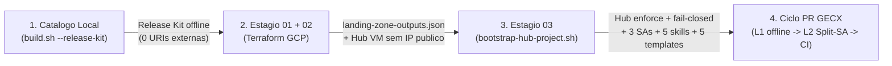
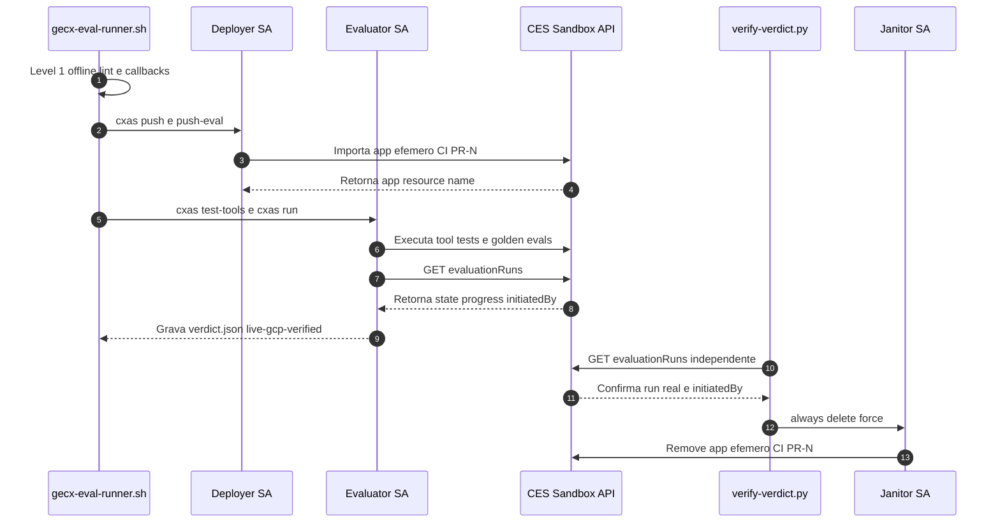

# Guia Didático Hands-On — Fábrica Autônoma GECX do Zero (`gcp-fde-factories`)

**Audiência:** FDEs e engenheiros Google Cloud executando o fluxo completo de `packs/gecx` do zero para entender cada estágio e fronteira de segurança.

## 1. Visão Macro (4 Peças Independentes)



**Fallback ASCII:**

```text
[1. Catalogo Local] --(Release Kit offline)--> [2. Terraform 01+02 (Rede, IAM, VM)]
                                                         |
                                      (landing-zone-outputs.json + Hub VM via IAP)
                                                         v
[4. Ciclo PR GECX (L1 -> L2 -> CI)] <--(Hub hardened + SAs + Templates)-- [3. Bootstrap 03]
```

## 2. Script Interativo Local (`scripts/hands-on-walkthrough.sh`)

Execute o script passo a passo (ele pausa antes de cada etapa e explica o porquê de cada comando):

```bash
./scripts/hands-on-walkthrough.sh --step 1
./scripts/hands-on-walkthrough.sh --step 2
./scripts/hands-on-walkthrough.sh --step 3
./scripts/hands-on-walkthrough.sh --step 4
./scripts/hands-on-walkthrough.sh --step 5
```

Para inspecionar uma Hub VM já implantada via IAP SSH (passo 6):

```bash
./scripts/hands-on-walkthrough.sh \
  --step 6 \
  --gcloud-config <SEU_CONFIG_GCLOUD> \
  --hub-project <SEU_HUB_PROJECT_ID> \
  --hub-vm <SEU_HUB_VM_NAME>
```

## 3. Passo a Passo Completo (Do Zero ao Teardown)

### Passo 1 — Validar o Catálogo e Gerar o Release Kit Offline

```bash
uv venv .venv --python 3.12
uv pip install --python .venv/bin/python -e ".[dev]"
./build.sh --check packs/gecx
./build.sh --test
./build.sh --release-kit packs/gecx --out /tmp/gecx-kit
```

### Passo 2 — Criar Projetos Alvo e Aplicar Stage 01 (`deploy/01-landing-zone`)

Copie [deploy/01-landing-zone/example.tfvars](../deploy/01-landing-zone/example.tfvars) para `/tmp/stage01.tfvars`, preencha `hub_project_id`, `inference_project_id`, `sandbox_project_id`, `billing_account_id` e `factory_operator_members`, e execute:

```bash
export GOOGLE_OAUTH_ACCESS_TOKEN="$(gcloud --configuration=<CONFIG> auth print-access-token)"
terraform -chdir=deploy/01-landing-zone init
terraform -chdir=deploy/01-landing-zone apply -var-file=/tmp/stage01.tfvars
terraform -chdir=deploy/01-landing-zone output -json > /tmp/landing-zone-outputs.json
```

### Passo 3 — Aplicar Stage 02 (`deploy/02-factory-runtime/lite-vm` ou `ha-gke`)

```bash
jq '{
  hub_project_id: .hub_project_id.value,
  region: .region.value,
  zone: .zone.value,
  name_prefix: .name_prefix.value,
  subnet_self_link: .subnet_self_link.value,
  hub_sa_email: .hub_sa_email.value,
  artifact_registry_url: .artifact_registry_url.value
}' /tmp/landing-zone-outputs.json > /tmp/stage02.tfvars.json

terraform -chdir=deploy/02-factory-runtime/lite-vm init
terraform -chdir=deploy/02-factory-runtime/lite-vm apply -var-file=/tmp/stage02.tfvars.json
```

### Passo 4 — Publicar Imagem por Digest (`mirror` ou `rebuild`) e Validar Offline (`--network=none`)

```bash
/tmp/gecx-kit/bootstrap/stage-release-kit.sh \
  --mode rebuild \
  --gcloud-config <CONFIG> \
  --kit /tmp/gecx-kit \
  --landing-zone /tmp/landing-zone-outputs.json
```

### Passo 5 — Reconciliar o Hub no Stage 03 (`deploy/03-hub-bootstrap/bootstrap-hub-project.sh`)

```bash
./deploy/03-hub-bootstrap/bootstrap-hub-project.sh preflight --kit /tmp/gecx-kit --hub http://127.0.0.1:8080
./deploy/03-hub-bootstrap/bootstrap-hub-project.sh plan      --kit /tmp/gecx-kit --hub http://127.0.0.1:8080
./deploy/03-hub-bootstrap/bootstrap-hub-project.sh apply     --kit /tmp/gecx-kit --hub http://127.0.0.1:8080 \
  --landing-zone /tmp/landing-zone-outputs.json
```

### Passo 6 — Ciclo Split-SA de PR (`gecx-eval-runner.sh` -> `verify-verdict.py` -> Janitor)



Consulte [CUSTOMER_LANDING_ZONE_REQUIREMENTS.md](CUSTOMER_LANDING_ZONE_REQUIREMENTS.md) para a lista completa de APIs, 7 Service Accounts, 3 Custom Roles sem curingas e checklist Go/No-Go.
