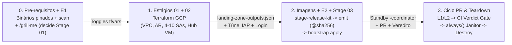
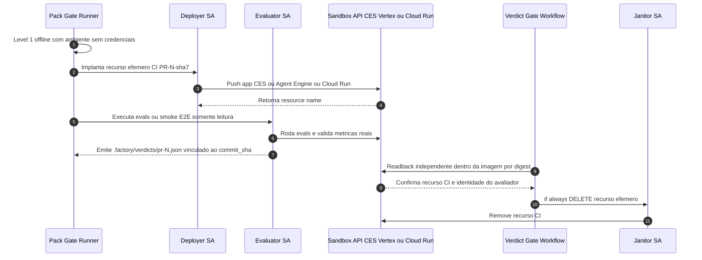

# Guia Didático Hands-On — Fábricas Autônomas do Zero ao Teardown (`packs/gecx`, `packs/adk` e `packs/generic`)

**Versão:** `v0.6.0` (`contra-filé`) · **Scion Pinado:** `v0.4.0-preview.3`
**Audiência:** FDEs e engenheiros Google Cloud executando o fluxo completo de `packs/gecx`, `packs/adk` ou `packs/generic` (`sw-*`) do zero até o teardown a `$0`, sem passos ocultos.

---

## 1. Visão Macro e Ordem Correta Sem Paradoxo



---

## 2. Script Interativo Local (`scripts/hands-on-walkthrough.sh`)

O script executa os passos locais de verificação e build para **qualquer um dos 3 packs** (`--pack gecx`, `--pack adk` ou `--pack generic`), pausando antes de cada etapa para explicar o porquê:

```bash
# Escolha --pack gecx, --pack adk ou --pack generic
./scripts/hands-on-walkthrough.sh --pack generic --step 1   # Static Catalog Gate (--check)
./scripts/hands-on-walkthrough.sh --pack generic --step 2   # Full Offline Unit Test Suite (--test)
./scripts/hands-on-walkthrough.sh --pack generic --step 3   # Build Offline Release Kit (--release-kit)
./scripts/hands-on-walkthrough.sh --pack generic --step 4   # Terraform Validate (01 + lite-vm + ha-gke)
./scripts/hands-on-walkthrough.sh --pack generic --step 5   # Contract Canaries (GECX/ADK; Scion snapshot-only)
```

Para inspecionar uma Hub VM já implantada via IAP SSH (**Step 6**):

```bash
./scripts/hands-on-walkthrough.sh \
  --step 6 \
  --gcloud-config <SEU_CONFIG_GCLOUD> \
  --hub-project <SEU_HUB_PROJECT_ID> \
  --hub-vm <SEU_HUB_VM_NAME>
```

---

## 3. Fluxo Completo de Implantação em Cliente (Do Zero ao Teardown)

### Etapa 0 — Pré-Requisitos Locais & Binário `scion` Pinado

Garanta os binários locais antes de começar: `gcloud`, `terraform` (`>= 1.6`, conforme `deploy/01-landing-zone/versions.tf`), `jq`, `uv`, `python3` com `PyYAML` instalado (usado por `parse_hub_project.py` no Stage 03), `crane` (apenas se usar `--mode mirror`) e o **CLI `scion` exato listado em `compat.yaml`** (`v0.4.0-preview.3` — o `preflight` do Stage 03 aborta se a versão divergir):

```bash
# Instale o scion v0.4.0-preview.3 verificando o SHA-256 exato de compat.yaml
SCION_VER="v0.4.0-preview.3"
SCION_SHA="d210505c58393f68ae719bc6185e71a3f0455caa1dce6e7798d6bc355663e17f"
curl -fsSLO "https://github.com/GoogleCloudPlatform/scion/releases/download/${SCION_VER}/scion-linux-amd64.tar.gz"
echo "${SCION_SHA}  scion-linux-amd64.tar.gz" | sha256sum -c -
tar -xzf scion-linux-amd64.tar.gz -C ~/.local/bin scion && rm -f scion-linux-amd64.tar.gz
scion version
```

### Etapa A — Validar o Catálogo e Gerar o Release Kit Offline

Escolha `PACK=gecx` (`16` templates, `11` skills), `PACK=adk` (`16` templates, `18` skills com `agents-cli` nativo) ou `PACK=generic` (`15` templates `sw-*`, `10` skills):

```bash
PACK=generic   # ou gecx / adk
uv venv .venv --python 3.12
uv pip install --python .venv/bin/python -e ".[dev]"
./build.sh --check "packs/${PACK}"
./build.sh --test
./build.sh --release-kit "packs/${PACK}" --out "/tmp/${PACK}-kit"
```

### Etapa E1 (Para Repos Brownfield — **Antes** do Stage 01) — Scan 0-Token & `/grill-me`

Para repositórios já existentes, rode o `scan` e conduza a entrevista `/grill-me` **antes do Stage 01**, pois as respostas do PO (`deploy_target`, `mode`, `enable_sandbox_project`, `existing_hub`) definem os toggles do Terraform:

```bash
.venv/bin/python core-gcp-fde/scripts/factory_onboard.py scan \
  --repo /caminho/do/repo-cliente \
  --pack "${PACK}" \
  --track complete \
  --emit-draft /tmp/factory-profile-draft.yaml \
  --json

# Conduza o /grill-me de 6 pilares com o PO preenchendo /tmp/factory-profile-draft.yaml,
# depois valide o portao de prontidao ate "ready": true:
.venv/bin/python core-gcp-fde/scripts/factory_onboard.py check \
  --profile /tmp/factory-profile-draft.yaml --json
```

### Etapa B — Aplicar Stage 01 (`deploy/01-landing-zone`)

Copie [deploy/01-landing-zone/example.tfvars](../deploy/01-landing-zone/example.tfvars) para `/tmp/stage01.tfvars`.

> [!WARNING]
> **Pegadinha importante de IAM (`variables.tf`):** `enable_gecx_sandbox_roles` vem **`true` por padrão**. Ao implantar `packs/adk` ou `packs/generic`, defina explicitamente **`enable_gecx_sandbox_roles = false`** para evitar criar 65 permissões CES e habilitar `ces.googleapis.com` sem necessidade.

- **`packs/gecx`:** `enable_gecx_sandbox_roles = true`
- **`packs/adk`:** `enable_gecx_sandbox_roles = false` e `enable_adk_sandbox_roles = true` (cria também `<name_prefix>-adk-runtime@` no Sandbox — `ADR-013`)
- **`packs/generic` com Cloud Run Sandbox:** `enable_gecx_sandbox_roles = false` e `enable_generic_sandbox_roles = true` (`iam_generic.tf`)
- **Exceção CI-only / `deploy_target: none` sem Sandbox:** `enable_sandbox_project = false` e `enable_gecx_sandbox_roles = false` (omite SAs de Sandbox e move o staging bucket para `hub_project_id`)
- **GitHub Actions WIF keyless:** `enable_github_wif = true` e `github_repository = "org/repo"` *(observação: no Stage 01 atual, o WIF só é provisionado quando `enable_sandbox_project = true`)*
- **Org Policy Domain Restricted Sharing (DRS):** se `billing-budget-alert@system.gserviceaccount.com` for bloqueada, defina `enable_budget_pubsub_topic = false` (`HC-04 F2`)

```bash
export GOOGLE_OAUTH_ACCESS_TOKEN="$(gcloud --configuration=<CONFIG> auth print-access-token)"
terraform -chdir=deploy/01-landing-zone init
terraform -chdir=deploy/01-landing-zone apply -var-file=/tmp/stage01.tfvars
terraform -chdir=deploy/01-landing-zone output -json > /tmp/landing-zone-outputs.json
```

### Etapa C — Aplicar Stage 02 (`deploy/02-factory-runtime/lite-vm`)

*(Nota: `deploy/02-factory-runtime/ha-gke` é uma ponte de contrato sem blocos `resource` — ela valida outputs do Stage 01 e emite parâmetros para o módulo Terraform/Helm upstream do Scion. Um único Hub `lite-vm` suporta várias fábricas em paralelo — validado no `HC-09`.)*

```bash
jq '{
  hub_project_id: .hub_project_id.value,
  region: .region.value,
  zone: .zone.value,
  name_prefix: .name_prefix.value,
  subnet_self_link: .subnet_self_link.value,
  hub_sa_email: .hub_sa_email.value,
  artifact_registry_url: .artifact_registry_url.value
}' /tmp/landing-zone-outputs.json > /tmp/stage02.tfvars.json

terraform -chdir=deploy/02-factory-runtime/lite-vm init
terraform -chdir=deploy/02-factory-runtime/lite-vm apply -var-file=/tmp/stage02.tfvars.json
```

### Etapa D — Construir Imagens por Digest (`stage-release-kit.sh`)

Constrói **a imagem lean de CI (`<pack>-runtime`)** e **a imagem de agente Scion com `sciontool` (`<pack>-antigravity-runtime`)** dentro do `hub_project_id` do cliente e carimba os `@sha256:` reais no `manifest.json` e nos `harness-configs/*/config.yaml`:

```bash
"/tmp/${PACK}-kit/bootstrap/stage-release-kit.sh" \
  --mode rebuild \
  --gcloud-config <CONFIG> \
  --kit "/tmp/${PACK}-kit" \
  --landing-zone /tmp/landing-zone-outputs.json \
  --antigravity-base-image ghcr.io/homebrew-scion/scion-antigravity:v0.4.0-preview.3
```

*(Adicione `--claude-base-image ghcr.io/homebrew-scion/scion-claude:v0.4.0-preview.3` quando `harnesses.claude_model_garden_enabled: true`.)*

### Etapa E2 (Pós-Digest) — Emitir Knowledge Plane & Abrir Acesso ao Hub

Agora que o digest `@sha256:` existe no `manifest.json`, materialize o Layer 3 (`.factory/`) no repositório cliente e abra o túnel IAP + autenticação no Scion Hub:

```bash
# 1. Leia o digest carimbado na Etapa D e emita o overlay zero-clobber + Knowledge Plane
PACK_IMAGE_DIGEST="$(jq -r ".images[\"${PACK}-antigravity-runtime\"]" "/tmp/${PACK}-kit/manifest.json")"

.venv/bin/python core-gcp-fde/scripts/factory_onboard.py emit \
  --repo /caminho/do/repo-cliente \
  --profile /tmp/factory-profile-draft.yaml \
  --pack-image "$PACK_IMAGE_DIGEST"

.venv/bin/python core-gcp-fde/scripts/factory_onboard.py kp-check \
  --repo /caminho/do/repo-cliente

# 2. Em um terminal separado, abra o tunel IAP SSH para a VM privada do Hub (zero IP publico)
HUB_VM="$(terraform -chdir=deploy/02-factory-runtime/lite-vm output -raw hub_vm_name)"
HUB_PROJECT="$(jq -r '.hub_project_id.value' /tmp/landing-zone-outputs.json)"
HUB_ZONE="$(jq -r '.zone.value' /tmp/landing-zone-outputs.json)"
gcloud --configuration=<CONFIG> compute ssh "$HUB_VM" \
  --project="$HUB_PROJECT" --zone="$HUB_ZONE" --tunnel-through-iap \
  -- -N -L 8080:127.0.0.1:8080

# 3. No terminal principal, conecte o CLI, autentique e linke o repositorio cliente
scion hub add fde-hub http://127.0.0.1:8080
scion hub auth login --hub fde-hub
scion use --hub fde-hub
cd /caminho/do/repo-cliente && scion init && scion hub link

# 4. Para repos privados no GitHub, grave GITHUB_TOKEN e GH_TOKEN com injectionMode=always (no Scion v0.4 o default e as_needed)
scion hub secret set --project GITHUB_TOKEN "$(gh auth token)" --hub http://127.0.0.1:8080
scion hub secret update --project GITHUB_TOKEN --injection-mode always --hub http://127.0.0.1:8080
scion hub secret set --project GH_TOKEN "$(gh auth token)" --hub http://127.0.0.1:8080
scion hub secret update --project GH_TOKEN --injection-mode always --hub http://127.0.0.1:8080

# 5. Exporte SCION_HUB_TOKEN para o Stage 03 injetar GOOGLE_CLOUD_QUOTA_PROJECT e AGY_ADC_AUTH no projeto do Hub
export SCION_HUB_TOKEN="$(scion hub token create --name stage03-bootstrap --expires 1h --format json | jq -r '.token')"
```

### Etapa F — Reconciliar o Scion Hub no Stage 03 (`bootstrap-hub-project.sh`)

O comando `apply` valida `compat.yaml`, publica skills (idempotente em `409`), sincroniza harness-configs com `GOOGLE_CLOUD_QUOTA_PROJECT`, filtra templates por `roster.disabled_roles`, registra as SAs aplicáveis, agenda `weekly-kaizen` (sextas 17:00 BRT) e **inicia o `<prefix>-coordinator` em standby PO-gated** quando `.factory/coordinator-bootstrap-brief.md` existe *(passe `--no-start-coordinator` em CI headless)*:

```bash
# Se quiser fail-closed (apenas com roles/iam.denyReviewer na org), exporte tambem:
# export GCP_IAM_DENY_UNKNOWN_POLICY=fail-closed
"/tmp/${PACK}-kit/bootstrap/bootstrap-hub-project.sh" preflight \
  --kit "/tmp/${PACK}-kit" --hub http://127.0.0.1:8080

"/tmp/${PACK}-kit/bootstrap/bootstrap-hub-project.sh" plan \
  --kit "/tmp/${PACK}-kit" --hub http://127.0.0.1:8080

"/tmp/${PACK}-kit/bootstrap/bootstrap-hub-project.sh" apply \
  --kit "/tmp/${PACK}-kit" --hub http://127.0.0.1:8080 \
  --landing-zone /tmp/landing-zone-outputs.json \
  --repo /caminho/do/repo-cliente
```

> [!TIP]
> Confira o nome exato do Coordinator com `scion list` (em repos `v0.6.0`, o nome é `<prefix>-coordinator`, ex.: `sw-coordinator`, definido em `kaizen.coordinator_agent` de `.factory/hub-project.yaml`).

### Etapa G — Ciclo Split-SA de PR e Anti-Falsificação (CI Verdict Gate)



*(Para repositórios `packs/generic` com `deploy_target: none` e `mode: ci-only`, `generic_sandbox_gate.py --base-ref origin/main` executa o Level 1 determinístico no CI sem criar recursos no Sandbox.)*

### Etapa H — Teardown Completo Até `$0` (`INV-16`)

Ao encerrar um piloto ou laboratório efêmero, destrua sempre **de baixo para cima** para não deixar recursos órfãos:

```bash
# 1. Garanta git push das branches desejadas e remova agentes bottom-up (workers -> EM -> coordinator)
scion list
scion delete <worker-ou-coordinator> --non-interactive

# 2. (Opcional) Salve backup de estado antes de destruir a infra
"/tmp/${PACK}-kit/bootstrap/bootstrap-hub-project.sh" backup \
  --kit "/tmp/${PACK}-kit" --hub http://127.0.0.1:8080

# 3. Destrua Stage 02 primeiro, depois Stage 01
export GOOGLE_OAUTH_ACCESS_TOKEN="$(gcloud --configuration=<CONFIG> auth print-access-token)"
terraform -chdir=deploy/02-factory-runtime/lite-vm destroy -var-file=/tmp/stage02.tfvars.json
terraform -chdir=deploy/01-landing-zone destroy -var-file=/tmp/stage01.tfvars

# 4. Confira zero recursos [CI] / factory_ci=true residuais no Sandbox (se ativo)
# Ex. Cloud Run: gcloud run services list --project=<SANDBOX_PROJECT> --filter="metadata.labels.factory_ci=true"
```

Consulte [CUSTOMER_LANDING_ZONE_REQUIREMENTS.md](CUSTOMER_LANDING_ZONE_REQUIREMENTS.md) para a matriz completa de APIs, Service Accounts e Custom Roles, e [AGENT_AUTHORING_AND_OPERATIONS.md](AGENT_AUTHORING_AND_OPERATIONS.md) para o manual operacional completo do Scion.
