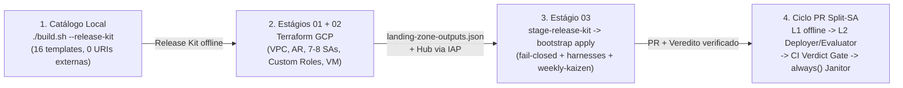
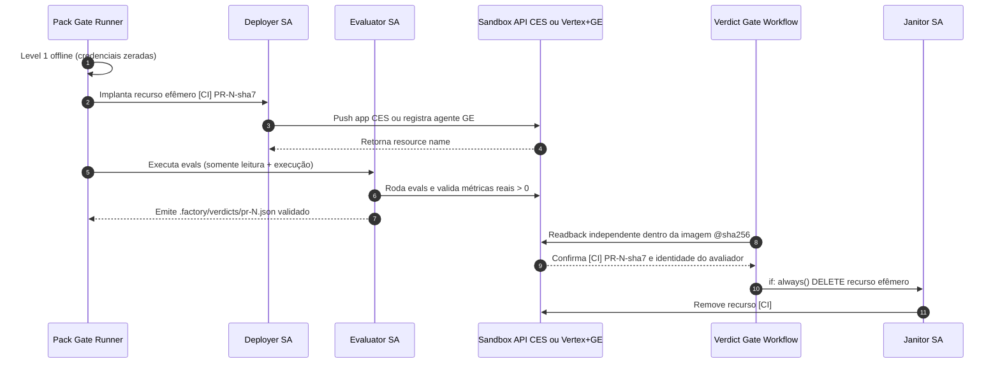

# Guia Didático Hands-On — Fábricas Autônomas do Zero (`packs/gecx` e `packs/adk`)

**Audiência:** FDEs e engenheiros Google Cloud executando o fluxo completo de `packs/gecx` ou `packs/adk` do zero para dominar cada estágio, imagem e fronteira de segurança.

---

## 1. Visão Macro (4 Peças Independentes)



---

## 2. Script Interativo Local (`scripts/hands-on-walkthrough.sh`)

O script executa os passos locais de verificação e build para **ambos os packs** (`--pack gecx` ou `--pack adk`), pausando antes de cada etapa para explicar o porquê de cada comando:

```bash
# Exemplo com packs/gecx (padrão) ou passe --pack adk
./scripts/hands-on-walkthrough.sh --pack gecx --step 1   # Static Catalog Gate (--check)
./scripts/hands-on-walkthrough.sh --pack gecx --step 2   # Full Offline Unit Test Suite (--test)
./scripts/hands-on-walkthrough.sh --pack gecx --step 3   # Build Offline Release Kit (--release-kit)
./scripts/hands-on-walkthrough.sh --pack gecx --step 4   # Terraform Validate (01 + lite-vm + ha-gke)
./scripts/hands-on-walkthrough.sh --pack gecx --step 5   # Contract Canaries (GECX CLI + ADK GE Export)
```

Para inspecionar uma Hub VM já implantada via IAP SSH (**Step 6**):

```bash
./scripts/hands-on-walkthrough.sh \
  --step 6 \
  --gcloud-config <SEU_CONFIG_GCLOUD> \
  --hub-project <SEU_HUB_PROJECT_ID> \
  --hub-vm <SEU_HUB_VM_NAME>
```

---

## 3. Fluxo Completo de Implantação em Cliente (Do Zero ao Primeiro PR)

### Etapa A — Validar o Catálogo e Gerar o Release Kit Offline

Escolha `PACK=gecx` (`16` templates, `11` skills) ou `PACK=adk` (`16` templates, `18` skills):

```bash
PACK=gecx   # ou PACK=adk
uv venv .venv --python 3.12
uv pip install --python .venv/bin/python -e ".[dev]"
./build.sh --check "packs/${PACK}"
./build.sh --test
./build.sh --release-kit "packs/${PACK}" --out "/tmp/${PACK}-kit"
```

### Etapa B — Aplicar Stage 01 (`deploy/01-landing-zone`)

Copie [deploy/01-landing-zone/example.tfvars](../deploy/01-landing-zone/example.tfvars) para `/tmp/stage01.tfvars`. Para `packs/adk`, defina `enable_adk_sandbox_roles = true`. Para criar WIF do GitHub Actions automaticamente, defina `enable_github_wif = true` e `github_repository = "org/repo"`:

```bash
export GOOGLE_OAUTH_ACCESS_TOKEN="$(gcloud --configuration=<CONFIG> auth print-access-token)"
terraform -chdir=deploy/01-landing-zone init
terraform -chdir=deploy/01-landing-zone apply -var-file=/tmp/stage01.tfvars
terraform -chdir=deploy/01-landing-zone output -json > /tmp/landing-zone-outputs.json
```

### Etapa C — Aplicar Stage 02 (`deploy/02-factory-runtime/lite-vm`)

*(Nota: `deploy/02-factory-runtime/ha-gke` atua como Preview Contract Bridge validando inputs para o módulo GKE oficial do Scion.)*

```bash
jq '{
  hub_project_id: .hub_project_id.value,
  region: .region.value,
  zone: .zone.value,
  name_prefix: .name_prefix.value,
  subnet_self_link: .subnet_self_link.value,
  hub_sa_email: .hub_sa_email.value,
  artifact_registry_url: .artifact_registry_url.value
}' /tmp/landing-zone-outputs.json > /tmp/stage02.tfvars.json

terraform -chdir=deploy/02-factory-runtime/lite-vm init
terraform -chdir=deploy/02-factory-runtime/lite-vm apply -var-file=/tmp/stage02.tfvars.json
```

### Etapa D — Construir Imagens por Digest (`stage-release-kit.sh`)

O comando abaixo constrói **a imagem lean de CI (`<pack>-runtime`)** e **a imagem de agente Scion com `sciontool` (`<pack>-antigravity-runtime`)** dentro do projeto do cliente, carimbando automaticamente os `@sha256:` reais no `manifest.json` e nos `harness-configs/*/config.yaml`:

```bash
"/tmp/${PACK}-kit/bootstrap/stage-release-kit.sh" \
  --mode rebuild \
  --gcloud-config <CONFIG> \
  --kit "/tmp/${PACK}-kit" \
  --landing-zone /tmp/landing-zone-outputs.json \
  --antigravity-base-image ghcr.io/homebrew-scion/scion-antigravity:v0.4.0-preview.3
```

*(Adicione `--claude-base-image ghcr.io/homebrew-scion/scion-claude:v0.4.0-preview.3` quando `harnesses.claude_model_garden_enabled: true`.)*

### Etapa E — Reconciliar o Scion Hub no Stage 03 (`bootstrap-hub-project.sh`)

Execute a partir do diretório do repositório cliente já linkado ao Hub (`scion init && scion hub link`). O comando `apply` valida `compat.yaml`, publica skills, sincroniza harness-configs globais (`--global`, falhando fechado em imagens placeholder), sincroniza templates, verifica SAs, aplica `fail-closed` + `default_max_model_calls`, e **agenda automaticamente `weekly-kaizen` toda sexta às 17:00 BRT** (salvo `kaizen.enabled: false`):

```bash
"/tmp/${PACK}-kit/bootstrap/bootstrap-hub-project.sh" preflight \
  --kit "/tmp/${PACK}-kit" --hub http://127.0.0.1:8080

"/tmp/${PACK}-kit/bootstrap/bootstrap-hub-project.sh" plan \
  --kit "/tmp/${PACK}-kit" --hub http://127.0.0.1:8080

"/tmp/${PACK}-kit/bootstrap/bootstrap-hub-project.sh" apply \
  --kit "/tmp/${PACK}-kit" --hub http://127.0.0.1:8080 \
  --landing-zone /tmp/landing-zone-outputs.json \
  --repo /caminho/do/repo-cliente
```

### Etapa F — Ciclo Split-SA de PR e Anti-Falsificação (CI Verdict Gate)



Consulte [CUSTOMER_LANDING_ZONE_REQUIREMENTS.md](CUSTOMER_LANDING_ZONE_REQUIREMENTS.md) para a lista completa de APIs, 7–8 Service Accounts, Custom Roles sem curingas e checklist Go/No-Go, e [AGENT_AUTHORING_AND_OPERATIONS.md](AGENT_AUTHORING_AND_OPERATIONS.md) para operação diária no Scion Hub.
