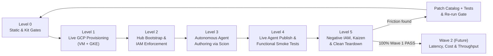

# Hillclimbing Qualification Charter (Functional-First)

This charter defines the empirical qualification program for `gcp-fde-factories`.
The program uses a practical, functional-first Hillclimbing loop: prove that real factories deploy, bootstrap, author, publish, verify, and tear down cleanly in live Google Cloud projects before optimizing latency or token throughput.

## Qualification Strategy

## Wave 1 Scope: Functional and Operational Qualification

Wave 1 executes two parallel live qualification tracks in brand-new, ephemeral Google Cloud projects:

| Track | Runtime Profile | Domain Pack | Target Published Artifact | Target Live Verification |
| :--- | :--- | :--- | :--- | :--- |
| **Track A (VM + GECX)** | Stage 01 + Stage 02 Lite Single-VM (`e2-standard-4`, Cloud NAT, IAP SSH) | `packs/gecx` | Live CES App (`[CI]` prefixed) with agent, tool, guardrail, and golden eval | `cxas push`, `cxas push-eval`, `cxas test-tools`, `cxas run --eval-type all --wait`, Contract 5 `verify-verdict.py`, `sandbox-janitor.py` |
| **Track B (GKE + ADK)** | Stage 01 + GKE Cluster (Workload Identity, Shielded Nodes) + Scion Hub Helm Chart (`hub-gke` image) | `packs/adk` | Live Dockerfile-first ADK agent container deployed to Cloud Run / Vertex AI Agent Engine + Gemini Enterprise export bundle | Live HTTP `/list-apps` and `/run` smoke tests, `adk eval`, `ge_export.py`, Contract 5 `verify-verdict.py`, `sandbox_janitor.py` |

NOTE: Wave 1 explicitly excludes p95 inference latency, token-per-second micro-benchmarks, and multi-replica HA load testing.
Those metrics belong to Wave 2 after every Level 0 through Level 5 functional metric reaches 100%.

## Functional Hillclimbing Metrics (Levels 0 to 5)

Each metric uses an objective, binary or pass-rate measurement so Hillclimbing iterations produce comparable scores.

### Level 0: Static Catalog and Offline Kit Integrity

| Metric ID | Metric | Measurement Formula | Wave 1 Target |
| :--- | :--- | :--- | :--- |
| **M0.1** | Unit and contract suite pass rate | `passed_tests / total_tests` via `./build.sh --test` | `100%` |
| **M0.2** | Clean-room sanitizer compliance | `0` forbidden patterns via `scripts/sanitizer_check.py` | `PASS (0 hits)` |
| **M0.3** | Diagram and Terraform syntax validity | `validate-diagrams.sh` + `terraform validate` across all modules | `100%` |
| **M0.4** | Offline Release Kit checksum integrity | `sha256sum -c SHA256SUMS` on `gecx` and `adk` kits | `100%` |

### Level 1: Cold-Start Provisioning on Brand-New GCP Projects

| Metric ID | Metric | Measurement Formula | Wave 1 Target |
| :--- | :--- | :--- | :--- |
| **M1.1** | Cold-start Stage 01 apply rate | Stage 01 applies cleanly on brand-new project (counting manual API pre-enables as friction) | `PASS (0 manual workarounds)` |
| **M1.2** | Stage 02 runtime bring-up (VM + GKE) | Hub reaches HTTP `200` on `/healthz` and `/readyz` on both VM and GKE | `2/2 runtimes healthy` |
| **M1.3** | Release Kit staging via Cloud Build (`--mode rebuild`) | CI runtime and Scion agent harness images build, push, and stamp `@sha256:` digests | `2/2 packs stamped` |

### Level 2: Hub Bootstrap and Control Plane Readiness

| Metric ID | Metric | Measurement Formula | Wave 1 Target |
| :--- | :--- | :--- | :--- |
| **M2.1** | `bootstrap-hub-project.sh` idempotency | `preflight -> plan -> apply -> second apply` exits `0` on both VM and GKE Hubs | `2/2 Hubs idempotent` |
| **M2.2** | Template, skill, and harness registration | `16` prefix-scoped templates, expected pack skills, and Vertex AI harness configs registered | `100% present` |
| **M2.3** | Assignable SA hygiene (`INV-04`) | `worker`, `deployer`, `evaluator` registered (`janitor` absent) with `gcp_iam_check_mode=enforce` | `100% compliant` |

### Level 3: Autonomous Scion Agent Authoring

| Metric ID | Metric | Measurement Formula | Wave 1 Target |
| :--- | :--- | :--- | :--- |
| **M3.1** | Real Scion agent spawn on VM (Docker) and GKE (K8s Pod) | `scion start` launches a real container/pod with Vertex AI credentials via minted `worker` SA token | `2/2 tracks spawn` |
| **M3.2** | End-to-end autonomous task completion | Agent edits target repo, passes local unit tests, and commits/pushes a clean feature branch | `2/2 tracks produce valid PR code` |

### Level 4: Live Agent Publish and Functional Smoke Tests

| Metric ID | Metric | Measurement Formula | Wave 1 Target |
| :--- | :--- | :--- | :--- |
| **M4.1** | Live GECX publish and evaluation (Track A) | Deployer pushes `[CI]` CES app + evals, and Evaluator runs `test-tools` plus `run --eval-type all --wait` with `pass_rate == 1.0` | `PASS (live-gcp-verified)` |
| **M4.2** | Live ADK container build, deploy, and smoke test (Track B) | Dockerfile builds via Cloud Build, deploys live ADK runtime, passes HTTP `/list-apps` + `/run` + `adk eval` + `ge_export.py` | `PASS (live smoke + export)` |
| **M4.3** | Independent Contract 5 Verdict verification | `verify-verdict.py` validates `.factory/verdicts/pr-*.json` against commit SHA and live GCP readback | `2/2 tracks verified` |

### Level 5: Security Boundaries, Kaizen Collection, and Clean Teardown

| Metric ID | Metric | Measurement Formula | Wave 1 Target |
| :--- | :--- | :--- | :--- |
| **M5.1** | Negative IAM boundary enforcement | Live probes prove Evaluator gets `403` on writes and `conversations.list`, and Worker gets `403` on Sandbox mutations | `100% expected 403s` |
| **M5.2** | Zero-token Kaizen collection (`INV-11`) | `kaizen_collect.py` runs against live Hub and writes valid `.factory/kaizen-snapshot.json` with `0` LLM calls | `2/2 tracks collected` |
| **M5.3** | Ephemeral Janitor and full project teardown (`INV-08`, `INV-16`) | Janitor removes `[CI]` apps, `terraform destroy` succeeds, ephemeral projects enter `DELETE_REQUESTED`, and temp GitHub repos are deleted | `100% clean teardown ($0 residual)` |

## Wave 2 Preview (Deferred Until Wave 1 = 100%)

Once Wave 1 reaches `100%` across Levels 0 to 5 with zero manual workarounds, Wave 2 introduces efficiency metrics:
- Time-to-first-agent (`TTFA`): minutes from empty project to first healthy Scion agent pod.
- Token budget per merged PR: Vertex AI prompt and output tokens per verified feature wave.
- First-pass PR acceptance rate: percentage of autonomous PRs passing Contract 5 on attempt 1 without rework.
- HA failover recovery: zero-downtime Hub pod recycle on GKE with Cloud SQL + Filestore.

## Qualification Log

| Run ID | Date (BRT) | Release Base | Track A (VM + GECX) | Track B (GKE + ADK) | Friction Items Fixed | Status |
| :--- | :--- | :--- | :--- | :--- | :--- | :--- |
| `HC-2026-11-24-01` | 2026-11-24 | `acém` (`v0.4.0`) | In progress | In progress | Pending live run synthesis | Active |
