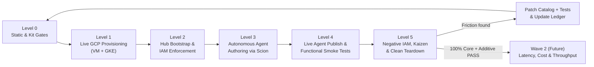

# Hillclimbing Qualification Charter (Functional-First)

This charter defines the empirical qualification program for `gcp-fde-factories`.
The program uses a practical, functional-first Hillclimbing loop.
Each round proves that real factories deploy, bootstrap, author, publish, verify, and tear down cleanly in live Google Cloud projects before optimizing latency or throughput.

## Qualification Strategy

## Single Source of Truth and Progression Ledger

Every qualification round appends one JSON object to [docs/hillclimbing-runs.jsonl](hillclimbing-runs.jsonl).
Run `python3 scripts/render-hillclimbing-report.py` after each round to regenerate [docs/hillclimbing-dashboard.html](hillclimbing-dashboard.html) deterministically from the ledger.
Publish the same HTML file to the team Artifacts dashboard so repository history and visual reports never drift.

## Ledger Structure: Immutable Core vs. Versioned Extensions

The qualification ledger separates metrics into two blocks to preserve apples-to-apples comparisons across releases:

1. **`core_v1` (Immutable Baseline, 18 gates `M0.1` to `M5.3`):** Every round scores the exact same 18 functional gates across Levels 0 through 5. Never remove, rename, or weaken a `core_v1` gate.
2. **`additive_gates` (Versioned Extensions for `HC-02+`):** New qualification horizons (such as 3-project cross-project topologies or HA failover) add versioned blocks without mutating `core_v1` scores.

## Cross-Round Evolution Metrics

Each round computes three longitudinal metrics over `core_v1` (and tracks separate totals for active `additive_gates` blocks):

| Evolution Metric | Formula | Purpose | Wave 1 Target |
| :--- | :--- | :--- | :--- |
| **Cold-Start First-Pass Rate (%)** | `gates_passed_on_attempt_1_without_workarounds / total_gates * 100` | Measures out-of-the-box reliability on brand-new projects | `>= 90%` (toward `100%`) |
| **Manual Friction Count (#)** | `showstoppers_count` + `minor_count` (tracked separately) | Quantifies operator effort required during live execution | `0` Showstoppers, `<= 2` Minor |
| **Mock-to-Reality Escape Rate (#)** | Count of live failures that passed offline `pytest`, `./build.sh --check`, and `terraform validate` | Measures blind spots in offline unit tests and mocks | `0` escapes |

## Wave 1 Scope: Functional and Operational Qualification

Wave 1 executes two parallel live qualification tracks in brand-new, ephemeral Google Cloud projects:

| Track | Runtime Profile | Domain Pack | Target Published Artifact | Target Live Verification |
| :--- | :--- | :--- | :--- | :--- |
| **Track A (VM + GECX)** | Stage 01 + Stage 02 Lite Single-VM (`e2-standard-4`, Cloud NAT, IAP SSH) | `packs/gecx` | Live CES App (`[CI]` prefixed) with agent, tool, and eval | `cxas push`, live `v1beta` `runSession` tool execution, Contract 5 `verify-verdict.py`, `sandbox_janitor.py` |
| **Track B (GKE + ADK)** | Stage 01 + GKE Cluster (Workload Identity, Shielded Nodes) + Scion Hub Helm Chart (`hub-gke` image) | `packs/adk` | Live Dockerfile-first ADK agent container on Cloud Run / Vertex AI Agent Engine + Gemini Enterprise export bundle | Live HTTP `/list-apps` and `/run` smoke tests, `ge_export.py`, Contract 5 `verify-verdict.py`, `sandbox_janitor.py` |

NOTE: Wave 1 excludes p95 inference latency, token-per-second micro-benchmarks, and multi-replica HA load testing.
Those metrics belong to Wave 2 after every Level 0 through Level 5 functional metric reaches 100%.

## Immutable `core_v1` Functional Gates (18 Gates, Levels 0 to 5)

Each gate uses a binary first-pass check (`first_pass: true` or `false`) and an end-of-round verification status (`PASS`, `PARTIAL`, or `FAIL`).

### Level 0: Static Catalog and Offline Kit Integrity

| Metric ID | Metric | Measurement Formula | Wave 1 Target |
| :--- | :--- | :--- | :--- |
| **M0.1** | Unit and contract suite pass rate | `passed_tests / total_tests` via `./build.sh --test` | `100%` |
| **M0.2** | Clean-room sanitizer compliance | `0` forbidden patterns via `scripts/sanitize-public-check.py` | `PASS (0 hits)` |
| **M0.3** | Diagram and Terraform syntax validity | Static check plus `terraform validate` across all modules | `100%` |
| **M0.4** | Offline Release Kit checksum integrity | Embedded SHA-256 verification in `manifest.json` and `skills.lock` on `gecx` and `adk` kits | `100%` |

### Level 1: Cold-Start Provisioning on Brand-New GCP Projects

| Metric ID | Metric | Measurement Formula | Wave 1 Target |
| :--- | :--- | :--- | :--- |
| **M1.1** | Cold-start Stage 01 apply rate | Stage 01 applies cleanly on brand-new project (counting manual API pre-enables as friction) | `PASS (0 manual workarounds)` |
| **M1.2** | Stage 02 runtime bring-up (VM + GKE) | Hub reaches HTTP `200` on `/healthz` and `/readyz` on both VM and GKE | `2/2 runtimes healthy` |
| **M1.3** | Release Kit staging via Cloud Build (`--mode rebuild`) | CI runtime and Scion agent harness images build, push, and stamp `@sha256:` digests | `2/2 packs stamped` |

### Level 2: Hub Bootstrap and Control Plane Readiness

| Metric ID | Metric | Measurement Formula | Wave 1 Target |
| :--- | :--- | :--- | :--- |
| **M2.1** | `bootstrap-hub-project.sh` idempotency | `preflight -> plan -> apply -> second apply` exits `0` on both VM and GKE Hubs | `2/2 Hubs idempotent` |
| **M2.2** | Template, skill, and harness registration | `16` prefix-scoped templates, expected pack skills, and Vertex AI harness configs registered | `100% present` |
| **M2.3** | Assignable SA hygiene (`INV-04`) | `worker`, `deployer`, `evaluator` registered (`janitor` absent) with `gcp_iam_check_mode=enforce` | `100% compliant` |

### Level 3: Autonomous Scion Agent Authoring

| Metric ID | Metric | Measurement Formula | Wave 1 Target |
| :--- | :--- | :--- | :--- |
| **M3.1** | Real Scion agent spawn on VM (Docker) and GKE (K8s Pod) | `scion start` launches a real container/pod with Vertex AI credentials via minted or Workload Identity `worker` SA | `2/2 tracks spawn` |
| **M3.2** | End-to-end autonomous task completion | Agent edits target repo, passes local unit tests, and commits/pushes a clean feature branch | `2/2 tracks produce valid PR code` |

### Level 4: Live Agent Publish and Functional Smoke Tests

| Metric ID | Metric | Measurement Formula | Wave 1 Target |
| :--- | :--- | :--- | :--- |
| **M4.1** | Live GECX publish and evaluation (Track A) | Deployer pushes `[CI]` CES app, and Evaluator runs live `runSession` tool execution with verified responses | `PASS (live-gcp-verified)` |
| **M4.2** | Live ADK container build, deploy, and smoke test (Track B) | Dockerfile builds via Cloud Build, deploys live ADK runtime, passes HTTP `/list-apps` + `/run` + `ge_export.py` | `PASS (live smoke + export)` |
| **M4.3** | Independent Contract 5 Verdict verification | `verify-verdict.py` validates `.factory/verdicts/pr-*.json` against commit SHA and live GCP readback | `2/2 tracks verified` |

### Level 5: Security Boundaries, Kaizen Collection, and Clean Teardown

| Metric ID | Metric | Measurement Formula | Wave 1 Target |
| :--- | :--- | :--- | :--- |
| **M5.1** | Negative IAM boundary enforcement | Live probes prove Evaluator gets `403` on writes and Insights, and Worker gets `403` on Sandbox mutations | `100% expected 403s` |
| **M5.2** | Zero-token Kaizen collection (`INV-11`) | `kaizen_collect.py` runs against live Hub and writes valid `.factory/kaizen-snapshot.json` with `0` LLM calls | `2/2 tracks collected` |
| **M5.3** | Ephemeral Janitor and full project teardown (`INV-08`, `INV-16`) | Janitor removes `[CI]` apps, ephemeral projects enter `DELETE_REQUESTED`, and temp repos are cleaned up | `100% clean teardown ($0 residual)` |

## Additive Gates: `additive_gates.v2_cross_project` (Qualified in `HC-02`)

`HC-02` qualified the production-grade unified 3-project topology (`hub` + `inf` + `sbx`) across both Lite VM and GKE runtimes while keeping all 18 `core_v1` gates unchanged.
`HC-02` executed five versioned extension gates under `additive_gates.v2_cross_project`:

| Metric ID | Additive Gate | Verification Requirement (`HC-02` 3-Project Topology) | Target |
| :--- | :--- | :--- | :--- |
| **M2.4** | Non-Owner operator enforcement | A human or service principal listed in `factory_operator_members` (without `roles/owner`) spawns agents under `gcp_iam_check_mode=enforce` | `PASS (0 Owner grants)` |
| **M3.3** | Multi-persona live turns on both runtimes | All three assignable personas (`worker`, `deployer`, `eval`) execute a real Vertex AI LLM turn on both Lite VM and GKE | `6/6 persona-runtime turns PASS` |
| **M4.4** | Cross-project boundary proof (`hub` / `inf` / `sbx`) | Workloads pull images from `hub` Artifact Registry, bill LLM inference strictly to `inf` Vertex AI, and mutate apps strictly inside `sbx` | `100% cross-project isolation` |
| **M4.5** | Live Agent Engine deploy and Gemini Enterprise App lifecycle | Deployer publishes the Dockerfile-first ADK agent to live Vertex AI Agent Engine and runs real register, readback, and delete in a Gemini Enterprise App via `packs/adk/scripts/ge_export.py` | `PASS (live AE + GE CRUD)` |
| **M5.4** | Stateful GKE Hub pod restart resilience | Deleting the running `scion-hub` pod on GKE recovers with zero loss of projects, secrets, templates, schedules, or RoleBindings | `0 state loss after pod recycle` |

## Additive Gates: `additive_gates.v3_real_factory_ops` (Qualified in `HC-03`)

`HC-03` qualified Day-2 multi-agent factory operations, keyless GitHub Actions WIF gates, brownfield customer overlays, and Cloud Run A2A dual export in a fresh 3-project topology:

| Metric ID | Additive Gate | Verification Requirement (`HC-03` Real Factory Operations) | Target |
| :--- | :--- | :--- | :--- |
| **M3.4** | Multi-agent PR collaboration and review loop | `coordinator`, `developer`, and independent `reviewer` collaborate on one PR using shared scratchpad or `scion message`, apply a review fix on the branch, and reach approval before deploy | `PASS (review -> fix -> approve)` |
| **M4.6** | Keyless GitHub Actions WIF Verdict Gate (`enable_github_wif=true`) | Live GitHub Actions workflow authenticates via WIF (`0` static JSON keys), blocks a tampered `evals/` PR, approves a clean verified PR, and runs Janitor via WIF | `PASS (block tampered + pass clean)` |
| **M2.5** | Brownfield adopt-first onboarding and `overlay-sync` | `factory_onboard.py` and `bootstrap-hub-project.sh overlay-sync` attach custom client `.factory/skills/` and `exclude_skills` onto a dirty repo without overwriting customer code | `PASS (overlay enforced, 0 clobber)` |
| **M4.7** | Live ADK Cloud Run A2A dual export (`export_mode: a2a`) | Same root `Dockerfile` deploys to authenticated Cloud Run with `adk_runtime` SA, serves `/.well-known/agent-card.json` (`v0.3.0`), handles live JSON-RPC `message/send`, and exports valid `a2a` bundle | `PASS (live A2A AgentCard + RPC)` |

## Additive Gates: `additive_gates.v4_day2_resilience` (Qualified in `HC-04`)

`HC-04` qualified upgrade/rollback durability, closed-loop Tier-B Kaizen observability, FinOps loop kill-switches, and `cross-vendor` diversity (Gemini 4 author plus live Claude Opus 5.5 Vertex AI reviewer):

| Metric ID | Additive Gate | Verification Requirement (`HC-04` Day-2 Resilience and Third Pack) | Target |
| :--- | :--- | :--- | :--- |
| **M2.6** | Hub catalog upgrade and clean `rollback` | `bootstrap-hub-project.sh backup -> apply vNext -> rollback` restores prior templates without losing projects, secrets, or schedules | `PASS (0 state loss on rollback)` |
| **M5.5** | Closed-loop Kaizen Tier A + Tier B (`enable_kaizen_gcp_obs=true`) | `weekly-kaizen` spawns `kaizen-analyst` with read-only `kaizen-viewer` SA, reads live Cloud Logging/Monitoring plus Hub metrics, and writes an actionable report | `PASS (real Tier A+B report)` |
| **M5.6** | FinOps loop kill-switch and `max_turns` enforcement | Agent spawned with strict `max_turns` / `max_model_calls` cap terminates deterministically before exceeding budget, and `budget_alerts` Pub/Sub delivery verifies cleanly | `PASS (hard cap enforced)` |
| **M3.5** | Starter pack (`packs/_template-pack`) and `cross-vendor` Claude review | A new pack cloned from `packs/_template-pack` passes build checks, and one live PR runs `diversity_profile: cross-vendor` (Gemini author plus Claude Vertex reviewer after manual Model Garden opt-in) | `PASS (template-pack + cross-vendor)` |

## Additive Gates: `additive_gates.v5_brownfield_interview_and_coexistence` (Qualified in `HC-05`)

`HC-05` qualified hostile brownfield onboarding, simulated `/grill-me` interviews, legacy hook coexistence, `.factory/Dockerfile.customer` live Cloud Builds, and live execution of the native `google-agents-cli` (`adk_python`) scaffold (ADR-014):

| Metric ID | Additive Gate | Verification Requirement (`HC-05` Hostile Brownfield, Interview, and Native ADK Scaffold) | Target |
| :--- | :--- | :--- | :--- |
| **M2.7** | Simulated `/grill-me` PO interview (`factory-onboard`) | Multi-turn harness runs `factory-onboard` against a vague synthetic PO, executes `scan` first, challenges weak answers, passes `check`, and emits `.factory/` cleanly | `PASS (0 redundant questions, ready=true)` |
| **M2.8** | Legacy AI files, hooks, and skills coexistence | Scanner detects diverging `AGENTS.md` and `CLAUDE.md`, Git hooks, harness hooks, and local skills, isolates untrusted workspace hooks, and reconciles CI parity without clobber | `PASS (0 clobber, hooks flagged)` |
| **M1.4** | Live `.factory/Dockerfile.customer` image build | `factory_onboard.py emit` generates `.factory/Dockerfile.customer` for detected `missing_binaries`, Cloud Build builds the image, and a live agent executes the added tools | `PASS (custom image built and verified)` |
| **M3.6** | Raw brownfield PR under absorbed conventions | Autonomous agent edits the raw brownfield repository (without `repo-scaffold`), obeys absorbed rules and overlay skills, preserves legacy files, and passes the Verdict CI gate | `PASS (PR green, legacy preserved)` |
| **M4.8** | Native `google-agents-cli` (`adk_python`) scaffold live proof (`ADR-014`) | New `packs/adk/repo-scaffold` (`app/fast_api_app.py` + `uv` non-root `Dockerfile`, zero `deployment/terraform/`) deploys to authenticated Cloud Run with `APP_URL`, serves dynamic HTTPS `/a2a/app/.well-known/agent-card.json` (v0.3 compat), executes live JSON-RPC `message/send` as `eval` SA, exposes `/api/reasoning_engine`, and passes keyless WIF Verdict Gate + Janitor | `PASS (live ADK HTTP + dynamic A2A + Playground + WIF)` |

## Additive Gates: `additive_gates.v6_endurance_soak` (Qualified in `HC-06`)

`HC-06` qualified an 11.7-hour overnight endurance soak on Lite Single-VM (`packs/adk`, ADR-014 layout, 3-project unified topology, hard budget cap `monthly_budget_usd = 30`, guaranteed `$0` residual teardown):

| Metric ID | Additive Gate | Verification Requirement (`HC-06` Extended Endurance Soak) | Target |
| :--- | :--- | :--- | :--- |
| **M6.1** | Multi-wave PO lifecycle with mid-flight scope change | Simulated PO merges Wave 1, waits over 75 minutes across OIDC expiry and `auto_suspend_idle`, posts a Wave 2 scope change, and verifies clean resume and re-verified Verdict | `PASS (0 auth stalls, clean resume)` |
| **M6.2** | Conflicting requests and invariant enforcement (Andon Cord) | Simulated PO submits conflicting requests (raw CPF logging, Wave 1 contract break, unapproved `evals/` edit) and verifies strict `security-auditor` Andon Cord defense and CI block | `PASS (100% invariant defense)` |
| **M6.3** | Concurrent PR merge conflict and live over-4h TTL Janitor | Two concurrent issues modify `app/tools.py` forcing real rebase and re-review while scheduled Janitor deletes an over-4h `[CI]` orphan Cloud Run service and preserves a non-`[CI]` control service | `PASS (conflict resolved + 4h TTL verified)` |
| **M6.4** | Closed-loop Kaizen impact measurement | Accelerated Kaizen runs over real 4-wave Hub and GCP telemetry, opens and merges a real improvement PR with `Kaizen-Ref:`, and Wave 5 measures before-versus-after delta via `kaizen_verifier.py` | `PASS (merged Kaizen PR + delta measured)` |
| **M6.5** | Sustained runtime stability and real TCO report | Lite VM Hub (SQLite, Docker disk, git worktrees, container GC) stays healthy with zero restarts or `SQLITE_BUSY` errors and reports measured per-PR and idle TCO | `PASS (0 crashes, TCO measured)` |

## Release Candidate Sanity Gate (`HC-07` for `v0.5.0` `bife`)

`HC-07` executes a zero-new-scope regression freeze across both Lite Single-VM (`packs/gecx` with `ADR-015` cognitive brownfield advisory validators) and Stateful GKE Standard (`packs/adk` `ADR-014` under root org `requireShieldedVm` plus `HC06-F1` Cloud Run Janitor) before cutting annotated tag `bife` (`v0.5.0`).

## Wave 2 Preview (Deferred Until Wave 1 = 100%)

Once `core_v1` and active Wave 1 additive blocks reach `100%` with zero Showstoppers, Wave 2 introduces efficiency metrics:
- Time-to-first-agent (`TTFA`): minutes from empty project to first healthy Scion agent pod.
- Token budget per merged PR: Vertex AI prompt and output tokens per verified feature wave.
- First-pass PR acceptance rate: percentage of autonomous PRs passing Contract 5 on attempt 1 without rework.
- HA failover recovery: zero-downtime Hub pod recycle on GKE with Cloud SQL + Filestore.

## Qualification Log

| Run ID | Date (BRT) | Release Base | `core_v1` Cold-Start First-Pass | `core_v1` End-of-Round | Friction (Showstoppers / Minor) | Mock Escapes | Status |
| :--- | :--- | :--- | :--- | :--- | :--- | :--- | :--- |
| `HC-2026-11-24-01` | 2026-11-24 | `acém` (`v0.4.0`) | `33.3%` (`6/18`) | `17/18 PASS`, `1 PARTIAL` | `31` (`24` / `7`) | `26` | Completed baseline (30 fixed in repo + 1 upstream `WK-005`) |
| `HC-2026-11-24-02` | 2026-11-24 | `acém` (`v0.4.0` + HC-01) | `66.7%` (`12/18`) | `17/18 PASS`, `1 PARTIAL` | `14` (`9` / `5`) | `14` | Completed 3-project cross-project (`v2_cross_project`: `4/5 PASS`, `1 PARTIAL` GE billing license) |
| `HC-2026-11-24-03` | 2026-11-24 | `acém` (`v0.4.0` + HC-02) | `66.7%` (`12/18`) | `17/18 PASS`, `1 PARTIAL` | `8` (`6` / `2`) | `8` | Completed real factory ops (`v3_real_factory_ops`: `3/4 PASS`, `1 PARTIAL` Cloud Run A2A `agent.json` + `run.routes.invoke`, all 8 findings fixed) |
| `HC-2026-11-24-04` | 2026-11-24 | `acém` (`v0.4.0` + HC-03) | `77.8%` (`14/18`) | `17/18 PASS`, `1 PARTIAL` | `5` (`3` / `2`) | `3` | Completed Day-2 resilience and cross-vendor (`v4_day2_resilience`: `4/4 PASS` — `M2.6`, `M5.5`, `M5.6`, `M3.5` live Claude Opus 5.5 review, all 5 findings fixed) |
| `HC-2026-11-24-05` | 2026-11-24 | `acém` (`v0.4.0` + HC-04 + `ADR-014`) | `72.2%` (`13/18`) | `17/18 PASS`, `1 PARTIAL` | `6` (`4` / `2`) | `6` | Completed hostile brownfield, `/grill-me`, and `ADR-014` native `agents-cli` proof (`v5_brownfield_interview_and_coexistence`: `4/5 PASS`, `1 PARTIAL` scanner hook detection, all 6 findings fixed + `ADR-015`) |
| `HC-2026-11-25-06` | 2026-11-25 | `acém` (`v0.4.0` + HC-05 + `ADR-015`) | `94.4%` (`17/18`) | `17/18 PASS`, `1 PARTIAL` | `1` (`1` / `0`) | `1` | Completed 11.7h Lite Single-VM endurance soak (`v6_endurance_soak`: `5/5 PASS` across 5 waves, `101.8m` idle resume, strict Andon Cord, `4.8h` real TTL Janitor + `HC06-F1` fix, `KZ-2026-11-25-01` `verified_pass`, `0` restarts, `~$3.06` list-price est.) |
