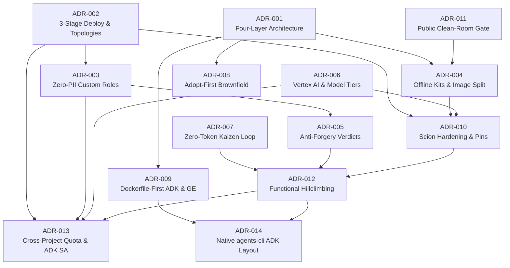

# Architecture Decision Records (ADRs)

This directory records the formal architecture decisions for `gcp-fde-factories`.
Each record states the context, the decision, the consequences, and the enforcing code and tests.
Every accepted decision maps to one or more invariants in [INVARIANTS.md](../INVARIANTS.md).

## Decision Dependency Map

## Decision Index

| ID | Title | Status | Linked Invariants | Primary Enforcement |
| :--- | :--- | :--- | :--- | :--- |
| [ADR-001](ADR-001-four-layer-architecture-and-vendoring.md) | Four-Layer Architecture and Vendored Core | Accepted | INV-01 | `build.sh`, `scripts/build.py`, `scripts/lib/release_kit.py` |
| [ADR-002](ADR-002-three-stage-deployment-and-project-topologies.md) | Three-Stage Deployment and Project Topologies | Accepted | INV-02 | `deploy/01-landing-zone/`, `deploy/02-factory-runtime/`, `deploy/03-hub-bootstrap/` |
| [ADR-003](ADR-003-zero-pii-custom-roles-and-split-sa-isolation.md) | Zero-PII Custom Roles and Split Service Accounts | Accepted | INV-03, INV-04 | `deploy/01-landing-zone/iam.tf` |
| [ADR-004](ADR-004-offline-release-kits-and-image-separation.md) | Offline Release Kits and Image Separation | Accepted | INV-05, INV-06 | `scripts/lib/release_kit.py`, `deploy/03-hub-bootstrap/stage-release-kit.sh` |
| [ADR-005](ADR-005-anti-forgery-verdicts-and-janitor-teardown.md) | Anti-Forgery Verdicts and Janitor Teardown | Accepted | INV-07, INV-08 | `scripts/verify-verdict.py`, `packs/gecx/scripts/sandbox_janitor.py`, `packs/adk/scripts/sandbox_janitor.py` |
| [ADR-006](ADR-006-vertex-ai-generic-tiers-and-fail-closed-claude.md) | Vertex AI Default, Generic Tiers, and Fail-Closed Claude | Accepted | INV-09, INV-10 | `scripts/lib/model_routing.py`, `deploy/03-hub-bootstrap/parse_hub_project.py` |
| [ADR-007](ADR-007-closed-loop-zero-token-kaizen-engine.md) | Closed-Loop Zero-Token Kaizen Engine | Accepted | INV-11 | `core-gcp-fde/scripts/kaizen_collect.py`, `scripts/lib/kaizen_verifier.py` |
| [ADR-008](ADR-008-adopt-first-brownfield-onboarding.md) | Adopt-First Brownfield Onboarding | Accepted | INV-12 | `core-gcp-fde/scripts/factory_onboard.py`, `schemas/factory-profile.schema.json` |
| [ADR-009](ADR-009-dockerfile-first-adk-and-dual-ge-export.md) | Dockerfile-First ADK and Dual Gemini Enterprise Export | Accepted | INV-13 | `packs/adk/repo-scaffold/Dockerfile`, `packs/adk/scripts/ge_export.py` |
| [ADR-010](ADR-010-scion-hardening-and-pinned-supply-chain.md) | Scion Hub Hardening and Pinned Supply Chain | Accepted | INV-06, INV-14 | `compat.yaml`, `deploy/02-factory-runtime/lite-vm/cloud-init.tftpl` |
| [ADR-011](ADR-011-public-clean-room-and-runtime-denylist.md) | Public Clean-Room Gate and Runtime Denylist | Accepted | INV-15 | `scripts/sanitize-public-check.py`, `scripts/lib/sanitizer.py` |
| [ADR-012](ADR-012-functional-hillclimbing-e2e-qualification.md) | Functional-First Live Hillclimbing Qualification | Accepted | INV-16 | [HILLCLIMBING_CHARTER.md](../HILLCLIMBING_CHARTER.md) |
| [ADR-013](ADR-013-cross-project-adc-quota-and-sandbox-runtime-sa.md) | Cross-Project ADC Quota Routing and Same-Project ADK Runtime SA | Accepted | INV-02, INV-03, INV-09, INV-13 | `deploy/01-landing-zone/iam.tf`, `parse_hub_project.py`, `ge_payload.py` |
| [ADR-014](ADR-014-agents-cli-native-adk-scaffold.md) | Native `google-agents-cli` (`adk_python`) Layout for `packs/adk` | Accepted | INV-12, INV-13 | `packs/adk/repo-scaffold/app/`, `agents-cli-manifest.yaml`, `pyproject.toml`, `Dockerfile` |

## Lifecycle Rules

1. Create a new file `ADR-NNN-<short-slug>.md` for every structural decision that changes security boundaries, runtime contracts, or pack interfaces.
2. Mark superseded records as `Superseded by ADR-NNN` instead of deleting them.
3. Update [INVARIANTS.md](../INVARIANTS.md) whenever an ADR adds, modifies, or retires an automated check.
