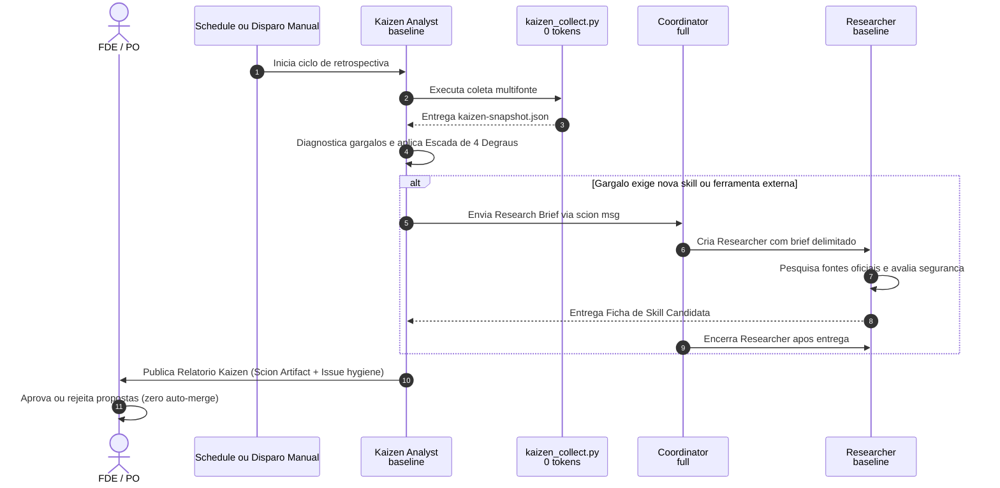
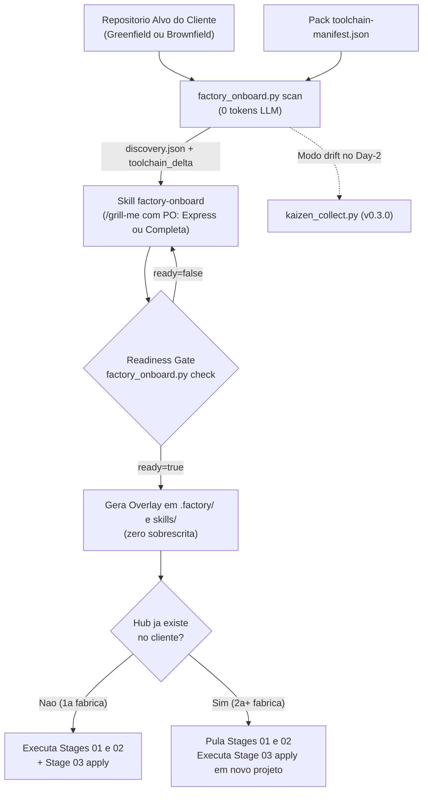

# Especificação Formal — Motor Kaizen Closed-Loop (`v0.3.0`) e Onboarding Dinâmico Brownfield (`v0.4.0`)

**Status:** Implementada no repositório (`packs/gecx v0.4.0` e `packs/adk v0.1.0`), aguardando validação live em Argolis após o smoke test manual da `v0.2.0`
**Data:** 24/11/2026 (BRT)
**Baseline Protegido:** `packs/gecx v0.2.0` (live em Argolis), `scion v0.4.0-preview.3`, `scion-frontiers/agent-team@08faf48`
**Escopo:** Evolução de `core-gcp-fde/` (Camada 1), `packs/gecx/` e `packs/adk/` (Camada 2) e Overlay `.factory/` (Camada 3), sem alterações na Camada 0 (`vendor/agent-team/`).

> [!NOTE]
> Esta especificação registra decisões arquiteturais e contratos verificáveis para as releases `v0.3.0` e `v0.4.0`. O ambiente live de validação da `v0.2.0` em Argolis permanece intacto até o término do smoke test manual.

---

## 1. Glossário Canônico

Esta especificação usa um termo único para cada componente e papel.

| Termo Canônico | Definição |
| :--- | :--- |
| **Upstream** | Código e templates originais de `GoogleCloudPlatform/scion` e `scion-frontiers/agent-team` em `vendor/agent-team/`. |
| **Core FDE** | Camada 1 (`core-gcp-fde/`), compartilhada por todos os packs da fábrica. |
| **Pack** | Camada 2 (`packs/<domínio>/`), pacote versionado de templates, skills e imagem de domínio (piloto ativo: `packs/gecx`). |
| **Overlay** | Camada 3 (`.factory/` e `skills/` no repositório do cliente), camada declarativa que adapta o Pack ao repositório alvo. |
| **Hub** | Instância do Scion Hub que executa controle de projetos, templates, Skill Bank, mensagens e métricas de sessão. |
| **PO** | Pessoa responsável pelo produto ou Tech Lead que valida decisões, requisitos e aprovações de PR. |
| **Coletor** | Script determinístico `core-gcp-fde/scripts/kaizen_collect.py` que agrega telemetria em JSON sem usar LLM. |
| **Kaizen Analyst** | Agente especialista (`gecx-kaizen-analyst` no Pack GECX) que diagnostica gargalos e propõe melhorias governadas. |
| **Researcher** | Agente especialista (`gecx-researcher`) que pesquisa skills, ferramentas e padrões públicos sob demanda. |
| **Scanner** | Script determinístico `core-gcp-fde/scripts/factory_onboard.py` que detecta fatos estáticos de um repositório sem usar LLM. |
| **Readiness Gate** | Verificação determinística (`factory_onboard.py check --json`) que libera a geração do Overlay apenas quando `ready=true`. |
| **Modernization Backlog** | Arquivo `.factory/modernization-backlog.yaml` que registra lacunas brownfield para adoção gradual. |
| **Diff Cirúrgico** | Proposta de alteração de prompt em formato unificado (`-` e `+`) que respeita os tetos do `budget_engine.py`. |
| **Critério de Reversão** | Métrica e janela de PRs que determinam quando reverter uma mudança de prompt ou de harness. |

---

## 2. Fronteiras de Camadas e Invariantes Globais

O modelo em 4 camadas separa evolução do Upstream, governança FDE, domínio técnico e realidade brownfield do cliente.

| Camada | Diretório / Escopo | O que Muda em `v0.3.0` e `v0.4.0` | Invariante |
| :--- | :--- | :--- | :--- |
| **Camada 0** | `vendor/agent-team/` | Nenhuma alteração. | O mantenedor nunca edita arquivos em `vendor/`. |
| **Camada 1** | `core-gcp-fde/` | Recebe `Coletor`, `Scanner`, skill `gcp-kaizen-analyst`, template base `kaizen-analyst` e skill `factory-onboard`. | Todo recurso genérico atende `gecx`, `adk` e `agent-platform`. |
| **Camada 2** | `packs/<domínio>/` | Recebe delta fino do `Kaizen Analyst`, papel `gecx-kaizen-analyst` e manifesto `toolchain-manifest.json`. | Os templates prefixados (`gecx-*`) permanecem intactos no cliente. |
| **Camada 3** | `.factory/` no repositório alvo | Recebe perfil brownfield, Overlay Skill de convenções, `Dockerfile.customer` condicional, `knowledge-index.yaml` e `Modernization Backlog`. | O `bootstrap-hub-project.sh` sincroniza o Overlay sem gerar drift no Pack. |

### 2.1 Invariantes Obrigatórias

1. O `Kaizen Analyst` e o `Researcher` nunca executam merge automático nem alteram templates no Hub.
2. O `Overlay` nunca sobrescreve arquivos pré-existentes de AI coding, CI ou documentação do cliente.
3. Toda proposta de alteração no Pack passa obrigatoriamente por `./build.sh --check` e respeita o teto de 1.800 linhas por papel.
4. Toda lição originada em cliente passa pelo pipeline Clean-Room (`scripts/lib/sanitizer.py`) e por reprodução sintética antes de entrar em `gcp-fde-factories`.
5. Se uma falha envolver comportamento do template base em `vendor/agent-team/`, o `Kaizen Analyst` classifica o item como `[UPSTREAM-CANDIDATE]` e nunca edita `vendor/`.

---

## 3. Release `v0.3.0` — Motor Kaizen Closed-Loop (Opção A)

A release `v0.3.0` fecha o ciclo de observação, diagnóstico e proposta de melhoria contínua sobre a operação real da fábrica.

### 3.1 Componentes e Alocação por Camada

1. **Coletor determinístico (`core-gcp-fde/scripts/kaizen_collect.py`):**
   - A imagem base `core-gcp-fde/images/base.Dockerfile` empacota o `Coletor` em `/opt/gcp-fde/kaizen_collect.py`.
   - O `Coletor` lê todas as fontes de telemetria disponíveis e grava `/scion-volumes/scratchpad/kaizen-snapshot.json`.
   - O `Coletor` executa em Python puro e consome 0 tokens de LLM.
2. **Skill especialista (`core-gcp-fde/skills/gcp-kaizen-analyst/SKILL.md`):**
   - O manifesto `packs/gecx/pack.yaml` publica esta skill com `attach_to_project: false`.
   - O template `gecx-kaizen-analyst` monta esta skill via `role_skills`, mantendo 0 linhas extras nos outros 15 papéis.
3. **Atualização da skill base (`core-gcp-fde/skills/gcp-kaizen-light/SKILL.md`):**
   - Substituir a referência antiga `scripts/budget-check.py` pelo comando canônico `./build.sh --check`.
   - Instruir `coordinator` e `eng-manager` a registrar 1 linha em `/scion-volumes/scratchpad/kaizen-events.jsonl` quando acionarem *Andon Cord* ou detectarem *stall*.
4. **Template base e especialização GECX:**
   - O template `core-gcp-fde/templates/kaizen-analyst/` deriva de `base_role: investigator` do Upstream.
   - O arquivo `packs/gecx/templates/kaizen-analyst/delta.md` define no máximo 10 regras para ler sinais específicos de GECX (`verdict.json`, `sandbox-ledger.jsonl`, falhas de `cxas`).
   - O manifesto `packs/gecx/pack.yaml` registra o 16º papel `gecx-kaizen-analyst` com `hub_role: baseline` e `sandbox_sa_slot: worker`.

> [!NOTE]
> Em `pkg/hub/agentrole.go` do Scion `v0.4.0-preview.3`, o papel `readonly` não inclui `ScopeAgentNotify` nem `ScopeProjectArtifactWrite`. O papel `baseline` concede leitura de projeto, envio de mensagens e publicação de artefatos, enquanto bloqueia criação de agentes (`ScopeAgentCreate`), escrita de templates (`ScopeProjectTemplateWrite`) e controle de ciclo de vida (`ScopeAgentLifecycle`).

### 3.2 Fontes de Telemetria (Tier A Padrão e Tier B Opt-In)

O `Coletor` opera em degradação graciosa: se uma fonte opcional não estiver habilitada, o `Coletor` registra o campo como ausente e continua a coleta.

| Tier | Fonte | Mecanismo Real de Leitura | Sinais Extraídos |
| :--- | :--- | :--- | :--- |
| **Tier A (Padrão, 0 IAM extra)** | Scion Hub Session Metrics API | `GET /api/v1/projects/{id}/metrics/summary` e `GET /api/v1/agents/{id}/metrics/summary` | `totalSessions`, `avgSessionDurationMs`, tokens (`input`/`output`/`cached`/`reasoning`), `avgTokensPerSession`, `mostUsedTools` (`calls`/`success`/`error`), `mostUsedModels`. |
| **Tier A (Padrão, 0 IAM extra)** | Scion Control Plane | `scion list --json`, `scion logs`, `scion artifact list`, `scion decisions list` | Estados `stalled` e `limits_exceeded`, árvore de criação de agentes, gargalos de decisão humana. |
| **Tier A (Padrão, 0 IAM extra)** | GitHub e CI | `gh pr list`, `gh api .../reviews`, `gh run list`, `gh issue list` | Lead time de PR, rodadas de `code-review`, categorias de `REQUEST_CHANGES`, falhas de CI, issues `priority:hygiene`. |
| **Tier A (Padrão, 0 IAM extra)** | Scratchpad e Repositório | Leitura direta em `/scion-volumes/scratchpad/` e git local | Históricos de `verdict.json`, `sandbox-ledger.jsonl`, `kaizen-events.jsonl`, `WORKAROUNDS.yaml`, orçamento do `./build.sh --check`, briefs dos leads e drift do `Scanner` (na `v0.4.0`). |
| **Tier B (Opt-In GCP)** | Cloud Monitoring e Cloud Logging | SA dedicada com `roles/monitoring.viewer` e `roles/logging.viewer` | Séries de 7 a 90 dias de `workload.googleapis.com/scion.usage.tokens`, `gen_ai.api.calls`, `gen_ai.api.duration`, `agent.tool.duration` e logs `scion-server`, `scion-agents` e `scion-artifacts`. |

> [!NOTE]
> No Scion `v0.4.0-preview.3`, o harness Claude Code reporta contagem completa de tokens via OTLP nativo. O harness Antigravity reporta contagem de chamadas e ferramentas sem detalhamento de tokens.

### 3.3 Escada de Intervenção (4 Degraus Obrigatórios)

O `Kaizen Analyst` avalia soluções na ordem rígida abaixo para evitar inchaço de prompts.

| Ordem | Alvo da Melhoria | Quando Escolher | Destino da Mudança |
| :--- | :--- | :--- | :--- |
| **1º** | **Código Determinístico (Poka-Yoke)** | Erro de schema, regressão funcional ou falha de avaliação verificável por máquina. | Testes em `tests/`, `evals/` ou lint no CI do repositório alvo (0 tokens). |
| **2º** | **Calibração de Harness e Runtime** | Papel lento, caro, cortado por `limits_exceeded` ou degradado por contexto longo. | `core-gcp-fde/harness-configs/*.yaml` ou `.factory/hub-project.yaml` (0 linhas em prompt). |
| **3º** | **Cirurgia de Prompt e Operação de Leads** | Gargalo cognitivo, brief ambíguo, cerimônia excessiva ou nitpicks recorrentes em review. | `AGENTS.md` (projeto), `packs/<pack>/templates/<role>/delta.md` (domínio) ou `[UPSTREAM-CANDIDATE]` (Upstream). |
| **4º** | **Nova Skill ou Ferramenta via `Researcher`** | Gargalo recorrente sem solução local nem flag conhecida no toolchain atual. | Pesquisa delegada pelo `coordinator` ao `Researcher` (Seção 3.4). |

### 3.4 Fluxo da Parceria `Kaizen Analyst` e `Researcher` (Opção A)

Na Opção A, o `Kaizen Analyst` solicita pesquisa externa durante o mesmo ciclo por meio do `coordinator`, preservando o limite de autoridade do papel `baseline`.



#### Campos Obrigatórios da Ficha de Skill Candidata

Se o `Researcher` propuser uma nova skill ou ferramenta, a ficha entrega obrigatoriamente os campos abaixo:

1. `candidate_name`: identificador canônico em `kebab-case`.
2. `source_url` e `commit_sha40`: URL pública e hash SHA de 40 caracteres.
3. `license`: licença aprovada (`Apache-2.0`, `MIT` ou `BSD-3-Clause`).
4. `security_audit`: confirmação explícita de ausência de prompt injection, downloads sem pin ou acesso indevido a rede.
5. `budget_impact_lines`: número exato de linhas somadas aos papéis impactados contra o teto de 1.800 linhas.
6. `target_metric`: métrica exata de `kaizen-snapshot.json` que a candidata busca melhorar.

### 3.5 Guardrails Anti-Reward-Hacking e Critério de Reversão

> [!CAUTION]
> Mudanças de prompt podem otimizar uma métrica local enquanto degradam qualidade em outros cenários. Aplique os 4 guardrails abaixo em toda proposta do `Kaizen Analyst`.

1. **Proibição de *Reward Hacking*:** o `Kaizen Analyst` nunca propõe remover checks do `code-reviewer` ou reduzir `evals/`. Ele também nunca relaxa IAM nem pula o Sandbox.
2. **Diff Cirúrgico obrigatório:** toda proposta para `AGENTS.md`, `delta.md` ou `harness-configs/*.yaml` inclui diff unificado (`-` e `+`). O agente substitui ou enxuga regras vagas antes de anexar texto novo.
3. **Respeito ao Upstream:** se a causa raiz estiver em `vendor/agent-team/`, o `Kaizen Analyst` emite um rascunho `[UPSTREAM-CANDIDATE]`. Se o bloqueio for urgente, ele propõe override temporário em `delta.md` com entrada em `WORKAROUNDS.yaml` (TTL 90d).
4. **Critério de Reversão explícito:** toda proposta nos Degraus 2 e 3 declara uma métrica verificável e uma janela de PRs. Exemplo: *"Se nos próximos 3 PRs a duração do `eng-manager` não cair 20%, reverta o commit."*

### 3.6 Cadência e Entrega ao Humano

1. O `Overlay` suporta execução sob demanda (pós-milestone) ou agendada via `scion schedule create-recurring` com `--time-zone America/Sao_Paulo` (exemplo: toda sexta às 17:00 BRT).
2. O `Kaizen Analyst` publica o relatório consolidado como **Scion Artifact** (quando `hub.artifacts` estiver ativo) e grava cópia Markdown em `/scion-volumes/scratchpad/kaizen-reports/<YYYY-MM-DD>.md`.
3. O operador ou `PO` converte apenas os itens aprovados em issues `priority:hygiene` ou PRs.

### 3.7 Critérios de Aceite — Release `v0.3.0`

1. O `Coletor` (`core-gcp-fde/scripts/kaizen_collect.py`) roda com saída `0` usando apenas fontes Tier A e gera `kaizen-snapshot.json` validado por JSON Schema.
2. Testes unitários cobrem degradação graciosa quando Tier B (Cloud Monitoring/Logging) ou `hub.artifacts` estiverem desabilitados.
3. O comando `./build.sh --check packs/gecx` passa com saída `0`, mantendo os 16 papéis abaixo de 1.800 linhas e sem aumentar o contexto dos 15 papéis originais.
4. O `Release Kit v0.3.0` inclui `gecx-kaizen-analyst` com `hub_role: baseline` e zero URIs externas flutuantes.
5. Um teste de integração comprova que `--role baseline` lê a API de métricas do Hub. O mesmo teste valida HTTP `403` ao criar agentes ou editar templates.
6. Um ciclo em Argolis executa o `Kaizen Analyst` sobre a telemetria real do smoke test da `v0.2.0`. O agente gera relatório estruturado cobrindo os 4 Degraus.
7. Um teste valida o fluxo Opção A (`Kaizen Analyst` -> `coordinator` -> `Researcher`). O fluxo produz uma Ficha de Skill Candidata sem instalar nada no Hub.

---

## 4. Release `v0.4.0` — Onboarding Dinâmico Brownfield (Camada 3)

A release `v0.4.0` adiciona o `Scanner`, a entrevista com o `PO` e a geração do `Overlay` na Camada 3. O processo adapta projetos brownfield sem forkar o Pack.

### 4.1 Arquitetura Camada 3 Pura e Suporte a Múltiplos Projetos no Hub

O `Scanner` e a skill `factory-onboard` rodam na estação do FDE (Jetski, Claude Code ou Gemini CLI). Ambos suportam Hubs novos e Hubs existentes.



1. Se o cliente ainda não possuir Hub, o FDE executa Stages 01, 02 e 03 usando o `Overlay` gerado.
2. Se o cliente já possuir Hub (2ª ou Nª fábrica), o FDE pula Stages 01 e 02. Ele executa `bootstrap-hub-project.sh apply --repo <novo-repo>` em um novo projeto.
3. No Day-2, o `Coletor` (`v0.3.0`) executa `factory_onboard.py scan --drift` no workspace. O resultado alerta o `Kaizen Analyst` sobre novas ferramentas ou pipelines no repositório.

### 4.2 Scanner Estático Determinístico (`core-gcp-fde/scripts/factory_onboard.py`)

O `Scanner` inspeciona o repositório alvo sem chamar LLM e emite `discovery.json` cobrindo 6 dimensões:

| Dimensão | Arquivos e Sinais Inspecionados | Saída Estruturada |
| :--- | :--- | :--- |
| **Stack e Runtimes** | `pyproject.toml`, `requirements*.txt`, `package.json`, `go.mod`, `pom.xml`, `*.tf`, `.python-version`, `.nvmrc`, `.tool-versions` | Linguagens, versões pinadas e gerenciadores (`uv`, `poetry`, `pnpm`, `npm`, `go`, `mvn`, `terraform`). |
| **Testes e Linters** | `pytest.ini`, `ruff.toml`, `.eslintrc*`, `playwright.config.*`, `Makefile`, `justfile`, `evals/` | Comandos reais de build, lint, unit test, callback test e E2E. |
| **Delta de Toolchain** | Comparação entre binários detectados e `packs/<pack>/toolchain-manifest.json` | Lista `missing_binaries` (vazia quando o Pack já atende 100%). |
| **AI Coding Pré-Existente** | `AGENTS.md`, `CLAUDE.md`, `GEMINI.md`, `.cursorrules`, `.github/copilot-instructions.md`, `.claude/skills/` | Caminhos encontrados, tamanho em linhas e regras absorvíveis. |
| **Git Flow e CI/CD** | `.git/config`, branches remotas, `.github/workflows/*`, `azure-pipelines.yml`, `.gitlab-ci.yml`, `CODEOWNERS`, `PULL_REQUEST_TEMPLATE*` | Branch base (`main` ou `develop`), padrão de branch/commit, plataforma de CI e checks existentes. |
| **Fontes de Conhecimento** | `docs/`, `adr/`, `rfcs/`, `SPEC*.md`, `DESIGN*.md`, `README.md` | Lista de caminhos candidatos para indexação *in-place* em `knowledge-index.yaml`. |

### 4.3 Cadeia `FROM` Condicional de Toolchain (`.factory/Dockerfile.customer`)

1. Cada Pack mantém `packs/<pack>/toolchain-manifest.json` com os binários embutidos na sua imagem. Em `packs/gecx`, a lista inclui `python 3.12`, `uv`, `pytest`, `cxas 1.11.0`, `git`, `jq` e `gh`.
2. Se `missing_binaries` estiver vazio, o gerador aponta o projeto diretamente para a imagem congelada do Pack (0 builds extras).
3. Se `missing_binaries` não estiver vazio, o gerador cria `.factory/Dockerfile.customer` derivando `FROM <pack-image>@sha256:<digest>` com 4 invariantes:
   - Alterna para `USER root` apenas para instalar versões pinadas dos binários faltantes.
   - Preserva `git >= 2.48` e `sciontool` herdados da imagem upstream.
   - Retorna explicitamente para `USER scion` (UID 1000) antes do fim do arquivo.
   - Executa um `RUN` de smoke check validando `--version` ou `--help` de cada binário adicionado.
4. Se o repositório exigir dependências pesadas de teste (como `playwright` ou JDK), o gerador oferece `.factory/Dockerfile.customer-tester`. Esse arquivo vincula-se apenas aos papéis `test-engineer` e `qa-tester`.

### 4.4 Estratégia *Adopt-First, Evolve-Gradually* para Brownfield

1. **Zero sobrescrita de AI coding files:**
   - Se `AGENTS.md` não existir, o gerador cria o arquivo com o bloco da fábrica.
   - Se `AGENTS.md` já existir, o gerador preserva o texto do cliente e insere apenas o bloco delimitado `<!-- gcp-fde-factory:start -->` a `<!-- gcp-fde-factory:end -->`.
   - Se existirem `CLAUDE.md`, `GEMINI.md`, `.cursorrules` ou `.github/copilot-instructions.md`, o `Scanner` absorve as regras confirmadas sem apagar os originais.
2. **Project Overlay Skill (`skills/<slug>-repo-conventions/SKILL.md`):**
   - O gerador cria esta skill com os comandos de build, test e lint do repositório. Ela inclui o Git Flow (branch base, padrão de branch/commit, tickets, template de PR) e convenções absorvidas.
   - O comando `bootstrap-hub-project.sh overlay-sync` publica esta skill no escopo `project` do Hub sem afetar outros projetos.
   - O `budget_engine.py` valida esta skill contra o teto de 300 linhas e contra o teto total de 1.800 linhas por papel.
3. **Modernization Backlog (`.factory/modernization-backlog.yaml`):**
   - Lacunas detectadas no repositório (exemplo: ausência de `evals/synthetic/`, ausência de `gecx-verdict-gate.yml`, ausência de testes de callback) nunca bloqueiam o onboarding no Day-0.
   - O gerador registra cada lacuna com severidade, esforço estimado e benefício em `.factory/modernization-backlog.yaml` para adoção gradual pelo `PO` e pelo `Kaizen Analyst`.

### 4.5 Skill `factory-onboard` — Entrevista `/grill-me` em 2 Trilhas e Readiness Gate

A skill `core-gcp-fde/skills/factory-onboard/SKILL.md` conduz uma entrevista estruturada com o `PO`, um tópico por turno, seguindo 4 regras:

1. Nunca perguntar fatos que o `Scanner` já detectou. Apresentar uma tabela curta e pedir confirmação ou correção.
2. Nunca inventar intenção de negócio, metas de latência, regras de autonomia ou critérios de aceite sem confirmação do `PO`.
3. Desafiar respostas vagas antes de gravar no perfil (exemplo: exigir critério verificável em vez de *"o agente deve responder bem"*).
4. Bloquear a geração dos arquivos em `.factory/` até `factory_onboard.py check --json` retornar `"ready": true`.

| Trilha | Duração Estimada | Quando Usar | Escopo Coberto |
| :--- | :--- | :--- | :--- |
| **Express** | ~10 minutos | Pilotos brownfield rápidos ou 2ª fábrica em cliente existente | Confirmação de fatos do `Scanner`, `mode` (`sandbox-direct`/`ci-only`), `diversity_profile`, autonomia, limites, cadência do Kaizen, indexação *in-place* de docs/ADRs existentes em `.factory/knowledge-index.yaml` e geração do `Modernization Backlog`. |
| **Completa** | ~25 minutos | Produtos críticos, greenfield ou brownfield sem documentação estruturada | Todo o escopo Express mais elicitação guiada de missão, não-objetivos, requisitos `REQ-NNN` com critérios testáveis, invariantes verificáveis por diff/comando, pirâmide de avaliação L1–L5 e `ADR-NNN` faltantes. |

### 4.6 Contrato Declarativo `.factory/` v2 (Retrocompatível)

O `Overlay` v2 mantém compatibilidade retroativa com `schemas/hub-project.schema.json` da `v0.2.0` e organiza os artefatos do cliente no layout abaixo:

```text
<repositorio-do-cliente>/
├── AGENTS.md                                    # Bloco delimitado adicionado sem sobrescrever texto existente
├── skills/
│   └── <slug>-repo-conventions/
│       └── SKILL.md                             # Project Overlay Skill (comandos, Git Flow e convenções)
└── .factory/
    ├── hub-project.yaml                         # Contrato 2 estendido (compatível com v0.2.0 + bloco kaizen)
    ├── factory-profile.yaml                     # Fatos confirmados do Scanner, trilha e intenções do PO
    ├── knowledge-index.yaml                     # Ponteiros in-place para docs/ADRs existentes + REQ/invariantes
    ├── modernization-backlog.yaml               # Gaps brownfield para evolução gradual e Kaizen
    ├── Dockerfile.customer                      # Gerado somente quando missing_binaries != []
    └── Dockerfile.customer-tester               # Opcional, somente para ferramentas pesadas de teste
```

### 4.7 Critérios de Aceite — Release `v0.4.0`

1. O `Scanner` (`factory_onboard.py scan --repo <dir> --json`) detecta corretamente stack, comandos, AI files, Git Flow, CI e `missing_binaries` em fixtures greenfield e brownfield com 0 chamadas a LLM.
2. O `Readiness Gate` (`factory_onboard.py check --json`) rejeita perfis incompletos (`ready=false`) e aprova perfis válidos nas trilhas Express e Completa (`ready=true`).
3. Em repositório brownfield com `AGENTS.md`, `CLAUDE.md` e `.cursorrules` pré-existentes, o gerador preserva 100% do conteúdo original e insere apenas o bloco delimitado de forma idempotente.
4. Se `missing_binaries` estiver vazio, o gerador não cria `.factory/Dockerfile.customer`. Se `missing_binaries` contiver `poetry` e `ruff`, o gerador cria `.factory/Dockerfile.customer` válido com `USER scion` (UID 1000) e smoke check aprovado em `docker build`.
5. O `bootstrap-hub-project.sh overlay-sync` publica `skills/<slug>-repo-conventions/` no escopo `project` do Hub sem alterar os 16 templates `gecx-*` e passa no `budget_engine.py`.
6. O `Scanner` em modo `--drift` roda dentro do `kaizen_collect.py` e reporta quando um novo linter ou workflow é adicionado ao repositório após o onboarding.
7. A suite `./build.sh --check packs/gecx` e `./build.sh --test` passa integralmente com cobertura unitária para `Scanner`, `Readiness Gate`, merge idempotente de `AGENTS.md` e gerador de `Dockerfile.customer`.

---

## 5. Matriz de Rastreabilidade das Decisões Aprovadas

| ID | Decisão Aprovada | Release |
| :--- | :--- | :--- |
| **DEC-01** | Camada 3 pura (`Overlay` em `.factory/` sobre o Pack congelado), sem forkar templates `gecx-*`. | `v0.4.0` |
| **DEC-02** | Skill local Day-0 (`factory-onboard`) suportando Hub novo ou existente, com o mesmo `Scanner` reusado no Day-2 pelo `Coletor` do Kaizen. | `v0.3.0` + `v0.4.0` |
| **DEC-03** | Cadeia `FROM` condicional (`.factory/Dockerfile.customer`) por diff contra `toolchain-manifest.json`, com imagem isolada opcional para papéis de teste pesados. | `v0.4.0` |
| **DEC-04** | Estratégia *Adopt-First, Evolve-Gradually*: zero sobrescrita, bloco delimitado em `AGENTS.md`, Project Overlay Skill `<slug>-repo-conventions` e `Modernization Backlog`. | `v0.4.0` |
| **DEC-05** | Entrevista `/grill-me` adaptativa em 2 trilhas (Express ~10 min ou Completa ~25 min) com `Readiness Gate` determinístico e indexação *in-place* do Knowledge Plane. | `v0.4.0` |
| **DEC-06** | Motor Kaizen em Camada 1 (`core-gcp-fde/`) com Opção A (delegação ao `Researcher` via `coordinator`), `hub_role: baseline`, Escada de 4 Degraus incluindo cirurgia de prompts e harnesses com `Critério de Reversão`. | `v0.3.0` |
| **DEC-07** | Congelar `v0.2.0` para smoke test manual, registrar este Spec formal agora e implementar `v0.3.0` seguido de `v0.4.0` após o teste. | `v0.3.0` -> `v0.4.0` |
