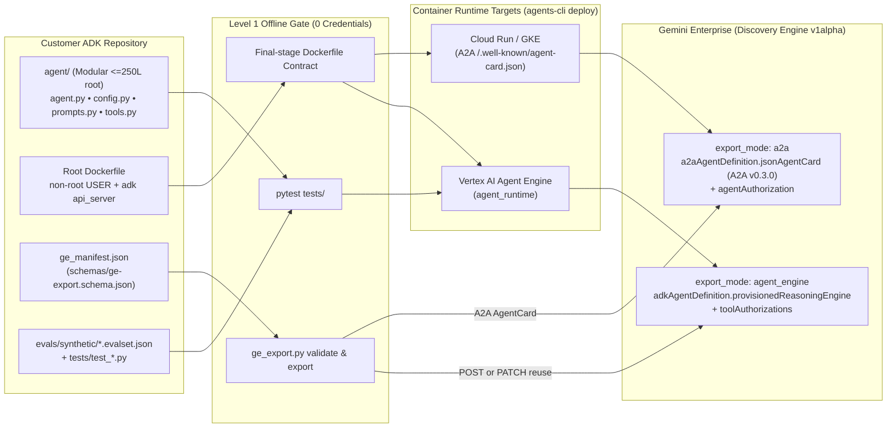
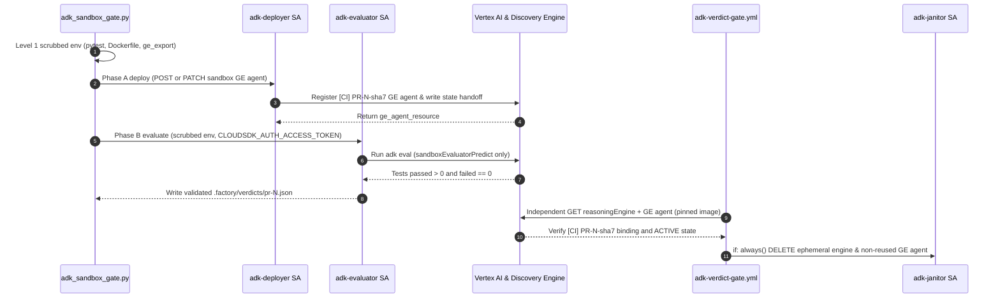

# `packs/adk` — ADK 2.15 + Dockerfile-First + Gemini Enterprise App Factory Pack (`v0.1.0`)

Reusable autonomous software factory pack for **Google Cloud Agent Development Kit (`google-adk[eval,a2a]==2.15.0`)** built around an opinionated **container-first root `Dockerfile`** deployment contract (`agents-cli deploy`), **7 vendored upstream `google/agents-cli v1.15.0` skills**, and deterministic dual export into **Gemini Enterprise (`GE App`)**.

---

## 1. Deployment & Dual Gemini Enterprise (`GE App`) Export Topology

Every ADK agent repository ships a root `Dockerfile` running `adk api_server` under a non-root user so the exact same container builds and deploys consistently across **Vertex AI Agent Engine Runtime**, **Cloud Run**, and **GKE**, then exports cleanly to **Gemini Enterprise** via Discovery Engine `v1alpha`.



---

## 2. Split-SA Anti-Forgery Sequence & Dual Janitor



---

## 3. Roles & Hub Skill Bank Breakdown (16 Templates, 18 Skills)

| Category | Count | Included Items | Context Strategy |
| :--- | :--- | :--- | :--- |
| **Templates (`adk-*`)** | **16** | 13 SEP roles (`scion-frontiers/agent-team@08faf48`) + `adk-deployer` + `adk-eval-tester` + `adk-kaizen-analyst` | All 16 roles strictly `<= 1,800` lines |
| **Project-Attached Skills** | **5** | `gcp-fde-guardrails`, `gcp-sandbox-contract`, `gcp-kaizen-light`, `adk-domain-guardrails`, `ge-app-export` | Attached to every role via `scion project skills add` |
| **SEP & Kaizen Role Skills** | **6** | `software-engineering-process`, `code-review`, `artifact-durability`, `agent-state-continuity`, `release-notes-daily`, `gcp-kaizen-analyst` | Role-scoped via `skill://scion/global/<name>` |
| **Vendored `google/agents-cli` Skills** | **7** | `google-agents-cli-workflow`, `scaffold`, `adk-code`, `eval`, `deploy`, `publish`, `observability` (Apache-2.0 @ `2fa159a8`) | Role-scoped strictly to matching roles (`architect`, `developer`, `test-engineer`, `adk-deployer`, `adk-eval-tester`) |

---

## 4. Key Commands

```bash
# 1. Validate pack schema, lockfile, budgets, and clean-room rules
./build.sh --check packs/adk

# 2. Build self-contained offline Release Kit
./build.sh --release-kit packs/adk --out /tmp/adk-kit

# 3. Validate and export a Gemini Enterprise registration bundle
.venv/bin/python packs/adk/scripts/ge_export.py export \
  --manifest packs/adk/repo-scaffold/ge_manifest.json \
  --out /tmp/ge-export

# 4. Run Level 1 offline verification (pytest + Dockerfile contract + GE bundle)
.venv/bin/python packs/adk/scripts/adk_sandbox_gate.py \
  --repo-dir packs/adk/repo-scaffold \
  --pr-number 1 \
  --commit-sha 0123456789abcdef0123456789abcdef01234567 \
  --mode level1-only \
  --verdict-out /tmp/adk-l1-verdict.json

# 5. Run Discovery Engine v1alpha + A2A v0.3.0 contract canary
.venv/bin/python canaries/adk/check_ge_contract.py
```
