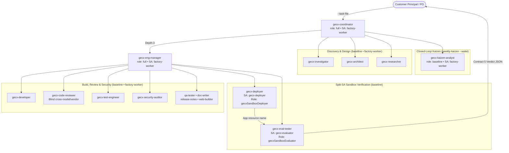
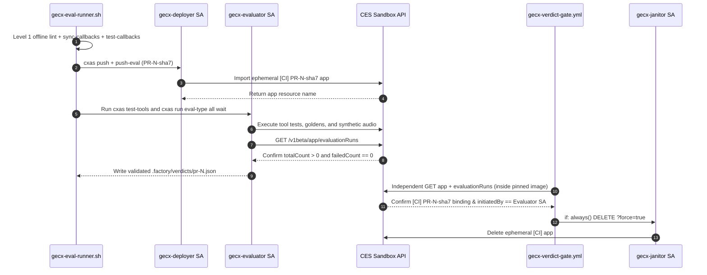

# `packs/gecx` — CX Agent Studio Autonomous Factory Pack (`v0.5.0`)

Reusable autonomous software factory pack for **Google Cloud Customer Engagement Suite (CES) / CX Agent Studio (GECX)** supporting text, callback unit tests, golden/simulation evaluations, and synthetic `BidiRunSession` audio verification.

---

## 1. Architecture & 16-Role SEP Hierarchy

`packs/gecx` composes all 13 upstream roles from `scion-frontiers/agent-team@08faf48` (read-only Layer 0) with 3 domain/operations specialists (`gecx-deployer`, `gecx-eval-tester`, `gecx-kaizen-analyst`). Every role stays under the **1,800-line context budget** enforced by `./build.sh --check packs/gecx`.



---

## 2. Split-SA Verification Sequence (Zero-PII Anti-Forgery)

Every PR touching `cxas_app/` runs two strictly separated Service Accounts in the disposable Sandbox project. Neither SA inherits the 79 `contactcenterinsights.*` or `ces.conversations.*` permissions present in predefined `roles/ces.*`.



---

## 3. Hub Skill Bank Breakdown (11 Skills)

| Attachment Scope | Skills | Purpose |
| :--- | :--- | :--- |
| **Project-Attached (5)** | `gcp-fde-guardrails`, `gcp-sandbox-contract`, `gcp-kaizen-light`, `gecx-foundry-adapter`, `gecx-domain-guardrails` | Mounted on every role via `scion project skills add` (core rules, 6-level Verdict ladder, `cxas 1.11.0` guardrails, `/opt/gecx-foundry` adapter) |
| **Role-Scoped (6)** | `software-engineering-process`, `code-review`, `artifact-durability`, `agent-state-continuity`, `release-notes-daily`, `gcp-kaizen-analyst` | Mounted via `skill://scion/global/<name>` strictly on roles that need them, keeping `gecx-deployer` and `gecx-eval-tester` lean |

---

## 4. Honest Sandbox Boundary (`not-verifiable-in-sandbox`)

The GECX Sandbox verifies **text flows**, **offline Python callbacks**, **tool unit tests**, **golden/simulation evals**, and **synthetic `BidiRunSession` audio**. Changes touching **SIP trunks, SBCs, AudioCodes VAIC, carrier 8 kHz audio, DTMF, or live CCaaS transfers** must emit `not-verifiable-in-sandbox` with explicit `not_verifiable_surfaces` for human sign-off.

---

## 5. Key Commands

```bash
# Validate pack schema, SHA-40 lockfile, 1,800-line budgets, TTLs, and clean-room rules
./build.sh --check packs/gecx

# Build self-contained offline Release Kit
./build.sh --release-kit packs/gecx --out /tmp/gecx-kit

# Verify cxas-scrapi 1.11.0 CLI contract canary
.venv/bin/python canaries/gecx/check_cli_contract.py

# Run Level 1 offline checks on the starter scaffold
.venv/bin/python packs/gecx/scripts/gecx_sandbox_gate.py \
  --repo-dir packs/gecx/repo-scaffold \
  --app-dir cxas_app/Starter_App \
  --pr-number 1 \
  --commit-sha 0123456789abcdef0123456789abcdef01234567 \
  --mode level1-only \
  --verdict-out /tmp/gecx-l1-verdict.json
```
