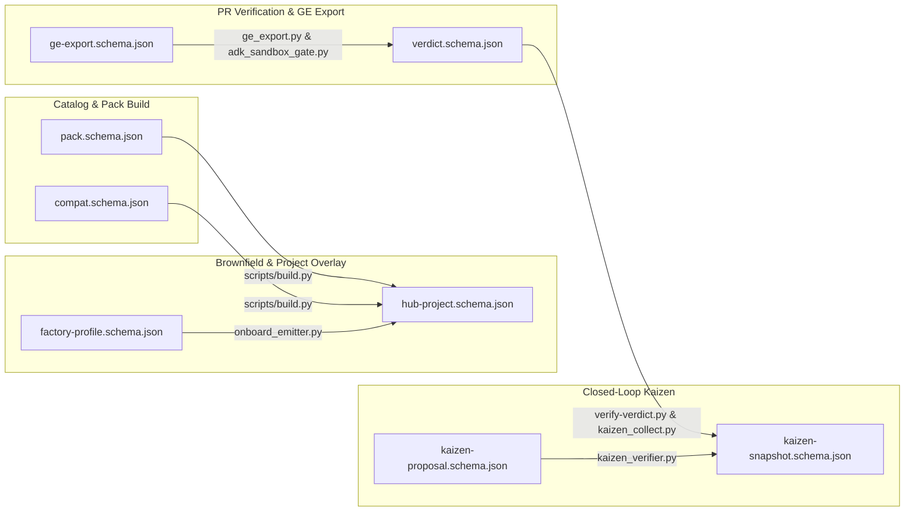

# `schemas/` — Machine-Enforced Factory Contracts (`JSON Schema Draft 2020-12`)

Every interface between the catalog builder, customer overlays, Sandbox gates, Gemini Enterprise export, and the closed-loop Kaizen engine is governed by an explicit JSON Schema validated offline with `jsonschema.Draft202012Validator`.

---

## 1. Contract Flow Map

---

## 2. Schema Registry (8 Schemas)

| Schema File | Primary Producer | Enforcing Consumer(s) | Key Invariants Enforced |
| :--- | :--- | :--- | :--- |
| [`pack.schema.json`](pack.schema.json) | Pack author (`packs/<pack>/pack.yaml`) | `scripts/build.py --check`, `release_kit.py` | Required `prefix`, `specialist_templates`, `runtime_image.dockerfile`, context budget caps |
| [`compat.schema.json`](compat.schema.json) | Pack author (`compat.yaml`) | `scripts/build.py --check`, `bootstrap-hub-project.sh` | Closed `scion.tested` version list, 64-hex `binary_sha256`, pinned toolchains & images |
| [`hub-project.schema.json`](hub-project.schema.json) | Customer repo / `onboard_emitter.py` | `parse_hub_project.py`, `scripts/build.py --check` | `mode`, `diversity_profile`, `limits` (`default_max_model_calls <= 500`), Vertex AI `harnesses`, `model_routing`, `kaizen`, `overlay_skills` |
| [`factory-profile.schema.json`](factory-profile.schema.json) | `factory_onboard.py` + PO interview | `onboard_emitter.py` Readiness Gate | Confirmed commands, allowlisted `missing_binaries` / `heavy_test_binaries`, Express vs. Complete track rules |
| [`ge-export.schema.json`](ge-export.schema.json) | Customer ADK repo (`ge_manifest.json`) | `ge_export.py`, `adk_sandbox_gate.py`, `build.py` | Conditional `agent_engine` (`provisionedReasoningEngine`) vs. `a2a` (A2A `v0.3.0` skills + tags) |
| [`verdict.schema.json`](verdict.schema.json) | `gecx_sandbox_gate.py`, `adk_sandbox_gate.py` | `scripts/verify-verdict.py`, PR Verdict Gate CI | 6-level Verdict ladder, `pack` (`gecx`/`adk`), `commit_sha`, `evals_tree_sha256`, `expected_evaluator_sa` |
| [`kaizen-snapshot.schema.json`](kaizen-snapshot.schema.json) | `core-gcp-fde/scripts/kaizen_collect.py` | `kaizen_collector.py`, `kaizen-analyst` | Bounded source statuses, `tool_error_rates <= 1.0`, `repo_drift.notes <= 200` chars, `proposal_verifications` |
| [`kaizen-proposal.schema.json`](kaizen-proposal.schema.json) | `kaizen-analyst` (`proposals.jsonl`) | `scripts/lib/kaizen_verifier.py` | Machine-evaluable `rollback_criterion`, `anti_reward_hacking_attestation`, `MIT`/`Apache-2.0` Skill Sheet, mandatory `merged_at_utc` when `implemented`/`measuring` |
